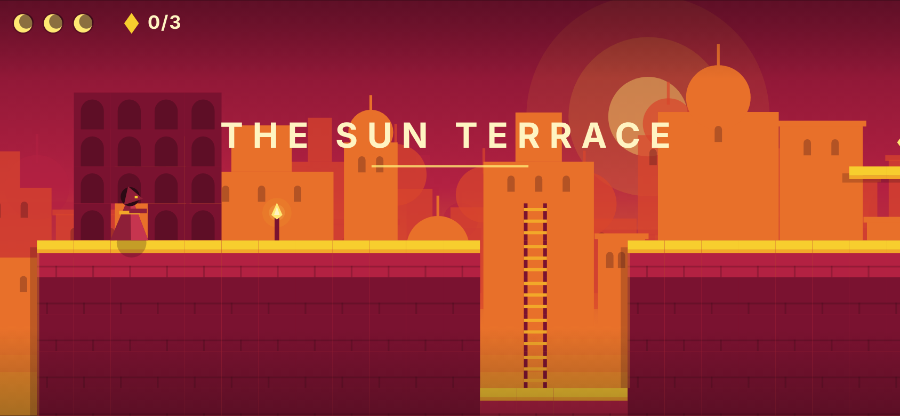
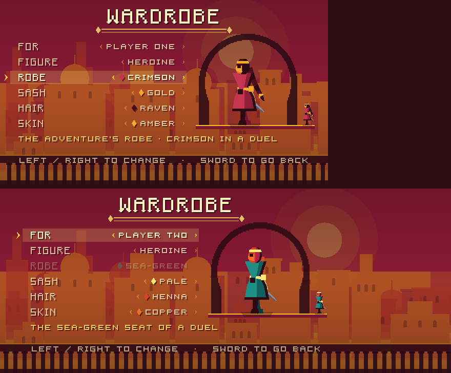

# Swordknights

A mobile-first platform adventure in the spirit of *Prince of Persia*:
deliberate, weighty movement, ledge grabs, and a sun-bleached duotone city —
plus a two-player sword duel in the spirit of *Nidhogg*, playable on one
keyboard, over the network, or against the computer.

Built with **Godot 4.5.1**. There are no hand-drawn assets — terrain, skyline,
characters and effects are all generated or drawn from one small palette.

**[Play it in the browser, or get the Android build](https://andreas83.github.io/swordknights/)**
— the project's page, rebuilt from `main` on every push.



## Running it

Open the project folder in Godot 4.5, or from a terminal:

```bash
godot --path .                 # play
godot --headless --path . --import   # import assets / rebuild the class cache
```

The engine binary is not vendored. Get 4.5.1 from the
[Godot releases page](https://github.com/godotengine/godot/releases/tag/4.5.1-stable).

## Installing development builds

Every push to `main` that touches the game builds a debug APK and publishes it
to the rolling **`dev` pre-release**, always at the same address:

**<https://github.com/andreas83/swordknights/releases/download/dev/swordknights-dev.apk>**

([release page](https://github.com/andreas83/swordknights/releases/tag/dev),
with the build number, the commit and its notes.)

Once, on the phone:

1. Open that link in the phone's browser. When the download finishes, open it.
2. Android asks to allow installing apps from the browser: **Settings → Allow
   from this source**, then back, then **Install**. (Later: *Settings → Apps →
   Special app access → Install unknown apps* → your browser.)
3. If Android says *App not installed* or that it *conflicts with an existing
   package*, the copy already on the phone was signed with a different key — an
   older build signed before the current key existed, or a release build.
   Uninstall the game once and install again.

After that, an update is one tap: when a newer build is published, the title
screen shows **UPDATE AVAILABLE · BUILD n** at the top. Tap it, open the
download, tap **Update**. The settings page (SOUND) shows which build is
running.

Only development builds check for updates; release builds never do. How the
channel, the build numbers and the signing key work, and the one thing the
repository owner should set up (the `DEBUG_KEYSTORE_B64` secret), is in
[`docs/ci.md`](docs/ci.md#the-dev-channel-one-tap-updates-on-the-phone).

## Controls

| Action      | Keyboard            | Gamepad       | Touch                      |
| ----------- | ------------------- | ------------- | -------------------------- |
| Move        | `←` `→` / `A` `D`   | Stick / D-pad | Left half — floating stick |
| Up / down   | `↑` `↓` / `W` `S`   | Stick / D-pad | Push the stick up or down  |
| Jump        | `Space` / `K`       | A             | **JUMP**                   |
| Sword       | `J` / `E` / `Enter` | X / B         | **SWORD**                  |
| Air slash   | Sword in the air    | X / B         | **SWORD** in a jump or fall |
| Plunge      | Down + sword in the air | Down + X / B | Stick down + **SWORD** in the air |
| Parry       | Up + sword          | Up + X / B    | Stick up + **SWORD**       |
| Backstep    | Back + sword        | Back + X / B  | Stick back + **SWORD**     |
| Roll        | Down + jump, standing or walking on stone | Down + A | Stick down + **JUMP** |
| Dive kick   | Down + jump in the air | Down + A in the air | Stick down + **JUMP** in the air |
| Throw       | `Q` / `L`           | R1            | **THROW** (the flying sword) |
| Pick up     | Down over the sword | Down          | Stick down over it         |
| Sweep       | Sword with no sword | X / B         | **SWORD** with no sword    |
| Walk (slow) | `Shift`             | L1            | Small stick deflection     |
| Pause       | `Esc` / `P`         | Start         | **II**                     |
| Mute        | `M`                 | —             | —                          |

Ledge grabs happen automatically when you fall past a grabbable corner while
moving into it; press up (or jump) to mantle, down to let go. Hold down and
press jump to drop through a one-way platform; on stone the same press is a
**roll**.

The sword swings in the air too, without touching the jump's arc. Down and
sword in the air is the **plunge**: straight down, point first, onto a guard's
head — it springs you back off him, but a plunge that misses bites the floor
and holds you there. Up and sword on the ground is the **parry**: it turns a
guard's cut if it is up when the blade comes down, opens him for a riposte,
and leaves you open if you raise it too soon. Back (away from the way you
face) and sword on the ground is the **backstep**: a skip of about a tile and
a half back, still facing him, and his cut from the front misses you for the
first quarter-second. It gives up the ground and the riposte, cannot be thrown
twice in a row, and stops at the edge of a drop rather than going over it.

The duel's moves are the prince's too. Down and jump on stone, from a stand
or a walk, is the **roll**: two and a half tiles low along the floor, under a
blade or a shield set against a standing man from either side -- through a
sentinel's cut, under a Bastion's shield to his back -- and then a moment
getting up in which nothing comes out. At a run, down and jump is still the
jump. Down and jump in the air is the **dive kick**: a steep straight line,
heel first, that knocks a foe back or a shield wide without wounding, and
springs you off. **Throw** sends the sword six tiles level into the first foe
it meets; then it lies where it falls until you stand over it and press down,
and with no sword the sword button is a **sweep** of the leg. Left lying, a
thrown sword flies back to your hand by itself after four seconds, and at
once if it fell somewhere it cannot be fetched; a respawn always gives it
back.

Jump on a ladder to leap off it,
sideways if you hold a direction. A relic gives back a heart.

Presses are forgiven at both ends: a jump made a moment before you land still
fires, a jump just after running off an edge still counts, and a quick tap of
jump is a short hop rather than nothing.

**Adventure** is *The Last Light*, played chapter by chapter from the chapter
select: CONTINUE carries on from the first chapter you have not cleared, and
each chapter keeps your best time and the most relics and secrets you have
found in it. Clearing a chapter opens the next; jump on the complete screen
plays it. Chapter I, the Sun Terrace, is built; the chapters after it are
listed and marked as still being built. There is one assist, **longer
warnings**, under SETTINGS: every foe's tell lasts half as long again.

Every torch you reach on foot is a checkpoint: the flame flares, and a death
sends you back there rather than to the start. Relics you picked up and guards
you cut down stay that way; the clock keeps running.

The city keeps **secret rooms** behind bricked-up doorways. Look for the
outline of an arch filled in with smaller stones: air moving through its
joints means you can walk through it; a crack shedding grit means your sword
can open it, and a cracked floor gives under a plunge. The Sun Terrace hides
three, the complete screen counts them, and some Endless ruins hide one. None
is ever the way to the door, and none can trap you.

**Endless** is a descent: each ruin you escape leads down into a new one, a
step harder, from a gentle first ruin up to the generator's hardest. The ruin
number and its seed sit bottom-left, and the first seed replays the whole run.

The local duel is a tug of war in the spirit of *Nidhogg*: one hit kills, and
every kill sends the world scrolling toward the killer's gate. Both players
share one keyboard; a Godot action cannot tell two gamepads apart, so these
bindings are keyboard-only by design:

| Action                 | Player one    | Player two             |
| ---------------------- | ------------- | ---------------------- |
| Run                    | `A` `D`       | `←` `→` / numpad `4 6` |
| Sword high / low       | hold `W` / `S` | hold `↑` / `↓` / numpad `8 5` |
| Duck                   | hold `S`, standing still | hold `↓`, standing still |
| Jump                   | `Space` / `V` | `K` / numpad `0`       |
| Thrust                 | `F`           | `J` / numpad `1`       |
| Throw the sword        | `G`           | `L` / numpad `2`       |
| Catch a thrown sword   | `G` with an empty hand, as it arrives | `L` / numpad `2`, the same |
| Roll / dive kick       | down + jump, on the ground / in the air | same |

Holding neither up nor down is the middle stance. Meet a thrust at its height
and the blades clash; move your sword *into* its height just as it starts and
you disarm the attacker. Up + throw angles the throw upward. An empty-handed
fighter sweeps on the ground and stamps from the air, and picks a sword up by
holding down over it. It can also snatch a thrown sword out of the air: press
throw just as the blade arrives, and it is yours. Snatch too early and you stand
there with open hands; a low throw cannot be caught at all
([`docs/duel-combat.md`](docs/duel-combat.md#the-catch)).

**Duel** on the title screen asks how: **One keyboard**, **VS CPU** or
**Online**, and where: the **Strip** row, stepped with left and right, chooses
among five, or **Random**. It opens next time on the way, the level and the
strip last played.

| Strip | Hour | What it does to a duel |
| --- | --- | --- |
| The Tug of War | afternoon | a spike pit and a moat at the gates: the original |
| The Clockwork Well | night | scythes swing at head height on the beat, spike slots rise on the off-beat: duck, or count |
| The Floodgates | golden hour | the sunken courts flood and drain on a twenty-second tide |
| The Crumbling Aqueduct | sunset | cracked slabs fall where they are stood on, and stay down |
| The Rooftops | dusk | alleys with nothing at the bottom, chimneys, a plank |

Online, the host's strip is the match's. Every hazard is a function of the
match's frame or of its snapshot, so they never desync, and each is told at
least 27 frames before it kills
([`docs/duel-match.md`](docs/duel-match.md#the-strips)).

**VS CPU** is the duel on one phone: you in the crimson seat, the computer
in the sea-green one. Left and right on its row choose **EASY**,
**MEDIUM** or **HARD**. The computer plays through the same eight buttons you
do, sees the fight a reaction time late (20 frames on EASY, 8 on HARD, at 60
a second) and never sees your buttons at all; EASY telegraphs its thrusts and
blunders, HARD guards, reads for the disarm and feints. The stick, JUMP, SWORD
and THROW are as online; on a desktop it is the single-player keys.
How it plays and why is in
[`docs/duel-match.md`](docs/duel-match.md#the-computer-opponent).

Two players do not fit on one phone, so on phones each plays on their own:
**Duel** → **Online** → *Host on this Wi-Fi* on one phone shows a short code, and the
other phone picks *Join on this Wi-Fi* and types it. On a phone the left half
of the screen is a stick (sideways to run, up or down for the sword's height),
with JUMP, SWORD and THROW on the right. On a desktop the online duel uses the
single-player keys above, with `Q` / `L` or R1 to throw. A relay room joins
players on different networks; see [`docs/netplay.md`](docs/netplay.md).

## The prince, the heroine and the wardrobe

Two figures are playable: the hooded prince and the heroine — bare-headed,
with a braid, a belted knee-length tunic and two sash ribbons where he has a
cloak. They are the same body: the same moves, the same hitbox, the same
reach. **WARDROBE** on the title screen chooses the figure and a few palette
colours (robe, sash, hair, skin) for player one, who is the adventure, Endless
and the crimson duel seat, and for player two, the sea-green seat. The choice
is saved on the device. In a duel the robe always takes the seat's colour, so
the two seats stay crimson and sea-green whatever either player wears. Online,
each phone sends its player's look once, in the handshake, and shows the
opponent in the look they chose, still in their seat's colour. See [`docs/character.md`](docs/character.md) and
[`docs/ui.md`](docs/ui.md).



## Project layout

```
project.godot          written by tools/configure_project.gd, not by hand
scripts/
  core/      palette, tuning, boot, game controller, mode registry
  world/     ASCII level parser, tilemap level node, secret rooms
  player/    character state machine, input seam, character art, the
             heroine's costume, saved looks
  entities/  relic, exit door, torch, patrol guard, inscription
  render/    follow camera, procedural parallax skyline
  ui/        HUD, menu, wardrobe, touch controls
  audio/     synthesis, mixer autoload, character sounds, music
  levels/    segment grammar, generator, reachability verifier
  duel/      the tug-of-war duel: fighter, combat, zones, match, camera, HUD
  net/       transport, protocol, session, lobby, rendezvous server
scenes/      boot, menu, game, player, duel, rendezvous, touch controls
levels/      ASCII levels, and the duel strips: manifests and zone files
assets/      generated tile atlas + TileSet
tools/       project configuration, asset generation, screenshots
tests/       headless test scripts
legacy/      earlier prototypes (Python/pygame, TypeScript/Vite), .gdignore'd
```

## Configuration as code

Project settings and the whole input map live in `tools/configure_project.gd`
rather than in editor state, so every binding is reviewable in a diff and
reproducible on a fresh clone:

```bash
godot --headless --path . --script tools/configure_project.gd
```

The same applies to art. The terrain atlas and its TileSet are generated:

```bash
python3 tools/generate_tiles_png.py        # assets/tiles.png from the palette
godot --headless --path . --script tools/build_tileset.gd   # assets/tiles.tres
```

Re-lighting the world — night, interior, storm — is an edit to
`scripts/core/palette.gd` plus those two commands, not an art pass.

## Authoring a level

Levels are ASCII art. `levels/level_01.txt` is the worked example.

```
 #  solid block        =  one-way platform     H  ladder
 ^  spikes             ~  water                :  background niche
 @  player spawn       *  relic                D  exit door
 t  torch (decor)      p  patrol guard         .  or space — empty
 %  false wall         &  cracked wall         L  inscription
```

`%` and `&` seal a secret room; the room is the `:` masonry behind the seal,
with whatever it holds. `docs/world.md` has the rules.

Vertical spacing is a design language, not a free choice:

| Rise      | How the player clears it   |
| --------- | -------------------------- |
| 2 tiles   | plain jump                 |
| 3 tiles   | needs a one-way platform   |
| 4 tiles   | needs a ledge grab         |

Horizontally, `Tuning.gap_tiles()` is the widest flat gap a running jump
crosses.

All four numbers come out of the jump arc in `scripts/core/tuning.gd`. Retune
the character and the grammar moves with it; `tests/tuning_grammar_test.gd`
and `tests/level_envelope_test.gd` fail if a level's geometry stops matching
what the character can do.

**A hazard narrower than grab reach is not a hazard.** The ledge-grab probe
runs every frame while falling, so a 2-tile spike pit is free passage: you
drop in, catch the far wall and mantle out. A pit has to be wider than
`Tuning.grab_tiles()` to cost anything — or be roofed, or have nothing
grabbable on the far side. This caught out the first duelling arena, where
both fighters simply walked across the spikes.

## Screenshots without a screen

`tools/screenshot.gd` renders any scene off-screen and writes PNGs, which is
how visual changes get checked in CI and on headless machines:

```bash
xvfb-run -a godot --path . --rendering-driver opengl3 \
  --script tools/screenshot.gd -- \
  --scene res://scenes/game.tscn --out /tmp/shots --shots 1,3,6 --hold move_right
```

`--level <file>` plays another level in the game scene, and `--time <stop>`
plays it at an hour of the time-of-day grade (`docs/world.md`, *Time of day*)
without editing the file.

## Documentation

| | |
| --- | --- |
| [`docs/architecture.md`](docs/architecture.md) | layers, fixed timestep, collision, the input seam |
| [`docs/art-direction.md`](docs/art-direction.md) | the look-and-feel thesis: one low sun, cast shadows, hard edges |
| [`docs/world.md`](docs/world.md) | cast shadows, shade twins, architecture dressed onto terrain |
| [`docs/character.md`](docs/character.md) | pose vocabulary, secondary motion, the heroine's costume, the feel lab |
| [`docs/feel.md`](docs/feel.md) | camera beats, hitstop, the wipe, haptics |
| [`docs/ui.md`](docs/ui.md) | the Alcazar typeface, safe areas, variable width |
| [`docs/duel-spec.md`](docs/duel-spec.md) | the Nidhogg duel specification, with three engineering objections |
| [`docs/duel-combat.md`](docs/duel-combat.md) | how a duel frame resolves: matrix, clash, parry, disarm window |
| [`docs/duel-match.md`](docs/duel-match.md) | the tug-of-war: initiative, zones, respawn, gore, open items |
| [`docs/level-generation.md`](docs/level-generation.md) | segment grammar and the reachability proof |
| [`docs/campaign.md`](docs/campaign.md) | the campaign bible: five chapters, the bestiary, the mechanisms, the build plan |
| [`docs/netplay.md`](docs/netplay.md) | host-authoritative prediction and reconciliation |
| [`docs/audio.md`](docs/audio.md) | synthesis, buses, adding a voice |
| [`docs/ci.md`](docs/ci.md) | workflows, secrets, what the repository owner must enable |

Contributors — human or agent — should start at [`CLAUDE.md`](CLAUDE.md): one
command to run every check, and the invariants that are not safe to change
quietly.

## Status

Working: tilemap world with solid, one-way, ladder and hazard tiles; the full
ground/air/ledge character state machine with coyote time, jump buffering,
variable jump height and apex float; sword and stomp attacks; relics, exits
and patrol guards; dead-zone follow camera; procedural parallax skyline; HUD;
keyboard, gamepad and touch input; mode menu; two playable figures (the
prince and the heroine) with a wardrobe that saves each player's look; build,
test and release pipeline; procedural level generation with a reachability proof; procedural
audio — synthesised sound effects, an Andalusian music loop with an intensity
parameter, and persisted volume and mute settings; a two-player duel on the
*Nidhogg* model — one hit kills, three sword stances that clash or kill,
disarm, sword throw, and a tug-of-war over a chain of zones — on one
keyboard, over the network, with host-authoritative prediction,
reconciliation and a desync test, and against a computer opponent at three
levels that plays through the input seam and sees the fight a reaction time
late. The round-based duel it replaced is retired.

In progress: the duel's open items, listed under *Status* in
[`docs/duel-match.md`](docs/duel-match.md). The specification and the
objections to it are in [`docs/duel-spec.md`](docs/duel-spec.md).

Not built yet: more hand-authored levels, enemy AI beyond a patrol route,
cutscenes.

## History

This repository started as a two-player sword-fighting prototype in Python 2
and pygame, and passed through a TypeScript/Vite/Capacitor foundation before
moving to Godot. Both are preserved under `legacy/` — the feel tuning, the
ASCII level format and the palette were carried across rather than reinvented.

## Credits

Original prototype by Andreas, with support from Harald P. and Michael W.

## Licence

GPL-3.0-or-later. See [LICENSE](LICENSE).
