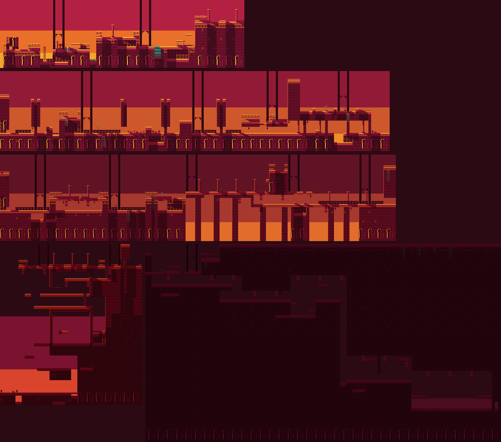
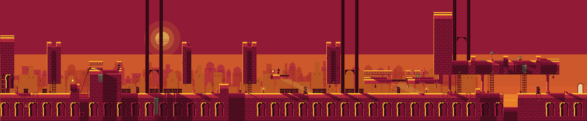
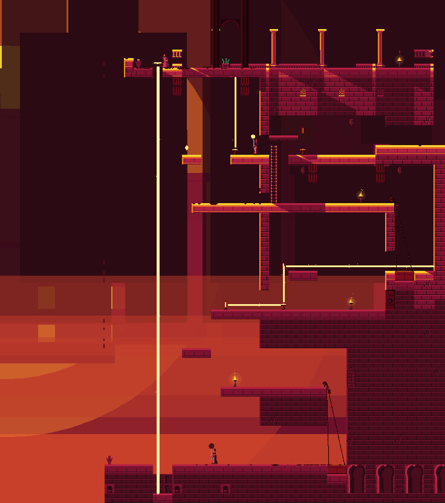
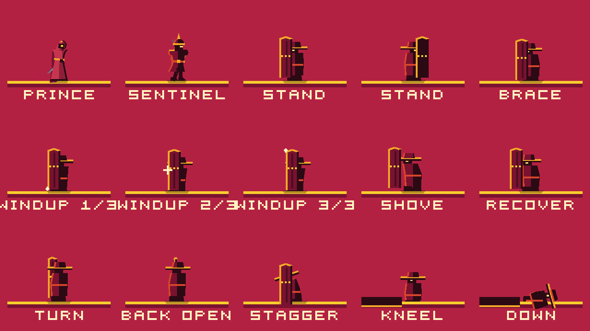
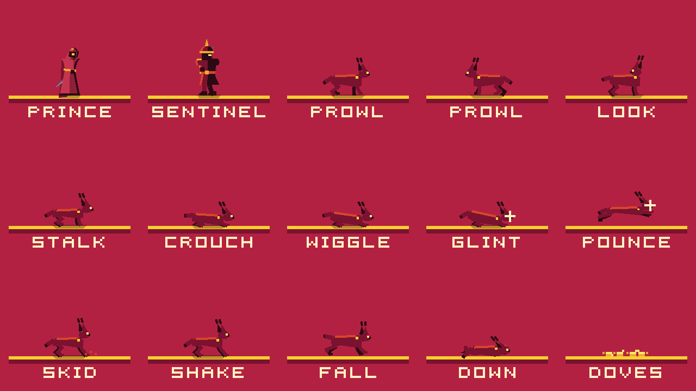
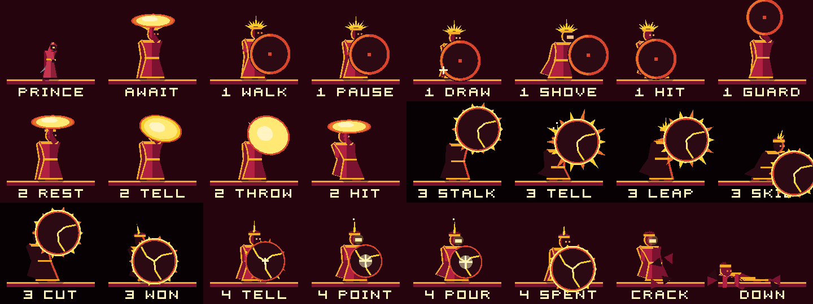

# The campaign

The design bible for the Adventure: five chapters, four new foes, a boss, four
families of mechanism, and the rules that hold them together. It is written
for the people and agents who will build it, so it says exactly what to build,
what number every timing is tied to, and how each piece is proved. Chapters
II–V exist as playable-shaped ASCII drafts in
[`docs/campaign/drafts/`](campaign/drafts/), each with a static stand-in that
`LevelReachability` already proves today.

Nothing here is built yet except Chapter I, the Sun Terrace, which stays as it
is. Anything named below that does not exist is marked **(to be built)**.



*The five chapters at rest — gates shut, slabs whole — dressed and lit by the
game's own renderer (`tools/world_debug.gd`'s composite, with the proposed sun
rules applied to the mask), each under its own sky and through its own
proposed grade. Top to bottom: I, II, III; then IV (left) and V. Entities, the
parallax city and the torches' glow are not drawn, which is why the night of
Chapter V is this dark: in play its light is fire.*

---

## The pitch

The Adventure becomes **The Last Light**: one evening in a city built to keep
the sun. Its masons made the city an instrument. At every sunset, mirrors on
its towers catch the last light and pour it down the Sun Well, where it is
kept through the night, so that the city wakes lit before the sun clears the
hills. Tonight the King has turned the mirrors away to keep the light for
himself. The masons, who never told him how their city worked, are gone. Their
last swordknight — whose blade, like every swordknight's, is polished to a
mirror — has the end of the day to cross the city as the sun goes down,
chapter by chapter: through gates that close by their own weight, over the
masons' tired aqueduct, up the Mirror Tower to send the last ray down the
Well, and then, at night, down after it, to parry the stolen sun back through
the King's eclipse.

The game's identity was already a lighting decision (`docs/art-direction.md`:
one low sun, two values, hard edges). The campaign makes that decision the
story and the rules: the sun's descent is the clock, light is a thing you
carry and aim, and the parry the prince has had since Chapter I turns out to
be what the whole world was built around.

## The arc

| | Chapter | Time | Signature mechanic | New foe — the move it is for | Set piece | Size | Par |
| --- | --- | --- | --- | --- | --- | --- | --- |
| I | The Sun Terrace | late afternoon | the ledge grab (as built) | the sentinel — the sword | the grab over the spikes | 79 × 22 | 1:00 |
| II | The Long Arcade | golden hour | counterweights: plates, gates, lifts | the Bastion — the plunge | four gates slamming behind you | 126 × 26 | 1:45 |
| III | The Aqueduct | sunset | crumbling stone | the Caracal — the backstep | the collapse over the ravine | 128 × 28 | 2:15 |
| IV | The Mirror Tower | dusk | sun mirrors and sun-seals | the Glassbearer — the parry | the last ray, down the whole tower | 46 × 52 | 3:00 |
| V | The Sun Well | night | blades on the beat | the owl — the air slash; then the Eclipse | the lift through the scythes; the parry that ends it | 115 × 64 | 4:00 |

Par is a good first clear without deaths; a first playthrough with deaths runs
twenty to twenty-five minutes. Every chapter fits inside one full-resolution
shadow mask (`SunShadow.MAX_MASK_PX`, 2048 px, is 128 tiles), so no chapter's
shadows go soft.

### Story without words

No dialogue, no cutscene text. The story is told by four things only.

**Title cards.** The level card, plus a numeral and one line of epigraph in
the TEXT cut under it, inside the reserved band (`Hud.show_card()`,
`docs/ui.md`, "Chapter cards"). Nothing else is ever written on screen in
play.

| | Card | Epigraph |
| --- | --- | --- |
| I | THE SUN TERRACE | THE LAST HOUR OF LIGHT |
| II | THE LONG ARCADE | THE GATES ARE FALLING |
| III | THE AQUEDUCT | THE OLD STONE IS TIRED |
| IV | THE MIRROR TOWER | CATCH THE LAST LIGHT |
| V | THE SUN WELL | WHAT THE CITY KEPT |
| — | DAWN | THE SUN REMEMBERS |

**Inscriptions** — the masons' voice, one per chapter, in a secret room
(`Inscription.AUTHORED`, keyed by level title; at most nine letters a line).
Optional by construction, and read in order they are the backstory.

| | Inscription | What it says |
| --- | --- | --- |
| I | THE KING / NEVER KNEW | the masons built ways the King did not know (exists) |
| II | SAME MARK / SAME GATE | how the city's machinery is wired — the one inscription that is also a hint |
| III | WE LEFT / BY NIGHT | where the masons went |
| IV | NO KING / KEEPS IT | why they left |
| V | THE SUN / REMEMBERS | what the Well is for |

Three of these lines are in `Inscription.POOL` already; using them in the
campaign retroactively makes Endless's ruins the same city.

**The city.** The Mirror Tower stands in the parallax skyline from Chapter I,
its great mirror dark and turned away, and grows nearer each chapter until you
are on it (`ParallaxSky.tower`; *The presentation, as built*, below). The doves that peck on
the lit terraces go to roost at dusk; at night the owls hunt where they were.
The Well's mouth is seen, dark, at the foot of the tower in Chapter IV, and
entered in V. The kept sun is the boss arena's only light.

**The set pieces** are the plot points: the city shutting its gates (II), the
masons' quarter falling into the ravine (III), the last ray going down as the
sun sets (IV), the stolen light turned back (V).

The ending: the kept sun rises up the Well and out over the city, every window
lit from inside; then dawn — and for one frame the light comes from the right,
the only time in the game it does (an owner decision, below).

### The presentation, as built

What the four things above became on screen, and the decisions taken on the
way. Each is held by a test that was seen to fail with the thing it guards
broken.

**The cards.** Every entry's card is data in the catalogue: `numeral`,
`title` and `epigraph` are fields of each entry in `Campaign.entries()`, and
`Campaign.card()` is what `CampaignGame` hands the HUD on entering a chapter,
over the level file's plain title — so a level still plays on its own as it
always did. The card is set in three strokes (the rule opens, the name comes
up on it, the epigraph a beat later), holds for 4.4 s, and is taken away by
the first press of any verb — or, once it has been read, by a verb held
since before it opened — never eating the press: the prince's first jump
always happens, and the card is gone before it peaks. The **finale** has no
numeral of its own and no epigraph, by decision rather than omission: the
bible gives it none, and a boss told by a sentence would be the one place
the story spoke. Its card carries the eclipse — a black disc ringed with
fire — where the numeral would be. `tests/unit/test_title_cards.gd`.

**The Mirror Tower.** One number per entry, `Campaign.TOWER`, from 1 (on the
far skyline) toward 0 (here):

| | Chapter | Tower | Where it stands |
| --- | --- | --- | --- |
| I | The Sun Terrace | 1.0 | a needle over the far roofs, its mirror a dark disc |
| II | The Long Arcade | 0.72 | over the plaza's roofs |
| III | The Aqueduct | 0.46 | across the ravine, its crown catching the sunset |
| IV | The Mirror Tower | 0 | on it: the level is its west face |
| V | The Sun Well | 0 | under it |
| — | The Eclipse | 0 | under it |

"Grows nearer each chapter *until you are on it*" settles IV and V: a tower
in their skies would be a second one standing behind the first, so the
landmark is seen in I, II and III and once more at the dawn. It stands ahead
of the player, in the east, drifting at a third of the sun's rate so that a
whole chapter never carries it past the middle of the view; it is drawn in
the sky's own language — a flat silhouette, arched windows cut in ink, a
parapet and a lantern course where the city's tops are domes — and what
makes it the landmark is its outline: square-shouldered, taller than any
roof, and the one circle on a stick in the sky, the great mirror hung off
its west end, its bronze back to the city. Its tone is the sky behind its
crown a step toward ink, or a step up out of the ink once the sky is ink
(a fixed tone vanished at sunset, Chapter III's own hour, and the test that
found it now holds every hour at every distance); from sunset on its top
courses keep a two-pixel rim of the last light on the west. A camera low in
a tall chapter lifts the skyline, and the crown stops at the top of the
frame rather than leave it, as the sun's drift stops at the edge. The duel's
sky, and every sky but the campaign's, has none of this
(`tests/unit/test_mirror_tower.gd`, `tests/unit/test_duel_sky.gd`).

**The dawn.** One still after the Eclipse (`DawnFrame`,
`levels/dawn.txt`), held under DAWN and THE SUN REMEMBERS until the player
goes back to the chapter select. A terrace in the first light: the doorway
in the west wall he came up out of, one wide gold floor, a short balustrade
at the lip where the city drops away, and the swordknight between them in
his saved look, facing the sun, his long shadow running west along the
floor. The sun is low and large on the right — the only frame where it is —
and the city's windows are lit from inside, as the ending says the kept sun
left them. Behind him in the west the Mirror Tower's great mirror, dark and
turned away since Chapter I, holds the sun: a flat gold face in its bronze
rim and one point of paper. The light is from the east in every layer: the
whole frame is reflected over a solve made once, so the stones, the figure
and the shadows agree (`docs/world.md`, "The dawn"); the words cast their
shadow to the left. Nothing moves but what always moves — the air, the
cloth, the sun's pulse. The frame is dressed by its author alone
(`;! dress authored`). `tests/unit/test_dawn_frame.gd`.

**Still open.** The rising of the kept sun out of the Well before the dawn
is the boss's, and lands in front of this frame when it is built; the
`sunrise` voice the bible names is not built, so the dawn plays
`level_complete` as the ending card did. The cards' timings are first
numbers, judged by eye at 320 and 440 units, not measured on players.

What is deliberately **not** borrowed from *Prince of Persia*: no princess, no
vizier, no sultan, no hourglass or countdown, no potions, no mirror-double, no
dungeon start. The genre and the cadence are inherited; the content is the
city that keeps the sun.

### Time of day

Each chapter's light is a grade over the same atlas, the same palette and the
same shadow solve — `docs/art-direction.md` requires exactly that ("re-lighting
the world for night or interior must stay a palette edit"). The grade that
already exists, `MatchDusk`, is the axis: a `CanvasModulate` multiply that
keeps red and takes green and blue (`MatchDusk.DUSK`), with `ParallaxSky.dusk`
moving the sky the same way. The campaign walks along it and adds one endpoint
for night.

| | Time | World multiply | Sky (`ParallaxSky.dusk`) | Sun | Shadow reach | Horizon |
| --- | --- | --- | --- | --- | --- | --- |
| I | late afternoon | none | 0 | as now | 3 tiles (as now) | — |
| II | golden hour | `DUSK` at 25% | 0.25 | lower, larger | 3.5 | — |
| III | sunset | `DUSK` at 55% | 0.6 | on the skyline | 4 | — |
| IV | dusk | `DUSK` | 1.0 | half under the horizon | 5 | row 32 |
| V | night | `NIGHT` (new): about (0.50, 0.30, 0.46) | `NIGHT_SKY_STOPS` (new): ink over ink over `SHADOW_PIT` | none | no sun | — |

Three new parameters, each a number rather than new art:

- **Shadow reach.** `SunShadow.REACH_TILES` becomes a grade value. Longer
  shadows are the visible sign of a lower sun, and they cost nothing at
  runtime: the mask is solved once at load. The sun's *slope* must not change:
  thin casters are two pixels wide because the lanes run at (2, 1), and any
  other integer slope would dot every balustrade's shadow (`docs/world.md`).
- **Horizon.** A row below which there is no sun at all — the far city's
  shadow at dusk. One fill after the solve. In Chapter IV it is what makes the
  climb a climb toward the light, and it is a rule the mirrors and the
  Glassbearer read.
- **No sun.** At night the mask is all shade and the solve is skipped
  outright, which also saves the half second Chapter V's 1840 × 1024 mask
  costs on a desktop.

**What the grade does not touch.** Like `MatchDusk.LIT`, everything the player
must read is lifted back to full light: the prince, every foe (their tells are
drawn in `LIGHT` and `PAPER`, and a tell that dims is a death that is not
readable), torches, relics, beams and bolts, and the kept sun. The grade falls
on the city, not on what you fight.

**Interiors come almost free.** A roofed space is in shade, and an opening
throws a hard shaft through it — within the reach. A shadow is cut after the
reach's worth of horizontal travel along the sun's lane, so a pixel is dark
only if a wall or a roof stands within that distance of it, up and to the
left at two across for one down. Deep inside a wide room, the floor is lit
again. Chapter IV's dark room relies on this exactly as far as it must:
mirrors C and D stand within five tiles of its west wall and are dark (the
verifier checks it), while the far end of that room is lit by the cut. A
builder who wants a whole room dark keeps it within reach of its walls, or
gives that chapter a longer reach.

**The sun disc is on the wrong side.** `ParallaxSky._draw_sun()` puts the disc
at 72% of the view's width, on the right; the world is lit from the left. In
Chapter I nobody looks at the sun. From Chapter III it is the subject, so it
should sit low on the left, where the light comes from — which moves it in
Chapter I too. That is the owner's call.

---

## The chapters

Each chapter's signature mechanic and new foe are taught in the same four
steps, and the step is marked in every beat sheet:

1. **Introduce, safely** — first contact cannot hurt. Where possible the
   mechanic or the foe is *shown working on something else* first.
2. **Develop** — the same idea with a cost for getting it wrong.
3. **Twist** — the idea turned around: the thing you learned to avoid becomes
   a tool, or the foe's strength becomes its weakness.
4. **Master** — combined with everything before it, at speed.

Positions are given as columns (x) and rows (y) of the drafts, which carry the
full beat sheets in their headers.

### I. The Sun Terrace — late afternoon

Kept as it is (`levels/level_01.txt`): run, the cistern's ladder, the platform
step, the first ledge grab over the spikes, the sentinel, the basin, the stair
up to the door, and three secrets that teach walk through, cut through, plunge
through. Its job in the arc is the grammar — every rise and gap the later
chapters assume is taught here — and the one sentence of story it carries,
THE KING NEVER KNEW. The only changes the campaign asks of it are
presentational: the title card's numeral and epigraph, and the Mirror Tower,
far away and dark, in its sky.

### II. The Long Arcade — golden hour

**Built:** [`levels/chapter_02.txt`](../levels/chapter_02.txt) · 126 × 26
(drafted as [`chapter_02.txt`](campaign/drafts/chapter_02.txt), with its
[stand-in](campaign/drafts/chapter_02_static.txt); *As built*, below, says what
building it changed and why).

**The place.** The gate quarter: gatehouses with portcullises in horseshoe
arches, a rampart walk, a market street, and the Long Arcade — a colonnade of
four gates — opening onto a plaza with the Mirror Tower over its roofs.
**The note:** urgency without panic. The city is closing on you, and its
machinery is beautiful.

**Signature mechanic: counterweights.** Weight is the chapter's verb: a body
on a plate lifts a gate or moves a lift, and the counterweight you can see
hanging beside every gate is its clock.

| Step | Where | What is learned |
| --- | --- | --- |
| introduce | plate 1, gate 1 (x 7–11) | a plate and a gate carry the same mason's mark; step on, the gate rises and its counterweight is hauled up, and both stay |
| develop | the lift (x 17–18); the race street (x 43–53) | weight moves lifts; a held gate falls when its counterweight lands — four seconds here, nearly twice what the run needs |
| twist | the weighed gate (x 65–71) | a Bastion's weight holds gate 3 open for you; kill him and the 2.2-second race starts as he falls |
| master | the Long Arcade (x 95–119) | four races back to back, a pit, a kerb, and a Bastion on the last plate |

**New foe: the Bastion** (the plunge).

| Step | Where | What is learned |
| --- | --- | --- |
| introduce | the courtyard (x 29) | posted under the rampart's lip, where jumping off puts you above him; a shove here only puts you against a wall |
| develop | the weighed gate (x 65) | leap him, or plunge him and race |
| twist | the corridor (x 85) | two tiles high: no leap, no height to plunge from — the sun falls through an iron grate in the roof onto his helm, so go up onto the roof and plunge through the grate (down + SWORD) onto him |
| master | the arcade's last bay (x 115) | a Bastion in the middle of a race |

**Beat sheet** (12 beats; the draft's header has them in full):

1. The road in — plate 1, gate 1. *(counterweights: introduce)*
2. The lift court — a ridden lift up five courses; R1 on the stall. *(counterweights: develop)*
3. The rampart — a sentinel.
4. The courtyard — the first Bastion; secret B in the rampart's face. *(Bastion: introduce)*
5. The race street — a four-second hold; secret A in the paving. *(counterweights: develop)*
6. Torch 1.
7. The balcony — optional: a grab onto one course of stone over the street, a sentinel on four tiles of it, R2.
8. The weighed gate. *(counterweights: twist; Bastion: develop)*
9. The corridor and its grate. *(Bastion: twist)*
10. Torch 2.
11. **The Long Arcade.** *(master; set piece)*
12. The plaza and the door.

**The set piece.** Each of the arcade's four holds is set to drop its gate
about half a second behind a prince running flat out — 1.2, 1.7, 1.6, 1.6
seconds against runs the proof measures at 0.78, 1.21, 1.03 and 0.96 — so a
clean run is a
rhythm: click, run, *slam* behind you, click. Fail one and you are in a bay
with its own plate: you lose time, never the chapter. The columns stripe the
floor with shadow the whole way down.

**Checkpoints.** Torch 1 after the race street (about 35 s in), torch 2 at the
corridor's far end, before the arcade (about 40 s later).

**Relics.** Five: R1 on the stall, R2 on the balcony (the harder route: a grab
and a sentinel on a four-tile ledge), and one in each secret.

**Secrets.**

| | Where | Seal | Teaches |
| --- | --- | --- | --- |
| A | the race street's paving, beside the stall | cracked floor, two wide | the plunge opens floors mid-race; inside, SAME MARK / SAME GATE |
| B | the rampart's face where you land | false wall | look where you fall |
| C | the arcade's pit | false wall | losing a race can pay |

**Expert line, about 40 s:** hop the stall and grab across the lift shaft;
rebound double plunges; leap the weighed Bastion; never stop at a gate.



*The Long Arcade as built, rendered by the game at 1:1 at the golden hour:
the road and gatehouse, the lift court and rampart, the courtyard, the race
street, the balcony, the weighed gate, the corridor and its hatch, the
arcade's four gates and its pit, and the door in the plaza.*

**As built.** Building the draft changed five things, each because playing
it showed a flaw:

- **The balcony is one course of stone over the street**, not a block four
  courses tall across it. As drafted it was a wall on the only way east, so
  the "optional" grab, sentinel and R2 were forced on everyone. Now the
  street runs on underneath, and the grab up to R2 is still four courses.
- **The corridor's roof runs on to the arcade's wall.** As drafted it stopped
  two tiles short, and a prince could walk the roof and drop down past the
  Bastion; now the hatch is the way down.
- **The corridor's hatch is an iron grate the sun falls through** -- after
  the owner played it on a phone and called it "a weird situation". As
  drafted it was a notch in a two-course roof with a one-way floor at its
  foot: it read as a glitch, a gap in the stone the prince sank into; the
  way through it was a drop and then a plunge inside a two-tile fall,
  which nobody found; and from inside the tunnel the shield had no answer
  and nothing pointed at the one there was. Now:
  - the roof is one course, with the grate (`h`, `scripts/mechanisms/
    hatch.gd`) set flush in it, three wide, walked on like the stone either
    side;
  - **down + SWORD on any one-way floor plunges through it**
    (`Player._plunge_through()`), one press, everywhere; down + JUMP is still
    the plain drop, and on stone down + SWORD is still the swing;
  - sunlight falls through the grate down the sun's own lane, two across for
    one down -- every shadow in the game runs on it, so the shaft is drawn
    at it, not straight down -- and the Bastion stands under the grate's
    middle, where the shaft crosses his helm: from inside the tunnel the
    light points up at the way, from the roof down at him;
  - three wide with him under the middle, no stone rim is in reach of a
    prince bouncing off his helm: at two wide the rebound's fall caught the
    rim in a ledge grab and hung him in the hatch, between the two plunges;
  - the climb onto the roof is three courses, a grab; and the grate is shown
    first, safely, in the balcony's east half, which everyone walks under
    and sees the sun come through before the corridor needs it;
  - his turn already comes when a prince ends up behind him, so a roll past
    his shield to his open back is an answer from inside the moment the
    adventure has one.

  The rest of the chapter was checked for the same failure -- a solution
  the chapter never taught or showed -- and holds: the plate and gate are
  taught by gate 1, the lift by its chains and slab, the plunge on the
  courtyard Bastion by the drop off the rampart's lip above him (and the
  Sun Terrace before it), the weighed gate's leap and the arcade's kerb and
  pit are the jump, and the secrets are optional by construction.
- **The second bay's hold is 1.7 s, not 1.6.** The kerb's hop is an arc the
  proof charges frame by frame: 1.21 s of run, 76% of 1.6 — past the 25%
  slack every race must keep. At 1.7 it is 71%, and the gate still falls
  half a second behind the runner.
- **A latched gate's counterweight goes up and stays**, the same reading as a
  held gate's (up: time in hand; sinking: running out; landed: shut), so the
  first gate teaches what the race street tests.
- **The Bastion steps back to his post while he recovers.** As first built,
  each shove was a step forward, and the courtyard Bastion herded the prince
  eight tiles back into secret B.

The proof measures every race (`ReachRace.measure`), and
`tests/unit/test_chapter_02.gd` holds them beside the arithmetic above; a
scripted clear run, replayed blind through the real scene, reaches the door
without a death inside par.

### III. The Aqueduct — sunset

**Built:** [`levels/chapter_03.txt`](../levels/chapter_03.txt), from the
[draft](campaign/drafts/chapter_03.txt) · 128 × 28 ·
[stand-in](campaign/drafts/chapter_03_static.txt). What changed from the draft,
and why, is under *As built*, below.

**The place.** The masons' quarter, ruined, and the aqueduct that crosses the
ravine on its piers toward the Mirror Tower — partly an open deck, partly a
covered water-channel with shafts of red light through its vents. The ravine
is the chapter's negative space: the sunset sky shows between the piers.
**The note:** melancholy and vertigo. The city's oldest stone is giving way,
and something is hunting you across it.

**Signature mechanic: crumbling stone.**

| Step | Where | What is learned |
| --- | --- | --- |
| introduce | two slabs over a cellar (x 11–12) | a cracked slab shudders and drops — into a harmless cellar; run and it falls behind you |
| develop | the bridge between two roofs (x 51–53) | run it or fall into the lane and climb back |
| twist | the deck before the ruined tower (x 84–85) | the way on is *down through* the floor: stand still and let it go |
| master | the collapse (x 103–115) | the whole open channel falls in a chain behind you |

**New foe: the Caracal** (the backstep).

| Step | Where | What is learned |
| --- | --- | --- |
| introduce | the walled yard under the walk (x 25) | from above, watch it crouch, pounce at the doves, miss, skid — it cannot reach you |
| develop | the cat's yard (x 42) | backstep the pounce, cut it in the skid |
| twist | the deck (x 74) | a cat cannot push off crumbling stone: wait by torch 1 at the deck's west end and it stalks you onto the slabs (x 65–67) to crouch |
| master | the tower's foot (x 121) | the collapse is at your back, so the backstep costs ground you no longer have — cut it out of the air or jump it |

**Beat sheet** (11 beats):

1. The masons' gate — doves on the lit flags.
2. The first crumble; secret C in the cellar. *(crumbling: introduce)*
3. The walk over the doves' yard; R1. *(Caracal: introduce)*
4. The cat's yard. *(Caracal: develop)*
5. Two roofs; secret A in the lane. *(crumbling: develop)*
6. The deck, torch 1, and the cat that should not cross it. *(twist, both)*
7. The way down is the floor; R2 up the ruined tower by one crumbling stone. *(crumbling: twist)*
8. The channel — a sentinel in the low dark; secret B.
9. Torch 2, at the channel's mouth.
10. **The collapse.** *(crumbling: master; set piece)*
11. The tower's foot — the last doves, the last Caracal; the door in the tower's first course. *(Caracal: master)*

**The set piece.** The open channel over the ravine is crumbling stone in runs
of three between the piers that hold. Once you are on it, each slab that falls
starts its neighbours' fuses, and the chain runs at four tiles a second —
faster than a walk, slower than a run — with the sun on the skyline at your
back and your shadow stretched ahead. The voids between the piers are three
wide, so a slab gone from under you is caught by a ledge grab if you hold
toward the next pier: the collapse is a scramble, not a trapdoor, and it says
so honestly rather than pretending a three-wide gap is a hazard
(`CLAUDE.md`).

**Checkpoints.** Torch 1 at the deck's west end (about 40 s in), torch 2 at
the channel's mouth (about 40 s later), so the twist and the set piece are
each retried from their start.

**Relics.** Five: R1 on the walk, R2 on the ruined tower's top (the harder
route: one crumbling stone to grab, stand on and leave at once), one in each
secret.

| | Where | Seal | Teaches |
| --- | --- | --- | --- |
| A | house B's face, down in the lane | false wall | the fall off the bridge is a door; WE LEFT / BY NIGHT |
| B | the channel's floor over the wide pier | cracked floor | jump, then plunge, under a low roof |
| C | the first cellar's east wall | cracked wall | the first thing that gave way under you was a door |

**Expert line, about 45 s:** run every slab; cut the cats out of the air;
take the channel's floor the moment you reach it. The clear run in
`tests/unit/test_aqueduct_clear.gd` plays a line close to it -- runs past the
sentinel instead of fighting him -- in 32.2 s, without a death or a scratch.

**As built.** Four changes from the draft, each found by playing it, none of
which moves a beat:

- **The walk runs on three tiles as a lintel (x 35–37) over the cat's yard.**
  In the draft the prince dropped in off the walk's end with the yard's wall
  at his back, and the backstep -- the move the yard is there to teach --
  had three pixels to slide. Now he lands with the lintel's floor behind him.
- **The deck's slabs moved a tile west (x 65–67).** A cat crouches with its
  nose five tiles from the prince, so a prince waiting where he climbs onto
  the deck drew it to crouch on the last stone before the slabs, not on them:
  the twist did not happen. With the run at 65–67, anywhere from the deck's
  west end to two tiles in brings it onto them with all four feet.
- **Torch 1 moved from house B onto the deck's west end.** Its glow marks the
  place to wait for the twist, a respawn comes back to the twist rather than
  before the bridge, and its mark keeps the dresser's foreground arch -- one
  every 23 columns -- from standing between the waiting prince and the cat.
- **Doves at the gate, in the walled yard and at the tower's foot.** The yard's
  flock is the cat's demonstration; the last one, on the last lit terrace
  before the door, also keeps a foreground arch off the final fight.

What it does not yet do: the channel is not "the low dark". At sunset's
four-tile reach, a floor four rows under its roof is lit again by the cut
(*Time of day*), so the sentinel stands in light; a roof two rows lower would
not leave the prince room, so darkening it is a grade question, left open.

### IV. The Mirror Tower — dusk

**Built:** [`levels/chapter_04.txt`](../levels/chapter_04.txt) · 46 × 52
(drafted as [`chapter_04.txt`](campaign/drafts/chapter_04.txt), with its
[stand-in](campaign/drafts/chapter_04_static.txt); *As built*, below, says what
building it changed and why).

**The place.** The tower that has been in the sky since Chapter I: a square
of shaded town at its foot, balconies up its sunlit west face, rooms and lift
shafts inside, and on the roof the great mirror, hung off the parapet's end
over open air. Below the horizon row everything is in the city's shadow; the
upper courses are the last gold in the world. **The note:** hope against the
falling dark, and the wonder of making light go where you want.

**Signature mechanic: sun mirrors and sun-seals.**

| Step | Where | What is learned |
| --- | --- | --- |
| introduce | the first sunlit balcony (x 12, y 31) | a mirror throws the sun at the sky; strike it once and it turns east, into the sun carved on a door, which fills and opens |
| develop | the stairwell (A at x 18, B at x 18, y 27) | opening the door lets the sun onto mirror A; A throws it up to B; strike B into door 2 |
| twist | the dark room R6 (C at x 20, y 15; D at x 20, y 13) | no sun reaches in, so the Glassbearer's bolts are the light: mirror C stands in his line of fire and throws his bolts up to D |
| master | the summit | strike the great mirror twice — east, then down — under a Glassbearer's fire, and send the beam down the tower's whole height |

**New foe: the Glassbearer** (the parry).

| Step | Where | What is learned |
| --- | --- | --- |
| introduce | the square (x 11) | in the city's shadow his glass is dull: a glass only burns in the sun |
| develop | R5 (bolt through the window slot from x 11, y 20) | parry the bolt home and it kills him |
| twist | R6 (from x 14, y 15) | stand behind mirror C and let him shoot: his bolts open the door |
| master | the summit (x 9, y 6) | in the last gold, between you and the great mirror |

**Beat sheet** (10 beats, bottom to top):

1. The square — the Well's mouth, dark; a Glassbearer with a dull glass. *(Glassbearer: introduce)*
2. The hall — a sentinel, and Chapter II's lift; secret A off the room it reaches.
3. The face in shade — torch 1, R1, two grabs.
4. The first light. *(mirrors: introduce)*
5. The stairwell; torch 2; secret B. *(mirrors: develop)*
6. The lift shaft.
7. R5 — the bolt through the window; torch 3. *(Glassbearer: develop)*
8. R6 — the dark room; R2 three tiles out from the balcony. *(twist, both)*
9. The stair and the roof hatch; torch 4.
10. **The summit.** *(master, both; set piece)*

**The set piece.** The great mirror hangs off the end of the parapet throwing
the last of the sun straight up. Two strikes: east, then down. The beam falls
past every balcony you climbed, the whole height of the tower, into the Well's
mouth in the square — which carries mark 9, as does the great door on the
roof. The door opens as the sun goes under, and the chapter ends at night.

**Checkpoints.** Four torches, each a floor or two apart (about 10–15 s of
climbing each at a clear run's pace). The level says `;! checkpoints route`, so
"further on" is measured along the proved route rather than toward the door's
column (see *Checkpoints in tall chapters*, below);
`tests/unit/test_chapter_04.gd` holds the four in order, bottom to top.

**Relics.** Five: R1 on balcony E4, R2 on a pillar three tiles out from the
Glassbearer's balcony (the harder route: a three-tile jump over a long fall),
one in each secret.

| | Where | Seal | Teaches |
| --- | --- | --- | --- |
| A | the room the lift reaches, east wall | cracked wall | NO KING / KEEPS IT |
| B | the stairwell's east wall | **sun-sealed** (`Q`, the one new kind) | turn a mirror *away* from where it is needed — curiosity is rewarded |
| C | the hall's floor | cracked floor | the plunge works indoors too |

**Expert line, about 55 s:** kill the summit Glassbearer with his own bolt;
take R6 by letting the Glassbearer outside do the work; never stop at a lift.
The scripted clear run below is that line, and clears in 56 s.



*The Mirror Tower as built, rendered by the game at 1:1 at dusk, on the frame
the great mirror's beam reaches the Well: the square and the Well's mouth,
the hall and its lift, the face in shade, the first light and the stairwell,
the shaft's lift, R5 and R6, the roof, and the summit's great mirror with the
last ray falling the tower's whole height.*

**As built.** Building the draft changed these, each because building or
playing it showed a flaw:

- **The great door is a sun-seal on mark 9 that stands on a step**, not a
  portcullis on the roof's floor. A portcullis is Chapter II's, and the great
  mirror's first strike (east) sends its beam along the roof: with the door at
  floor level, any door that light opens would have opened on that strike
  and skipped the set piece. On a one-tile step the east beam lights the
  doorstep under the door, and only the Well's mouth, latching wire 9, opens
  it.
- **D moved down beside C, and door 3 to the dark room's own floor.** The
  dressing put the summit's colonnade over the roof, its shadow used up the
  roof's reach, and D, as drafted, stood in sunlight in the dressed mask --
  struck east, it opened door 3 alone, with no Glassbearer and no C. D now
  hangs at (20, 13), where the tower's west wall shades it whatever the
  dressing does, and door 3 stands on a one-step sill at the room's east
  end, in D's row. The upper room it used to need is stone.
- **R5's floor is a course lower and its west side is a wall with a slot.**
  As drafted, R2's pillar and R6's balcony shaded the R5 Glassbearer's glass
  at his post, and the way up out of R5 was at its east end, fifteen tiles
  from him: he never fired. Now his balcony is out of their shadow, his bolt
  comes through a slot a prince cannot pass, and the ladder up to R6 is at
  R5's west end, so the way on crosses his line of fire.
- **Every ladder that pierces a floor has an open cell beside it.** A
  one-wide hole through a floor admits a body only within 3.5 px of the
  ladder's middle, and the prince is not centred on a ladder; the roof's
  ladder now rises against the tower's wall with a two-wide hatch, and R5's
  has a two-wide hole into R6. The summit's foes treat the hatch as the end
  of their beat.
- **The great mirror hangs in a one-cell slot with a stone bastion beyond
  it.** As drafted it hung off the parapet's open end, and a prince struck
  by a bolt or a cut while striking it was thrown backwards off a forty-tile
  drop -- a death the fall rule now makes certain.
- **The Glassbearers are posted**, each keeping a beat of a tile and a half
  either side of his post (`Glassbearer.BEAT`). As built at first, R6's
  walked in through the doorway he was meant to fire through. The summit's
  is posted in the last gold at the parapet's west end, the sentinel mid-roof.
- **The sun goes under.** The great mirror carries `sunset=9`: when the
  Well's mouth latches wire 9, three seconds later nothing is lit by the sun,
  and the grade walks to night while the great door opens. The chapter ends
  at night, as the beat sheet says.
- **Chapter II's lift** carries both shafts, as drafted; the stand-in's
  ladders were used only until it landed.

The proof opens every door through its mirrors (*Sun mirrors and sun-seals*,
below) and `tests/unit/test_chapter_04.gd` holds the chapter to everything a
draft was held to -- the door, the secrets audit, every torch along the route,
every relic, every beam and seal, the dressed mask's agreement, each
Glassbearer's glass lit or dull at his post -- and plays two scripted clear
runs blind through the real scene under the death watch: as the game ships,
56.0 s against a par of 3:00, and with LONGER WARNINGS on, 55.6 s.

### V. The Sun Well — night

[`chapter_05.txt`](campaign/drafts/chapter_05.txt) · 115 × 64 ·
[stand-in](campaign/drafts/chapter_05_static.txt) · **built:**
[`levels/chapter_05.txt`](../levels/chapter_05.txt), 95 × 48, to the Vault's
door (*As built*, below)

**The place.** The Well under the city: a night square with the mouth open in
it, then the Well's machinery — galleries, a spike corridor, a sump, the
throat the lift goes down, an antechamber — and at the bottom the Vault of the
kept sun. Underground, the only light is fire. **The note:** dread and rhythm.
The machine keeps time, and at the bottom is the light you sent down.

**Signature mechanic: blades on the beat.** The music is 72 beats a minute,
which at 60 Hz is exactly 50 frames a beat, so every blade in the Well cuts on
the beat or the off-beat (`docs/audio.md`).

| Step | Where | What is learned |
| --- | --- | --- |
| introduce | the rim gallery's doorway (x 22) | a scythe draws back, ratchets, cuts, rests; go through in the rest |
| develop | the spike corridor (x 33–43) | slots off the beat, slots on it, a scythe off it: run the rhythm |
| twist | the throat (x 63–64) | the lift carries you down through a scythe every four courses, from alternate walls on alternate beats: step across the platform in time |
| master | the antechamber (x 65–85) | a scythe door, slots, a sentinel and two owls |

**New foe: the owl** (the air slash).

| Step | Where | What is learned |
| --- | --- | --- |
| introduce | the square, over the mouth's ladder (x 21) | on the rungs you are off the stone and it spreads its wings — you are down before it stoops, and it folds |
| develop | the sump (x 57, y 12) | climb out by a hop and a hang while it pulls up, or jump and slash it |
| twist | the antechamber's first owl (x 72) | draw its stoop through the scythe's cut on the beat: the machine kills it |
| master | the antechamber's second owl (x 83) | it takes anything that jumps, so run the slots on the beat instead of hopping them |

**Beat sheet** (10 beats, top left to bottom right):

1. The night square — the mouth open, a glow far below.
2. The mouth's ladder. *(owl: introduce)*
3. The rim gallery — torch 1, the first scythe, R1, secret A. *(blades: introduce)*
4. The spike corridor. *(blades: develop)*
5. The sump — secret B; torch 2 on the rim. *(owl: develop)*
6. **The throat.** *(blades: twist; set piece)*
7. Torch 3 at its foot.
8. The antechamber — secret C; torch 4 at the Vault's door. *(owl: twist and master; blades: master)*
9. **The Vault: the Eclipse** (below).
10. Dawn — the kept sun rises up the Well and dawn's door fills with it.

**The set piece.** The throat: a ten-second lift ride down twenty-six courses,
a scythe every four from alternate walls on alternate beats. The platform is
two tiles wide and each scythe sweeps one of them, so the ride is a dance in
time with the music — left, right, left — with every cut told 27 frames ahead
by its ratchet. The throat is exactly as wide as the platform, so a cut that
lands throws you against the far wall and you are still riding: a heart, not
the chapter.

**Checkpoints.** Four torches: the rim gallery, the sump's rim, the throat's
foot, the Vault's door — the last one jump from the boss.

**Relics.** Seven: R1 in the rim gallery; R2 on a ledge in the sump (the
harder route: a hang in the owl's sight); a heart on each of the Vault's
galleries, for the fight; one in each secret.

| | Where | Seal | Teaches |
| --- | --- | --- | --- |
| A | the rim gallery's floor by the ladder | cracked floor | THE SUN / REMEMBERS |
| B | the sump's west wall | false wall | look back where you came down |
| C | the antechamber's floor at the throat's foot | cracked floor | the last room still has rooms in it |

**Expert line, about 1:45 with the Eclipse:** run every rhythm without
stopping, never hop a slot, and plunge the Eclipse twice per pass.

#### As built

The chapter is `levels/chapter_05.txt`, 95 × 48, and it ends at the Vault's
door. The Vault and the Eclipse are the campaign's finale entry, built as a
level of their own (`Campaign`, "A finale is an entry"), so torch 4 and the
two gallery hearts belong to that level, not this one: this chapter has three
torches and five relics. **Par for the chapter alone is 2:15**; the bible's
4:00 is with the Eclipse. A scripted clear with no warps, no kills and no
death runs it in **34.8 s**, with LONGER WARNINGS off and on
(`tests/unit/test_sun_well.gd`).

Building it in the engine turned up flaws the draft's stand-in could not
show, because the stand-in has no owl, no blade and no clock. Each was fixed
in the level, and each is now a rule (*Rules learned while drafting*):

| Draft | Built | Why |
| --- | --- | --- |
| the square's owl on a cornice over the mouth, 9–10 tiles from it | on the flags before the mouth, where the doves pecked; the square six columns wider, the spawn out of its reach | eight tiles is its reach, and on a cornice it was out of it and above the top of the frame; and a perch sees past its own stone only at a shallow angle, so from the floor the mouth's lip hides everything under the square -- the spread folds whether he drops or climbs down |
| floor on the far side of the mouth | a sheer wall | a runner dropping into the mouth caught the far floor's lip and hung there in the owl's face: the first contact hurt |
| the sump's owl on a slab over the shelf | in a niche in the sump's west wall, the way you came down, a stone above secret B's false wall | from straight above, its own slab hid the climb; from the west it sees the hop and the hang across open air. Touching the seal, the niche was flooded into the secret room and the owl was blind |
| R2 on the corridor's last stone | on a lone stone over the sump: a jump from the corridor or a grab from the shelf, in the owl's sight | on the way down, R2 was not a harder route |
| the sump one column wider | a column narrower | the hang was a pixel outside the niche owl's eight tiles |
| the antechamber open to the throat, the sentinel's floor running to the lift | the throat's wall comes down to a doorway at its foot; the sentinel's hall a step up from the landing, ending three tiles short of the scythe's door | the first owl stooped at the lift's rider (the ride is the chapter's breather), the sentinel stood raised at the lift's far stop, and the hall's end dropped the runner onto the scythe's lintel, which stopped him dead and off the beat |
| the first owl over the hall on a slab | on a column in the hall, where its dive at a jump by the door runs into the door | the twist: draw its stoop through the cut on the beat. A half-height jump at the door's lip anywhere from frame 26 to 47 of the beat, and a step back, does it -- a 21-frame window, measured. In testing the machine also cut it out of the air when it chased the rider down the throat, before that was closed off |

The throat is the real lift (`scripts/mechanisms/lift.gd`): twenty-six
courses, a scythe every four from alternate walls on alternate beats. Ridden
from frame 0 of any beat, the cuts that reach the rider from opposite walls
are never closer than 41 frames apart (`BeatProof`, *the ride*).

---

## The bestiary

### What every foe shares

The foe contract the foundation is building (below, *Build plan*) is assumed
to carry the sentinel's rules, because they are what make a fight fair on a
phone:

- **Harmless to touch; dangerous in one state.** A foe hurts only with its
  weapon in its live frames (`Patrol.strike_rect()`), never on contact.
- **One telegraph length.** Every threat is told 27 frames ahead —
  `Patrol.WINDUP_TIME` — by a pose, a glint and a sound. That number is the
  game's vocabulary for "now": a player who has learned the sentinel can read
  every foe. Only the boss's last blow is told longer (54 frames).
- **One swing, one wound.** The `_struck` rule in `Game._resolve_guard()`
  applies to every foe.
- **Lifted out of the grade.** Every foe is in the grade's lit group.
- **The feet never wound.** The dive kick and the unarmed sweep
  (`Foe.Blow.KICK`, `Foe.Blow.SWEEP`) rock a foe that can be rocked
  (`Foe.knock()`) and ring off one that cannot; the default `take_blow()`
  does that, and `tests/unit/test_foe_contract.gd` holds every registered
  kind to it, so a foe that overrides `take_blow()` must not let a kick fall
  through to its wound. The thrown sword (`Foe.Blow.THROWN`) is a blade, and
  wounds by default.
- **A roll goes under what is set against a standing man.** A danger is
  `rollable` by default -- a blade, a shield, a shove -- and a body coming
  down on the prince or anything in flight must say `rollable = false`: a
  roll passes those only by being lower than them (the tuck is 9 px).

What each foe does with the duel's moves (`docs/character.md`, "The duel's
moves in the adventure"). The Glassbearer's row is pinned by
`tests/unit/test_glassbearer.gd` and the owl's by `tests/unit/test_owl.gd`:

| Foe | Roll | Dive kick | Sweep | Thrown sword |
| --- | --- | --- | --- | --- |
| Sentinel | under the cut, from either side; comes up at his back | reels 42 frames, no wound; a raise is broken | the same | wounds |
| Bastion | under the face and the shove: the corridor's answer from the front, to his back and his 30-frame turn | the pavise knocked wide, 54 frames: no wall, no shove, a front blade wounds | clangs off the front, rocks his back | clangs off the front and drops in his shove's reach; wounds his back |
| Caracal | the claws are not rollable; the roll passes under the leap only where the arc is higher than the tuck | bowled into its skid, claws spent; knocked out of a pounce | the same | over a cat on the floor (it is lower than a chest); kills a cat in the air |
| Glassbearer | the bolt is over the tuck by height: the roll closes on him under fire | knocked out of his aim into SPENT, no wound | the same | kills -- from six tiles, inside his aim, and leaves the prince with nothing to parry the next bolt with |
| Owl | no meeting: it never stoops at the stone, and its talons are not rollable | knocked off its perch or out of its stoop into a pull-up thrown up and away, no wound (`Owl.knock()`) | the same, at an owl perched on the floor | kills it, perched or in flight |
| Eclipse | under his shove, which gains nothing; not under his slam (not rollable) or the beam (16 px reaches the tuck) | blocked | blocked | blocked: only each phase's lesson wounds |

The numbers the bestiary is tied to, all from `scripts/core/tuning.gd` and
`scripts/entities/patrol.gd`:

| Number | Frames | Is |
| --- | --- | --- |
| `Patrol.WINDUP_TIME` | 27 | the telegraph |
| `Patrol.STRIKE_TIME` | 9 | a live cut |
| `Patrol.RECOVER_TIME` | 33 | an opening |
| `Patrol.STAGGER_TIME` | 24 | a stagger after a wound |
| `Patrol.PARRIED_TIME` | 54 | a parried reel |
| `Tuning.PARRY_ACTIVE` / `PARRY_TIME` | 12 / 24 | the parry's window / its whole cycle |
| `Tuning.BACKSTEP_ACTIVE` / `BACKSTEP_SLIDE` / `BACKSTEP_TIME` | 15 / 12 / 27 | the backstep's window / slide (22.75 px) / whole move |
| `Tuning.ATTACK_TIME` | 14.4 | a swing; live from phase 0.25 to 0.8 |
| `Tuning.PLUNGE_RECOVER` | 25 | a plunge that met stone |
| `Tuning.ROLL_TUCK` / `ROLL_TIME` | 21 / 33 | the roll's tuck, its window from either side (40 px) / the whole roll |
| `Tuning.DIVE_KICK_RECOVER` | 24 | a dive kick that met stone |
| `Patrol.KICKED_TIME` | 42 | a sentinel's reel from the feet |
| `Bastion.OPENED_TIME` | 54 | a Bastion's shield knocked wide |
| `Tuning.INVULNERABLE_TIME` | 54 | grace after a hit |
| `Tuning.RUN_SPEED` | 10.9 per tile | 88 px/s, 5.5 tiles a second |
| a jump | 37 | 0.62 s in the air; 33 px of rise in the engine, 54 px of reach at a run |

### The Bastion — the plunge (Chapter II)

A posted guard behind a tall shield. Where the sentinel walks a beat, a
Bastion holds a spot — a doorway, a corridor, a plate — and is a living wall.

**Silhouette.** Squat and square: a pavise from shin to above the head, a
broad flat-brimmed iron hat (a horizontal line on top, where the sentinel has
a dome and a spike and the prince a pointed cowl), heavy boots. 14 × 22 px.
In two tones: the shield's face is the lit plane when he faces the sun, one
gold rivet line across it; the hat's brim is the whole read.

| State | Frames | Tied to | What happens |
| --- | --- | --- | --- |
| STAND | — | — | posted; turns to face the prince |
| BRACE | — | — | the prince within 2 tiles in front: shield set; blows from the front clang and throw the prince back 6 px |
| SHOVE windup | 27 | `WINDUP_TIME` | the prince within a tile in front: shield drawn back, knees bent, the rim glints |
| SHOVE | 9 | `STRIKE_TIME` | lunges 16 px; a prince in it is thrown back about 2 tiles (180, −120 px/s) and staggered — **no heart lost** |
| RECOVER | 33 | `RECOVER_TIME` | the shield stays up: the front never opens |
| TURN | 30 | `LOOK_TIME` | the prince got behind him: his back is open for the whole turn |
| STAGGER | 24 | `STAGGER_TIME` | after a wound; unlike a sentinel he is not knocked back, so the plunge's rebound comes down on him again |



*Rendered by `tools/bastion_poses.gd`; `tests/unit/test_bastion.gd` pins the
numbers.* As built (`scripts/entities/bastion.gd`): foes have no collision in
this game, so his front is a wall by the referee's hand -- the shield's face
pushes a body that touches it back about six pixels, and a blade that clangs
off it the same, through Game's shove (`FoeDanger.push`), which costs no
heart and grants no grace. His shield's two planes are the dark figure's,
not the wall's: a crimson board vanished into every crimson wall behind it.

Two hearts. **Counters:** the plunge (a wound; its rebound puts you back in
the air to plunge again — the double plunge kills); a swing at his back during
the turn. **Fails:** swings and air slashes from the front (clang), the parry
(nothing to parry — a shove is not a blade). The stomp rings off the hat and
wounds nothing, but bounces you, which is a second chance to plunge. The
backstep slides out of the shove and gains nothing.

**With the sentinel:** a Bastion in a doorway with a sentinel behind it — the
rebound off the Bastion's hat carries you over the sentinel's cut. **With
terrain:** his weight holds plates; his shove into a wall is harmless and into
a drop is a long way down, so a level must never post him with a lethal drop
at the prince's back on first meeting. His shield stops light: beams and bolts
from the front end on it.

**Audio** (through `GameAudio.cue`): a clang (`sword_hit` at 0.55); the
windup's feet grinding (`cloth` 0.5 under `masonry` 1.5, −12 dB); the shove's
thump (`land_hard` 1.3, −6 dB); a wound (`guard_hit` 0.85).

### The Caracal — the backstep (Chapter III)

The King's hunting cat. The only foe on four legs, so the only one whose
silhouette shares nothing with a person. **Built:**
`scripts/entities/caracal.gd`, `caracal_art.gd`; its poses in
[`docs/caracal-poses.png`](caracal-poses.png), with the prince and the
sentinel beside it for scale (`tools/caracal_poses.gd`).



**Silhouette.** Horizontal and lean, 20 × 12 px: long legs, short tail, and
two tall ink ear-tufts — the read — with a gold collar dot. Dark wine with a
lit rim along its back.

| State | Frames | Tied to | What happens |
| --- | --- | --- | --- |
| PROWL | — | — | walks its beat at 40 px/s (`WALK_SPEED`) |
| STALK | — | — | the prince on its floor (±1 tile) within 12 tiles and the cat on screen, but out of reach: it walks toward him at 40 px/s, over crumbling stone too |
| CROUCH | 27 | `WINDUP_TIME` | the prince on its floor, within 5 tiles in front: it flattens, its rear wiggles, its eyes glint |
| POUNCE | 30 | — | a 24 px-high leap to where the prince stood at the end of the crouch (at most 5 tiles); claws live for the flight and 4 frames after |
| SKID | 40 | longer than `RECOVER_TIME` | lands, skids 8 px, shakes its head: the opening |

One heart. **Counters:** the backstep. Its 22.75 px slide carries the prince
clear of a landing that reaches 4 px past the cat's nose if it is thrown any
time from the end of the crouch to about two frames before the landing —
about 28 frames, nearly the whole flight — and `evades()` covers a front blow
for its first 15 frames besides. However late it is thrown, the backstep's
27 frames are over before the cat's 40-frame skid is, with the cat in front
of you: step in and cut. Also: a swing that meets it in the air (the
sword's band reaches it before its claws reach you — the expert's answer), a
jump over the pounce, a plunge or stomp on a crouching cat. **Fails:** the
parry — "a parry turns blades, not bodies"; the cat comes in under the raised
guard. Running away invites the next pounce.

**Rules that make it a terrain foe:** it never pounces at a target over a
hole or a hazard; it never pounces more than a tile up; it walks on crumbling
stone without breaking it, but its push-off and its landing break a slab at
once — it falls through. **With the sentinel:** a sentinel's raise and a
cat's crouch together are answered by one backstep, which evades both.

**Audio:** the crouch (`cloth` 1.6, −10 dB, and a hiss — a new `hiss` voice
filtered noise around 3 kHz, 0.25 s); the leap (`jump` 1.5);
the landing (`land_soft` 1.4); the skid (`step_run` 1.3, twice); death
(`guard_hit` 1.4 and a short `yowl`).

**As built.** The numbers above hold, pinned by `tests/unit/test_caracal.gd`;
building it settled five things the table left open.

- **Where it lands.** Its nose comes down at the near edge of where the prince
  stood, so its claws reach four pixels into that spot. Landing its middle
  there instead let the flying body rake a standing prince seven frames
  early, which shrank the backstep's window to 22 frames; nose-first, the
  claws touch him only in the leap's last two frames, and the window is the
  28 the table promises (thrown from the crouch's end through frame 27 of the
  30-frame leap).
- **Its reach is measured from its nose.** "Within 5 tiles in front" is from
  the front of the cat, so a cat that stalked onto crumbling stone to get in
  reach is on it with all four feet -- and its push-off breaks every slab
  under them, so it goes through rather than standing on the stone beside.
- **Only a stalking cat trusts crumbling stone.** Prowling, it turns at it
  like any walker; it crosses only when it has the prince in its sights. That
  keeps the last cat off the collapse until the prince is on it.
- **It springs off a prince it rakes.** Flying on to land where he stood put
  it under his knockback, and he came down on its back for a free stomp.
- **It weighs nothing** (`Foe.has_weight()`), acts only while the camera shows
  it, and a cat that falls out of the level is down, as if cut down.

### The Glassbearer — the parry (Chapter IV)

The King's mirror-men, who have been taking the city's light. Each carries a
burning glass on a staff.

**Silhouette.** Tall and thin, 9 × 22 px of robe, with a round disc on a
staff held above the head — a circle on a stick, higher than anyone else's
outline. The disc is `LIGHT_SOFT` when it is in the sun and `SHADOW_PIT` when
it is not, so the chapter's whole rule is visible on the foe.

| State | Frames | Tied to | What happens |
| --- | --- | --- | --- |
| WALK | — | — | 20 px/s on its beat |
| AIM | 27 | `WINDUP_TIME` | the prince on its floor (±1 tile) within 12 tiles and the Glassbearer on screen, line of sight clear, **and the glass lit** — by the sun, or by a beam through it: the staff tips toward him, the disc brightens in three steps, a star grows on it |
| FIRE | 1 | — | one sunbolt |
| SPENT | 60 | — | the glass dull while it recharges; backs away at 20 px/s from a prince within 3 tiles |

**The sunbolt.** 8 × 2 px, 150 px/s (2.5 px a frame), 14–16 px above the
firer's floor — chest height on a standing prince, clear over a crouching one
(13 px). It stops at stone, platforms, a Bastion's shield and the Eclipse's
black face; it passes through a portcullis's bars; a mirror redirects it; a
sun-seal takes it as a full fill; it costs any body it reaches one heart —
the prince, a sentinel, a cat, another Glassbearer.

One heart. **Counters:** the parry. Raised while the bolt is within about two
tiles — `PARRY_ACTIVE`'s 12 frames at 2.5 px a frame is 30 px of approach —
it reverses the bolt and makes it the prince's, and it kills the first foe it
reaches. Also: crouch under it, hop over it, take cover (a column, a wall, a
Bastion, a mirror), approach through shade, or simply reach him (one swing).
**Fails:** the backstep — "the backstep survives blades, not bolts"; the bolt
keeps flying down the line it was on.

**With the sentinel:** a bolt hits whoever is in line, so stand where a
sentinel takes it, or parry it into him. **With terrain:** the sun mask
decides where he can fire, mirrors decide where his bolts go, and seals open
to them.

**Audio:** the aim (a rising whine over 27 frames: `glass_charge`, a sine
sweep 900 → 1800 Hz, pitched down to last the longer aim with LONGER
WARNINGS on); the shot (`sword` 1.8, −6 dB); a bolt on stone (`sword_hit` 1.9,
−12 dB); a bolt turned by a mirror (`sword_hit` 2.1, −14 dB); a bolt parried
(`sword_hit` 1.35 — the parry's own clang, so it is heard as the same act);
death (`guard_hit` and `shatter`).

**As built.** `scripts/entities/glassbearer.gd`, `glassbearer_art.gd` and
`sunbolt.gd`; his states are sheeted in
[`docs/glassbearer-poses.png`](glassbearer-poses.png)
(`tools/glassbearer_poses.gd`). Three decisions the table above leaves open:

- **He is posted.** He walks a beat of a tile and a half either side of his
  post (`BEAT`) and turns at its end as at a wall: what he does depends on
  where he stands -- in the sun or not, at a window or not -- so the level
  designs his station, and one that wandered in through the doorway he was
  posted to fire through would be another chapter.
- **On screen** is measured from the prince, deterministically: the
  viewport's half-width less the camera's look-ahead and its drag. A wider
  phone sees him act from further away, as it shows him from further away.
- **The sunbolt is light and a blow both.** Mirrors turn it from their
  pivot, a mirror mid-turn swallows it, a seal takes it as a full fill, it
  stops where a beam stops, and until a parry turns it, it costs any body it
  meets a heart -- the prince, a sentinel, another Glassbearer -- except the
  hand that threw it. `Sunbolt.make()` takes a speed, so a boss's volleys can
  be the same bolt thrown harder.

### The owl — the air slash (Chapter V)

The night's hunter, which takes what is not standing on stone.

**Silhouette.** Perched: an upright oval with two ear-tufts, 10 × 12 px, and
two round eyes of `LIGHT_SOFT` — at night the brightest thing in the frame. In
flight: a flat bar of wing, 24 × 6 px. Ink, with shade on the wing edges.
Nothing else in the game is a bar in the air.

| State | Frames | Tied to | What happens |
| --- | --- | --- | --- |
| PERCH | — | — | watches; its head and eyes follow the prince |
| SPREAD | 27 | `WINDUP_TIME` | the prince **off the stone** within 8 tiles and in sight, the owl on screen: wings spread, a hoot. If he is back on the stone before it ends, it folds |
| STOOP | ≤ 37 | — | a straight dive at 210 px/s to where he was when the spread ended (at most 8 tiles); talons live |
| PULL-UP | 90 | — | swoops back to its perch, low past the target first: hittable |

*Off the stone* means jumping, falling, slashing, plunging, hanging, mantling,
on a ladder, or riding a lift. One heart.

**Counters:** the air slash — jump into the stoop and slash; the slash's band
runs from the chest to below the feet, and its live window at the closing
speed covers about 35 px of approach. A ground swing as it pulls up past you.
A plunge on a perched owl from above. **Defences:** be quick on ledges — a
grab and an immediate mantle take 20 frames (`HANG_HOLD_TIME` and
`CLIMB_UP_TIME`), under the spread's 27, so a decisive climber is on the
stone before it can stoop; climb during its 90-frame pull-up; drop off a
ledge to make it miss. **Fails:** the parry and the backstep, which are
ground moves, and the owl never stoops at the ground.

**What it changes:** ledges, ladders, lifts and every jump in its sight are
exposed; a roof is cover; a scythe's cut kills it if its stoop crosses one on
the beat. **With the sentinel:** fighting a sentinel on the ground is safe —
until you hop to slash him.

**Audio:** a soft two-note `hoot` while it watches, louder on
the spread under `cloth` 0.9; the stoop's rush (`jump` 0.7, −8 dB); a hit
(`guard_hit` 1.6).

**As built** (`scripts/entities/owl.gd`, `owl_art.gd`; the pose sheet is
[`docs/owl-poses.png`](owl-poses.png)). Four rules the bible did not have,
each found by playing it:

- **Folding takes half a second** (`Owl.FOLD_TIME`), and it does not spread
  again until it has. That is what makes "a decisive climber is on the stone
  before it can stoop" true where the owl sees the jump as well as the hang:
  a hop to a shelf draws the spread, touching the shelf folds it, and the
  climb from the shelf is over before the owl is ready again. A climber who
  stops on the shelf is fair game.
- **It sees past its own perch only at a shallow angle.** An owl on a beam or
  a cornice cannot see what is under it; its stone is in the way. Perch it on
  a column (decoration, which hides nothing), in a niche, or on the floor.
- **It acts only while the camera shows it** (`CameraView`), so a perch more
  than about five tiles above the prince's floor is above the frame, and the
  owl on it does nothing.
- **Off the stone is decided by the feet** (`Owl.off_the_stone()`), not
  by the state's name: on the frame he lands he is still FALL, and he is on
  the stone. Game hands it to every foe as `Foe.target_off_stone`.

The air slash kills it, as do a ground swing as it pulls up past, a plunge or
a stomp onto it, and any blade's cut it flies through on the beat
(`BeatBlade.GROUP`).

### The Eclipse — the boss (Chapter V)

The King, in his eclipse regalia: very tall (32 px — half as tall again as
the prince), a sunburst crown of gold spikes, and a great disc of blackened
bronze (24 px across) on his arm. One face of the disc is black and swallows
light; the other is polished and throws it. Held up between himself and the
kept sun, it is an eclipse: a black circle ringed with fire — the one
silhouette in the game that is a ring of light.

**The arena: the Vault of the kept sun** (columns 86–111, rows 41–52 of the
draft). A floor 26 tiles wide — it fits a 440-unit screen, and a 320-unit
screen pans a little — with a gallery slab five tiles long at each end, four
tiles up: high enough to plunge from, low enough to grab back onto. Under the
dome hangs the kept sun on its chains: the arena's only light, the last light
of the day the player sent down in Chapter IV. You enter by dropping five
tiles from the antechamber onto the west gallery; torch 4 is one jump behind
you. Dawn's door is in the east wall.

| Phase | Lesson | His pattern | Tell | Damage window | Wounds | Length |
| --- | --- | --- | --- | --- | --- | --- |
| **1. The Shield** | the Bastion | walks the floor end to end at 30 px/s, black face forward; front blows clang; a shove like a Bastion's | the shove's 27-frame draw-back; a 30-frame pause under each gallery's lip before he turns | plunge onto his crown from a gallery as he pauses below; the rebound can chain a second | 3 | ~25 s |
| **2. The Burning** | the Glassbearer | stands under the kept sun with the polished face to it, and throws its light at you: volleys of three sunbolts, 42 frames apart, faster each volley (150, 180, 210 px/s). The spacing is the parry's 24-frame cycle plus its 12-frame window and six to spare, because a press *inside* a parry that turned something is a riposte swing, not a second parry (`Player._update_parry()`): each bolt needs a fresh parry raised after the last one has ended | the disc's rim burns brighter in steps for 27 frames | a parried bolt flies back and strikes his chest: his disc faces the sun, not you | 3 | ~25 s |
| **3. The Eclipse** | the Caracal | raises the disc before the kept sun: the vault goes dark, and he pounces out of it | the corona flares and his eyes ignite, 27 frames | backstep the leap; he lands short and skids for 40 frames; cut him | 2 | ~25 s |
| **Finale** | the parry | pours the whole kept sun through the disc as one beam, at chest height, 120 px/s | the corona contracts to a point for 54 frames — twice the standard tell, the only one that long | parry as it arrives: the beam goes back into the disc, the disc cracks, he falls | 1 | ~10 s |

About 85 seconds in all. The structure is a final exam — each phase is a
foe's lesson from an earlier chapter, and the last blow is the move the
prince has had since Chapter I — and the parry is also the story: the
swordknight's blade was always a mirror.

**How he uses the light.** It is the player's own: the ray sent down in
Chapter IV is what he hoards and throws. Phase 3's darkness is a runtime
grade like `MatchDusk` — the vault multiplied nearly to black, with the lit
group (the prince, the corona, his crown and eyes, the torches) lifted out of
it — so the dark never hides what you must read. The arena floor's lip keeps
a one-pixel rim of corona light.

**Deaths.** Back at torch 4; **phases already won stay won** — the boss
resumes at the start of the phase you died in (an owner decision; it is what
makes an 85-second fight fair on a phone). The gallery hearts are taken once.
A missed final parry costs a heart and he gathers the beam again after 3 s.

**Audio:** the shield's clang and shove as the Bastion's, lower; the burning's
whine as the Glassbearer's; in the dark, the music drops to its bed stem
(`AudioDirector.set_intensity(0)`); the finale's beam is a rising tone and the
cracked disc is `masonry` under `sword_hit`; the release is
`level_complete`, then a `sunrise` voice (to be built).

#### As built



*Every beat of the fight, posed by the game's own art (`tools/eclipse_poses.gd`):
the prince for scale, the King drinking the kept sun, then each phase's
pattern, tell, opening and wound. The third phase's cells are on the ground it
is fought on, nearly black.*

The arena is `levels/chapter_06_eclipse.txt` (the catalogue's sixth entry),
38 × 17: the antechamber with the start and torch 4, a five-tile drop onto the
west gallery that cannot be climbed back, the 26-tile floor with a five-tile
gallery four tiles up at each end, the kept sun (`K`, `KeptSun`) over the
King's post (`E`, `Eclipse`), and dawn's door in the east wall. The King's
numbers are in `scripts/entities/eclipse.gd`; his art, `eclipse_art.gd`; his
light, `kept_sun.gd`, `eclipse_bolt.gd` and `eclipse_beam.gd`.

**Only the lesson wounds.** Every other blow — a sword at the disc, a plunge
into the raised disc, a stomp on the crown — is `Outcome.BLOCKED`: Game's
clang, no wound. A wrong answer is heard at once and costs time, not a heart.

**The dark reaches the stone.** The world shader is unshaded and writes its
colour outright, so the grade's multiply never lands on the tiles — the
night's look is the atlas's shade half, not the multiply. The third phase's
dim comes onto the stone through the shader's `tint` (white, and so a no-op,
everywhere else); the hour's own grade still does not, which is a question for
the time-of-day grade rather than for the boss.

**What he has left is on him**, not in a bar: nine gold spikes in his crown,
one put out per wound, outer pair first, the centre one the finale's; and a
crack of light across the disc for every phase won.

**Phases won are kept** by the post's memory (`EntitySite.memory`, which Game
keeps across a respawn and empties on a restart): the phase is written the
moment its last wound lands, and a King placed again waits under the kept sun
in that phase and rises into its start when the prince drops back into the
vault.

**How long it takes.** The clear run (`tests/unit/test_eclipse_clear_run.gd`, a
recorded input program, no warps, no kills, under the death watch) is a steady
player — one plunge a pass, the first bolt of each volley parried, every
pounce backstepped — and takes **79.07 s** on the game's clock. The expert line
(the double plunge, the rest the same) takes 61.08 s; under LONGER WARNINGS the
pilot clears it in 62.85 s.

**Changed from the plan above, and why:**

| | Planned | Built | Why |
| --- | --- | --- | --- |
| the shove | as the Bastion's: no heart | costs a heart | the Shield's only threat; without it phase 1 cannot hurt and the plunge is the only thing in the room |
| bolts | a 27-frame tell per volley | each bolt its own 27-frame charge, 15 frames of rest before it: 42 apart | every threat told 27 frames ahead; the spacing is unchanged, and under the assist only the charge stretches |
| a wound in phase 2 | — | puts out what is left of the volley | otherwise one perfect volley ends the phase and the 150/180/210 escalation is never seen |
| a pounce that lands | skids 40 frames | recovers 33 with no opening; only a miss skids | taking the hit and cutting him in the skid made the backstep optional |
| the leap | to where the prince stood, at most 5 tiles | at most 6, and never past the prince's near edge — at point-blank he comes straight down | a landing past the near edge is one no backstep clears |
| after a wound in phase 3 | — | he leaps back under the kept sun | the next pounce comes from across the floor, told from a distance |
| the beam | at chest height | a band 16 px tall at chest height | a crouch under the whole kept sun stalled the finale forever; now only the parry answers it |
| a prince on a gallery | — | out of every attack from phase 2 on | a breather that wins nothing |
| the vault | — | the kept sun draws the room it lights: a plain back wall under the tiles and its light in flat rings | underground, the night sky's city must not show, and the backdrop tile is too busy for a hall |
| the music in the dark | `AudioDirector.set_intensity(0)` | `PlayerAudio.HUSH`: while the King is in it, the intensity `PlayerAudio` asks for is the bed | `PlayerAudio` sets the intensity every frame, so a one-off call would be overwritten on the next |

### The doves — the city's life

Not a foe. Small flocks — three to five birds, 3 × 2 px, `LIGHT_SOFT` —
peck on lit terraces. **Built** (`scripts/entities/dove_flock.gd`), placed by
a mark, `v`, rather than by rule: the Caracal's demonstration needs a flock
exactly where the cat is, and a rule could not promise it. A flock pecks
along the floor it was put on (six tiles each way at most) and settles at the
far end of that stretch from whatever put it up, or leaves for seven seconds
when no end is far enough.
When the prince runs within three tiles they burst up and settle elsewhere
(`cloth` at 2.0, −14 dB, three times). They are a pure function of the clock
and the prince's position, so they cost nothing to the simulation; they are
the Caracal's demonstration target (it pounces at a flock and always misses);
they go to roost at dusk; and at night the owls hunt where they were. A
flock is stepped in physics frames from what it has seen of the prince and
the cats, so the cat that hunts it sees the same flock on every run; it has
no body and the proof never hears of it (`tests/unit/test_doves.gd`).

---

## Mechanisms

Four families, each with one twist that comes from the art direction rather
than from the genre.

### Wiring: channels and mason's marks

The foundation is building the channel framework; this is what the campaign
needs from it, with a proposed syntax it is free to replace.

- **A channel** is a numbered signal, on or off. Triggers drive it (a plate,
  a sun-seal that opened); receivers follow it (a gate, a lift, a blade).
- **A mason's mark** — a digit `1`–`9` written in a stone cell — is solid
  stone that carries a channel number, and wires the one mechanism it
  touches: the stone under a plate, the lintel over a gate, the wall beside a
  scythe. A validator fails the level if a mark touches no mechanism or two,
  or a wired mechanism touches no mark.
- **In play the marks are carved and visible**, lit on their lower and right
  inner edges like an inscription: the player sees the plate's stone and the
  gate's lintel carry the same sign, which is how wiring is taught without a
  word (and why Chapter II's inscription is SAME MARK / SAME GATE).
- **Header directives** set what a channel does:

```text
; @time golden            the grade (and @horizon 32 in Chapter IV)
; @channel 1 latch        on once, on for good
; @channel 2 hold 4.0     on while pressed, then for 4.0 s more
; @channel 4 beat 0       a blade clock: cuts on the beat (50-frame beats)
; @channel 5 beat 50      ... or the off-beat
```

Marks live in stone rather than beside the mechanism so that an edit which
inserts a row or a column cannot detach a wire, and so the digit's cell still
collides exactly as the stone around it.

**Glyphs.** Every proposed glyph was checked against every legend in
`scripts/world/tiles.gd` — `LEGEND`, `ENTITY_LEGEND`, `SEAL_LEGEND` and
`DECOR_LEGEND` — and against `;`, the comment marker.

| Glyph | Is | Parses as |
| --- | --- | --- |
| `o` | pressure plate — a floor stone | solid |
| `!` | portcullis — a vertical run, hung from a lintel | solid while shut |
| `1`–`9` | mason's mark | solid |
| `[` `]` | a lift's platform at its home stop | a moving solid |
| `'` | the lift's travel | empty |
| `,` | crumbling stone | solid until it falls |
| `x` | sun mirror, turned by the sword, starts facing up | empty + entity |
| `O` | sun-seal door | solid until lit |
| `Q` | sun-sealed secret — the third seal kind | solid until lit |
| `z` | scythe on a beat | empty + timed hazard |
| `i` | spike slot on a beat | empty + timed hazard |
| `w` `j` `g` `Y` `E` | Bastion, Caracal, Glassbearer, owl, the Eclipse | entity |

Until they are registered, `AsciiLevel.parse()` reads each of these as empty
air (it skips unknown glyphs), which is why every draft has a stand-in.

**Respawn.** Mechanisms return to their authored state behind the death wipe
— gates down, slabs whole, mirrors facing up, lifts home — except latched
channels and opened seals, which stay: a trap resets, a deed does not
("the level remembers what you did", `docs/feel.md`). A torch's proof is run
against that reset state.

### Counterweights: plates, gates, lifts (Chapter II)

**Rules.** A **plate** is pressed while a body's feet are on it — the
prince, a sentinel, a Bastion or a Glassbearer; a cat or an owl is too light.
It sinks 2 px over 4 frames with a click. A **gate** rises over 30 frames —
passable from about frame 21, when its foot clears the prince's 22 px — holds
as its channel says, and falls in 12 frames. **A gate never closes on a
body**: it waits above it, so there is no crush death to misread. A **lift**
moves at 40 px/s (`WALK_SPEED`). Unwired, it is ridden: it leaves 30 frames
after a body stands on it, goes to its other stop and waits, and goes home
180 frames after it is empty. Wired, it is at the far stop while its channel
is on. It never moves into a body, and coming down it waits two tiles above
one: parked on a prince's head in the pit its home stop leaves, it left him
no room to hop out.

**The twist: the counterweight is the clock.** Every gate's counterweight
hangs beside it, a stone on a chain, and sinks for exactly the hold — so the
time left is visible from anywhere on screen, as architecture, without a
gauge. The last second ticks: five chain ticks, one every 12 frames.

**Telegraph and drawing.** Bars in `INK`, two pixels wide (a thin caster must
be two pixels or its shadow dots, `docs/world.md`), each lit down its left
edge; the points along the bottom in `STEEL` — a portcullis's points are
spikes, the one thing steel is for. The plate is the floor's own stone with
the mark cut in it. The lift is a stone slab on two chains, its counterweight
in the next shaft. A moving gate or lift draws its own contact shadow, as the
characters do; the static shadow mask is not re-solved.

**Audio:** the plate's click (`masonry` 1.8, −10 dB); the chain (a `chain`
voice (to be built), Karplus–Strong on a short delay); the slam (`land_hard`
0.8 under `masonry`).

**Reachability.** The proof must model, in order:

1. Plates are floor.
2. A shut gate is solid; a **latched** gate is open once its plate has been
   reached with the gate shut.
3. A **held** gate is a race. The proof must find the fastest route, in
   frames, from the plate to the far side of the gate, using the primitives'
   own frame counts, and require it to be no more than **75% of the hold** —
   25% slack, because a thumb on a phone does not hold a perfect run. Chapter
   II's races, by arithmetic: the race street 2.05 s of 4.0; the weighed gate
   1.32 of 2.2; the arcade's bays 0.78 of 1.2, 1.14 of 1.6, 1.14 of 1.6 and
   0.96 of 1.6. The proof should measure them rather than trust that table.
   **Built** (`scripts/levels/reach_race.gd`), it measures: 2.07 of 4.0
   (52%), 1.32 of 2.2 (60%), 0.78 of 1.2 (65%), 1.21 of 1.6 (76% — refused,
   so that bay's hold became 1.7, 71%), 1.03 of 1.6 (64%) and 0.96 of 1.6
   (60%).
4. A gate a foe holds open (the weighed gate) is proved as if nobody held
   it — shut, opened by its plate, with its race — because the foe can die.
5. A lift is a ladder between its stops — the stand-ins draw it as one. An
   unridden lift goes home, so the ladder's both-ways promise holds as long as
   home is the stop the route needs it at; a wired lift is a ladder only in the
   channel states the proof can reach.

### Crumbling stone (Chapter III)

**Rules.** A slab's fuse starts on the first frame a body's **feet** touch it
— hands do not count, so a crumbling ledge can be grabbed and mantled — and
runs for **27 frames**, the game's telegraph length, during which it shudders
a pixel every three frames and sheds grit. Then it falls at gravity and breaks
on whatever it meets, harmlessly. A slab that falls starts its neighbours'
fuses, so a run collapses in a chain at 15 frames a slab: four tiles a second,
faster than a walk (2.5) and slower than a run (5.5). A Bastion's weight
breaks a slab at once. Sentinels and Glassbearers treat crumbling stone as
the end of their beat. The Caracal is the exception, and Chapter III is built
on it: it is light enough to walk crumbling stone, but its push-off and its
landing break a slab at once.

Running, a body is over each slab for about 14 frames, well inside the fuse;
walking, for about 37, so a walker falls through. The rule is *keep moving*,
and the first slabs teach it over a cellar two tiles deep.

**The twist: the floor is the door.** After a chapter of keeping moving, the
way on is a slab you stand on and wait for.

**Telegraph and drawing.** The slab is the floor's own stone with a hairline
crack across its cap — the cracked-floor secret's tell, which is fair: both
are stone that gives — and it shudders and sheds grit through its fuse. In two
tones the crack is one ink line; the shudder is motion, not colour.

**The design rule the drafts are built on.** Crumbling stone comes in runs of
**at most three**, between solid stone **at least two wide**. With every slab
fallen, each crossing is still a `Tuning.gap_tiles()` jump from a two-tile
runway, so nothing that falls can strand anyone — and the proof can take the
most conservative reading of every slab without losing the route.

**Reachability.** The proof must model:

1. A crumbling slab is solid for any primitive whose feet stay on it for
   fewer than 27 frames; a standing state on it is *transient* — jumps and
   walks may leave it, nothing may wait on it.
2. **The collapse audit**, in the style of `audit_secrets()`: with every
   subset of crumbling runs fallen (all subsets up to four runs; past that each
   alone and all together), no reachable cell is stranded, and every cell that
   was reachable before the fall either still reaches the door or can no
   longer be stood on.
3. Fallen slabs re-form on respawn, so a torch's proof uses the whole level.

**As built** (`scripts/mechanisms/crumbling_stone.gd`, `,` in
`Tiles.MECHANISM_LEGEND`; `tests/unit/test_crumbling.gd`). The rules above
hold to the frame: a slab lit on frame N holds a body through N + 26 and is
gone on N + 27, its neighbours 15 frames later, both read through `warn()`
so LONGER WARNINGS stretches them to 41 and 23. A slab is drawn from the atlas
tile it would be as stone, through the world's shader, so it takes the light
exactly as the floor around it does; it casts no shadow, as no mechanism does.

- **A trap, not a deed.** A fallen slab is put back whole by a checkpoint
  respawn, like every mechanism. Latching it instead -- holes kept for good
  -- would make the collapse, retried from torch 2, a row of three-wide jumps
  rather than the set piece. The proof is told so, and proves each torch
  under the state a death actually comes back to, which is how "fallen slabs
  re-form" (3, above) is made true rather than assumed.
- **Who breaks it.** Feet light the fuse; hands never do, so a crumbling ledge
  is grabbed and mantled. A foe with weight (`Foe.has_weight()`) on a slab
  breaks it at once; sentinels -- and any foe that walks a beat -- treat it as
  the end of the floor; a Caracal walks it, but its push-off and landing
  break every slab under its feet.
- **The proof** gives each run one wire (`crumble@x,y`): its cells are stone
  until it is on and air after. Two verbs were added to `ReachModel`, used by
  nothing without crumbling stone, so every other level is proved exactly as
  before: `fuse_on_stand()` makes the stand above a run *transient* -- the
  search expands it with the floor there and lands every move off it with the
  floor gone, and the jump straight up, which comes down where the slab was,
  is how it "waits" on one -- and `resets_on_respawn()` marks the wire a trap,
  so a torch is proved under every mask with the traps put back (and, when
  every wire is a trap, under the authored level alone, with no flood). One
  wire per run rather than per slab is exact: once one slab of a run drops,
  the chain takes the rest.
- **The collapse audit** is `CrumbleAudit` (`scripts/levels/crumble_audit.gd`):
  the design rule run by run, cell named; the masked flood with every slab
  whole, which walks every order the prince can bring them down in; and the
  fallen subsets above, for what a cat or an overhanging heel breaks.

### Sun mirrors and sun-seals (Chapter IV)

The game's identity as a mechanic: you aim the low sun.

**Rules.** A **mirror** is a bronze disc on a pivot, on a floor or a wall
bracket. It is **lit** when its pivot is lit in the shadow mask (and the
chapter has a sun, above the horizon), or when a beam or a bolt reaches it.
Lit, it throws a beam the way its face points — one of four directions —
from its centre. **A sword hit turns it a quarter clockwise**: a swing, an
air slash or a plunge whose rect touches its disc, once per swing, the same
verb that opens a cracked wall. A turn takes 6 frames, during which the beam
is dark. Every mirror starts facing **up**, throwing its light at the sky.

A **beam** runs until it meets stone, a one-way platform, a shut seal, a
Bastion's shield or the Eclipse's black face. It passes ladders, spikes,
water, backdrop, a portcullis's bars, and bodies, and it never hurts.

A **sun-seal** (`O`) is a doorway with a sun carved in it, a vertical run like
a gate. While light rests on it, its eight rays light one at a time over 27
frames, and drain at the same rate if the light leaves; full, it sinks into
the floor over 30 frames and stays open. A bolt fills it at once. Wired, it
also turns its channel on (the Well's mouth opens the great door). `Q` is the
same seal guarding a secret room: the third kind in `Tiles.SEAL_LEGEND`.

**The twist: your enemy's light.** Where no sun reaches, a Glassbearer's
bolts are light too: a mirror in his line of fire throws his bolts wherever
it points — and is cover while it does.

**Telegraph and drawing.** A mirror facing up is a column of light into the
sky, which is the tell for "this can be turned", visible from far below. The
beam is two pixels of `LIGHT_SOFT` with a one-pixel `PAPER` core — paper
white is reserved for the brightest specular, and a reflected sun is exactly
that — ending in a 3 × 3 lit diamond on the stone. `LevelAmbience` draws dust
in it the way it draws dust in sunlight, so a beam reads as a shaft without a
glow. **At most one beam puzzle on screen at a time, and at most three
mirrors to a puzzle.**

**Audio:** a turn (`sword_hit` 1.6, −8 dB: bronze); a seal filling (eight
ticks rising — the `relic` voice at eight pitches); a seal opening (`secret`).

**Reachability.** A seal on the route is openable when some setting of the
mirrors routes a lit source into it, and every mirror whose setting differs
from its start can be struck from a cell reachable with that seal shut. The
proof enumerates settings — four per mirror, at most three mirrors, 64
combinations — tracing each beam over the level with the doors in their
states. Two more checks keep it honest: every sunlit mirror and post must be
lit in the **dressed** mask (`SunShadow.last_mask`), because a planter or a
balustrade the dresser adds can shade a mirror the bare terrain does not; and
every beam's path must stay clear of anything the dresser could put in it
(decoration never collides, but a standing decoration casts).

**As built.** `scripts/mechanisms/sun_mirror.gd`, `sun_seal.gd` and the art
beside them; the light itself is one tracer, `scripts/mechanisms/sun_light.gd`,
that the game, the drawing and the proof all call, so a beam the player sees
is a beam the proof traced. The proof is `scripts/levels/sun_proof.gd`, reached
through each door's reach hook:

- **Puzzles** are the mirrors that can light one another, traced with every
  door open (the furthest light ever goes). A puzzle of more than three is
  refused, and so are two mirrors side by side, which the parser would make
  one.
- For every setting of a puzzle, under every state of the doors its light
  meets, the light is traced, and a door it rests on gets a **guarded latch**:
  standing where a turned mirror of that setting is struck, with those doors
  open, the door's wire latches (`ReachModel.latch_on_stand(cells, channel,
  needs)`). Still a latch, so the checkpoint proof's argument holds. Mirrors
  are no bits: they reset at a respawn and turn back as easily as forward.
- The latch assumes the prince can make the whole setting from where he
  strikes. **Locality** proves it: under every mask the search can strike from
  with the door shut, every mirror the setting depends on -- turned, or
  carrying its light -- can be reached and come back from with the doors held
  as they are. A puzzle the player could leave broken behind a one-way drop
  is refused.
- "Reachable with that seal shut" is asked of a model in which that seal's
  wire never comes on, so the door can never be the way to its own key; a
  door on a wire another seal latches (the great door) is opened by that
  seal's light.
- The sun in the proof is the shadow solve itself, run once per level on the
  bare terrain without its dressing, plus the rule that a shut door within
  the shadow's reach is stone in the light's way (the static mask cannot know
  a door). The game reads the dressed mask with the same door rule, so the
  only difference between the two is the dressing -- which
  `tests/unit/test_mirrors.gd` and the chapter's test hold equal for every
  mirror in every state of its doors.

A wired seal is a trigger and a receiver both: lit, it latches its wire;
when its wire comes on from elsewhere it fills as if lit. An unwired one
latches a wire of its own (`sun@x,y`), which is how an opened door outlives a
respawn. `Q` is a mechanism and a seal at once: the secret keeper owns its
room, as it owns every secret's, and the seal opens it through
`Contact.reveal_secret()` when full. A mirror declared `sunset=<wire>` sets the
sun three seconds after that wire latches (Chapter IV's great mirror). The
beam is two tones exactly as written, broader by a pixel each for the great
mirror's last ray, and its dust is drawn by the beam itself, motes that catch
the light only beside the band. Beams stop at a gate's stone like any stone;
a portcullis's bars and a Bastion's shield are not yet told apart from it,
which no chapter with mirrors needs yet.

### Blades on the beat (Chapter V)

**Rules.** Every blade runs on a beat channel: a period of **100 frames**
(two beats at 72 BPM) and a phase of 0 or 50. The music never times them —
audio drifts against the physics clock — the blade makes its own sound on its
own beat, and it is in time with the music because 50 frames *is* a beat.

| Blade | Tell | Live | Then | Crossing at a run | Window to start across |
| --- | --- | --- | --- | --- | --- |
| **scythe** (`z`, a 2-cell run in a doorway or a shaft) | 27 f: draws back, the ratchet ticks three times | 9 f (`STRIKE_TIME`): one heart and a knockback — a blade is a blade | returns 18 f, rests 46 f | 17 f | 74 f |
| **spike slot** (`i`, a cell above the floor) | 27 f: the grille rattles, the tips glint | 30 f: up, lethal like `^` | down 43 f | 28 f for two slots | 42 f |

**The twist: ride the beat.** The throat: a lift carries you through the
blades, so you cannot choose when you arrive — only which half of the
platform you are standing on.

**Telegraph and drawing.** The scythe is a crescent of `STEEL` on an ink arm;
the slot a dark grille in the floor whose tips glint in `STEEL`. Both draw
their tell as a pose (drawn back, rattling) and a sound, never as a colour
change alone.

**Audio:** the ratchet (`ladder` 1.8, −8 dB, three times); the cut (`sword`
0.9); the slots (`masonry` 2.0 under `sword_hit` 1.6, −10 dB). Under them,
while any blade is on screen, the Well's **escapement** knocks once on every
beat (`ladder` 0.75, −15 dB, unvaried): the machine keeping time, in the
ratchet's own timbre a fifth down, so a player has the pulse to run a rhythm
to before the first ratchet ticks. It is one knock however many blades are in
view.

**As built** (`scripts/mechanisms/beat_blade.gd`, `scythe.gd`,
`spike_slot.gd`). A scythe hung from a lintel is a pendulum that **parks high
on alternate sides** -- tick, tock -- not one that hangs in the doorway at
rest: hung straight down it was at the height of a runner's knees, and he
walked through a blade that did not hurt, which is danger with two looks. An
empty doorway is the way through. A wall scythe lives in a slot in the stone
and comes out of it only for its tell and its cut. The first cut on a beat's
clock waits for a whole tell, since the clock restarts at every respawn. With
LONGER WARNINGS on, the tell widens to 41 frames into the rest; the cut, the
beat and the opening keep their places, which the assist promises.

**Reachability.** Blades are timing hazards, which the proof leaves out
exactly as it leaves out a sentinel's cut — the stand-ins draw them as empty.
Each blade files its timing through its reach hook (`ReachModel.note()`) for
its own check, `BeatProof` (`scripts/mechanisms/beat_proof.gd`):

- every blade fits its period, its tell widened by the assist included;
- every blade's start-across window at a run (or a ladder's speed) is at
  least the parry's 12 frames -- the proof measures a scythe's 74 and two
  slots' 42 from the bodies' own widths;
- blades within six tiles on one floor are one run, and run straight through
  without stopping, the moments to set off from span at least a quarter of
  the period, either way: the races' 25% slack, as a window;
- blades in a lift's shaft are a **ride**: each sweeps only part of the slab,
  its tell covers the step across with that slack, and for every moment the
  lift could set off, cuts that reach the rider from opposite walls come at
  least 20 frames apart -- no two threats needing different answers inside
  20 frames. The throat's least gap is 41.

---

## Proving a draft

Each draft has a **static stand-in** beside it: the same level with every
proposed mechanism replaced by its most conservative static equivalent, so
that today's `LevelReachability` can prove it.

| Mechanism | Stand-in | Why that is conservative |
| --- | --- | --- |
| gate, sun-seal door | open | paired with a check that its opener is reachable **with it shut** — the door cannot be the way to its own key |
| a gate a foe holds open | open, like any gate, with its plate proved reachable with it shut | the foe can die, so the plate it stands on is the opener and the race is the route |
| plate, mark | stone | they are stone |
| lift | a ladder up its shaft; its far stop as floor | the same connection, in both directions |
| crumbling stone | **fallen** | every run is at most three, so the route survives; the one slab that must hold a body for a moment (Chapter III's R2) stays stone |
| sun-sealed secret `Q` | a cracked seal `&` | shut until opened, which is what `audit_secrets()` plays |
| mirror, blade, foe | empty | entities and timing hazards, as guards are |

A throwaway verifier ran on the committed stand-ins with the project's own
`LevelReachability`, `Game.checkpoint_cells()` and `audit_secrets()`, plus the
mechanism checks above. Every check passed:

| | Exit reached | Secrets audit | Torches proved | Relics reachable | Mechanism checks | Checks |
| --- | --- | --- | --- | --- | --- | --- |
| II | yes | 3 — never required, never a trap | 2 of 2 | 5 of 5 | 7 gates: opener reachable with the gate shut, and the gate matters; the expert's grab across the lift shaft proved, and the lift proved necessary without the stall | 24 |
| III | yes | 3 | 2 of 2 | 5 of 5 | with every slab fallen: exit reachable, nothing stranded, every earlier cell still reaches the door | 11 |
| III, built | yes | 3 | 2 of 2 | 5 of 5 | on `levels/chapter_03.txt` with slabs and cats registered: R2 only by its crumbling stone; 8 runs within the rule; the whole flood and 9 fallen subsets strand nobody (`tests/unit/test_chapter_aqueduct.gd`) | 16 |
| IV | yes | 3 | 4 of 4 | 5 of 5 | 5 doors' mirrors reachable with the door shut; 11 beam and bolt paths clear of stone; 7 sunlit mirrors and posts lit, 3 dark ones dark, with the horizon and the reach | 38 |
| V | yes | 3 | 4 of 4 | 7 of 7 | dawn's door: the Vault reachable with it shut, and the door matters | 12 |

The verifier refuses a run that checked nothing — it was caught passing on
an unread file once while being written, which is the failure `CLAUDE.md`
warns about.

A **blind-drop lint** listed every proved move landing six or more rows below
its start — outside the frame the camera shows at take-off, which is about
5.6 tiles under the feet (`GameCamera` centres the feet; the view is 180 units
tall). None is on an intended route. They are falls off optional perches
(Chapter III's ruined tower), back down a climb (Chapter IV's balconies), and
Chapter V's throat, which the lift covers except while it travels.

### Rules learned while drafting

Each of these was a failure in a draft before it was a rule.

- **A hole the body must fall into is two tiles wide.** At one tile a walking
  body's landing test meets the far lip before its centre drops, so it walks
  over the hole — the proof agrees, and so would the player. Chapter I's
  cracked floor is two wide too.
- **Crumbling stone in runs of three between pairs of stone** (above).
- **No intended drop deeper than five tiles.** Chapter II's rampart and
  Chapter V's gallery, sump and Vault were all brought to five for it.
- **Two torches may not share a column** while checkpoints are ordered by
  their distance from the door in x: the second is never claimed. Chapter IV
  had that bug.
- **Torches must approach the door in x.** Every draft is laid out so they do
  (below).

Building Chapter V in the engine added these (its *As built*):

- **A hole the prince should drop through has no lip on its far side.** At a
  run he crosses it falling with his hands out, and catches the far floor.
- **An owl's perch is a column, a niche or the floor**, never a slab over
  what it must watch: it sees past its own stone only at a shallow angle.
- **Nothing that is an entity may touch a seal.** A torch beside a cracked
  floor, or an owl's niche beside a false wall, is flooded into the secret
  room it guards.
- **A drop leaves runway before a blade's door.** Dropped onto the door's
  lintel, the runner stops dead and arrives off the beat.
- **No foe's beat reaches a lift's stop**, and no owl sees a ride: the
  rider cannot leave, so a threat there is not a choice.

### Checkpoints in tall chapters

`Game._progress()` measures progress as closeness to the exit door in x,
"the one direction every level in the game agrees on". A tower does not agree:
a zig-zag climb moves away from the door's column and back. The drafts are
laid out so that their torches strictly approach the door's column, and today's
rule holds for all of them. A future vertical level will not be so lucky, so
the build plan asks for progress measured along the proved route instead.

---

## What makes it stand out

The rules the builders must not compromise. Each one is a promise to a player
holding a phone.

**No blind jumps.** Every landing is inside the frame at take-off: no
intended drop deeper than five tiles (the camera shows about 5.6 under the
feet), and every drop lands on something that was visible from its lip. A
running jump reaches 54 px and the frame shows at least 126 px either side of
the prince, so across is never the problem; down is. A level may hide
secrets, never floors.

**Every death is readable.** One cause per death, on screen, told 27 frames
ahead by a pose, a glint and a sound. Spikes and blades are steel and nothing
else is. **A foe acts only while the camera shows it**: the ranges in the
bestiary are maxima, and a Glassbearer twelve tiles away on a 320-unit screen
waits until it is in the frame. No gate crushes. The grade never darkens a
tell.

**Teach without text.** Four steps, every time. First contact is safe, and
where possible the lesson is shown on something else first — the cat on the
doves, the owl on the ladder, the first mirror on the sky. Inscriptions are
the city talking, never instructions; the one that is also a hint is behind a
secret.

**A difficulty curve per chapter and across the campaign.**

| | Opens at | Peaks at | The breather |
| --- | --- | --- | --- |
| I | 1 | 3 — the grab over the spikes | the stair to the door |
| II | 2 | 4 — the Long Arcade | the plaza |
| III | 2.5 | 4.5 — the collapse | none: the door is the breather |
| IV | 2 | 4 — the summit | puzzle pace: the campaign's rest before the finale |
| V | 3 | 5 — the Eclipse | the throat's ride |

Each chapter opens below where the last one peaked. Chapter IV is slower on
purpose — a climb and a puzzle at dusk — before the steepest chapter.

**Accessible on touch.**

- No threat is told in fewer than 27 frames; only the final blow is told
  longer, never shorter.
- No execution window is narrower than the parry's 12 frames; most are wider
  (the backstep against a cat, 28; a scythe, 74; crumbling stone, 27).
- Every race keeps 25% slack at a run, measured by the proof.
- No two threats need different answers within 20 frames of each other.
- Every race can be retried in place, and every fall from a set piece lands
  somewhere you can climb from.
- Every threat is heard as well as seen, and every sound goes through
  `GameAudio.cue()`.

**Restraint.** One new mechanic and one new foe per chapter. Older ones recur
only where they mean something. No mechanism inside a race that is not the
race. At most one beam puzzle on screen, three mirrors to a puzzle. Every new
voice is justified against the existing catalogue first. When in doubt,
remove something (`docs/art-direction.md`).

---

## Build plan

### What the foundation is building, and what this assumes of it

A separate agent is building, right now: a **generic foe contract** in
`game.gd` with the Patrol refactored onto it; an **entity registry**; a
**mechanism wiring / channel framework**; **campaign chaining** with a chapter
select and saved progress; and a **per-level time-of-day directive** in the
level header. Their names and syntax win; this plan assumes only:

- **The foe contract** generalises `Game._resolve_guard()` to any foe, with
  per-foe answers to: is the front blocked (the Bastion), what a stomp does
  (the Bastion bounces it and takes no wound), whether a projectile was
  turned (the parry against a bolt), and a body that can be hit while
  airborne (the owl) — plus one question every foe asks before it acts: is it
  inside the camera's view.
- **The entity registry** maps a glyph to a scene, so the glyphs above are one
  line each.
- **The channel framework** has triggers, receivers, latch and hold, and room
  for a beat driver.
- **Campaign chaining** sets `Game.advance` to the next chapter, unlocks
  chapters in order, and saves per chapter: cleared, best time, relics found,
  secrets found.
- **The time-of-day directive** names a grade; the grades are the table in
  *Time of day*.

### In order

Each item is done when its tests pass and they were seen to fail with the
thing they guard broken (`CLAUDE.md`).

1. **Grades.** The multiply along `MatchDusk.DUSK`, a `NIGHT` endpoint and
   `NIGHT_SKY_STOPS` in `Palette`, shadow reach per grade, the horizon row,
   no-sun (skip the solve), and the lit group for actors, lights, beams and
   bolts. *Done when* `tests/unit/test_time_of_day.gd` (to be built) shows
   each grade's multiply and sky, no lit mask pixel below a horizon, an all-
   shade mask with no solve at night, and every lit-group node unmultiplied —
   and a 1:1 screenshot of each chapter from `tools/screenshot.gd` reads every
   ledge and every hazard.
2. **The glyphs.** Register them; extend the legend check in
   `tests/level_envelope_test.gd`; a test (to be built) that every glyph in
   every draft maps to something.
3. **Marks and channels.** The validator (a mark touches exactly one
   mechanism; a wired mechanism has one mark), the header directives, and the
   carved mark in the atlas. *Done when* a level with a stray mark fails to
   load with the cell named.
4. **Counterweights.** Plates, gates (never closing on a body), lifts, the
   visible counterweight; respawn resets them, latches stay; and the proof:
   two-phase doors and the race with 25% slack. *Done when*
   `tests/unit/test_counterweights.gd` (to be built) plays a race won and lost
   in the real scene, proves Chapter II's races against their holds, and
   refuses a race with 10% slack.
5. **Crumbling stone.** The fuse on feet, the chain, the foes' rules, the
   respawn; the transient stand and the collapse audit. *Done:*
   `tests/unit/test_crumbling.gd` shows a walker falls and a runner does not,
   and refuses a four-slab run between single stones.
6. **The Bastion.** *Done when* `tests/unit/test_bastion.gd` (to be built)
   pins, the way `tests/unit/test_patrol.gd` and `tests/unit/test_specials.gd`
   pin the sentinel: the shove's tell is `WINDUP_TIME`; front blows clang; two
   plunges kill; the turn exposes his back for longer than a swing's lead; the
   shove costs no heart; his weight holds a plate.
7. **The Caracal and the doves.** *Done:* `tests/unit/test_caracal.gd` pins
   the 28-frame backstep window against the pounce, the skid longer than the
   backstep's remainder plus a swing's lead, the parry failing, and a cat
   falling through crumbling stone it pushes off; `tests/unit/test_doves.gd`
   the cat on the doves.
8. **Mirrors and seals.** *(Done.)* Including `Q` in `SEAL_LEGEND` and the beam proof.
   *Done when* `tests/unit/test_mirrors.gd` turns a mirror with
   each sword move, fills and drains a seal, proves Chapter IV's doors, and
   fails a mirror shaded by dressing.
9. **The Glassbearer and the sunbolt.** *Done when*
   `tests/unit/test_glassbearer.gd` *(done)* pins the bolt over a crouch,
   the parry's 30 px of approach, the backstep failing, no aim in shade, and a
   mirror redirecting a bolt into a seal.
10. **Blades on the beat.** Beat channels, scythes, slots, and the window
    check. *Done when* `tests/unit/test_blades.gd` (built) shows a blade
    cuts on physics frame 100 k + its phase whatever the display's frame
    rate, and refuses a window under 12 frames.
11. **The owl.** "Off the stone" as one query on `Player`. *Done when*
    `tests/unit/test_owl.gd` (built) shows it folds for a prince back on
    the stone, cannot catch a grab-and-mantle, and dies to an air slash.
12. **The Eclipse.** The arena, the four parts, the runtime eclipse grade,
    and phases kept through deaths. *Built* (above, "As built"). *Done when*
    `tests/unit/test_eclipse.gd` plays each phase's damage window, pins the volley spacing
    above `PARRY_TIME` plus `PARRY_ACTIVE` (so a riposte never eats the next
    parry), and the whole fight is timed between 60 and 120 s by a scripted
    player.
13. **Route-ordered checkpoints, and a camera that climbs.**
    `Game._progress()` along the proved route instead of in x — not needed by
    the drafts as laid out, needed by the next vertical level. And
    `GameCamera.anchor_for()` follows a falling body down but never a climbing
    one up unless it is standing or hanging, and a prince on a ladder is
    neither: the frame holds still for the whole climb, so at the top of a
    five-tile ladder his head is about 12 px above the frame (the Sun
    Terrace's cistern ladder does it today). The drafts keep every ladder to
    five tiles; the camera should treat a ladder as it treats a ledge. *Done
    when* `tests/unit/test_checkpoints.gd` gains a zig-zag tower whose torches
    are claimed in order, and `tests/feel_camera_test.gd` pins an anchor that
    rises with a ladder climb.
14. **Chapter construction.** Each draft becomes `levels/chapter_0N.txt` (to
    be built) as its mechanisms land, never before; the title card's numeral
    and epigraph (built); the inscriptions in `Inscription.AUTHORED`; the
    Mirror Tower in the sky (built); the dawn (built). *Done when* `tests/unit/test_campaign.gd` (to
    be built) loads every chapter and runs on each what the drafts were held
    to here — the exit, the secrets audit, every torch proved, every relic
    reachable, every door's opener, every beam, every lit mirror, the collapse
    audit, the races, and the blind-drop lint — and until each chapter ships,
    runs the same on its stand-in in `docs/campaign/drafts/`.

Grades come first because they are cheap and change every screenshot after
them. The mechanisms follow in chapter order, and each foe comes right after
the mechanism it is designed against.

---

## Decided by the owner

All seven questions were put to the owner, who took every recommendation.
Builders treat these as settled.

1. **The sun disc moves to the left**, where the light comes from — in every
   chapter, Chapter I included, and in the duel's sky, which is the same
   `ParallaxSky`.
2. **A fall of ten tiles or more kills.** Deeper than any intended drop (the
   rule above is five), so it only ever ends a mistake; the reachability proof
   prunes such landings, and the Endless generator must never need one.
3. **Boss phases already won stay won through a death.** The respawn puts the
   prince back at the start of the phase he is in.
4. **The dawn epilogue frame is lit from the right**: the one frame in the game
   where the sun is in the east, with a mirrored shadow solve made once.
   Built: `DawnFrame` (*The presentation, as built*).
5. **There is an assist option: longer warnings.** One persisted setting that
   scales every foe's tell and every timed window that guards a death by the
   same factor, read through one API, so no foe can forget it. Off by default;
   the numbers in this bible are the unassisted ones.
6. **The Adventure is called *The Last Light*.**
7. **Chapter I changes only in presentation**: the Mirror Tower in its sky and
   the title-card epigraph. Its level file does not change. Built: its card
   and its tower come from the catalogue, and `levels/level_01.txt` is
   untouched.
