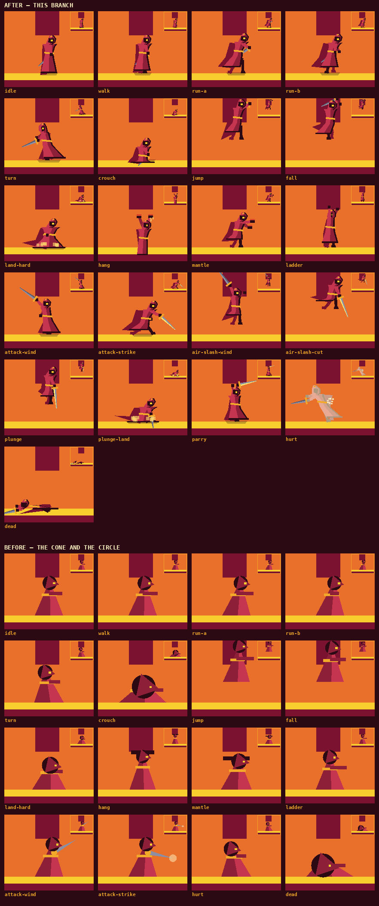
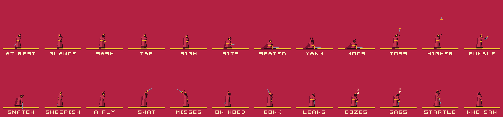
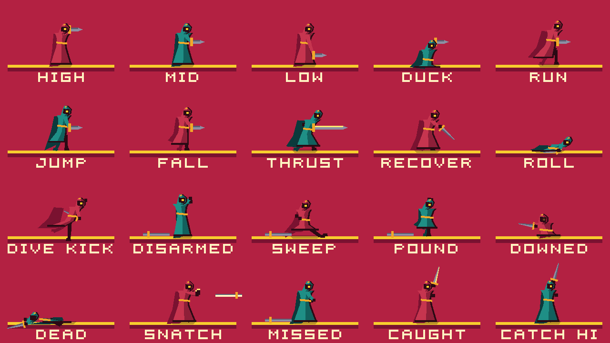
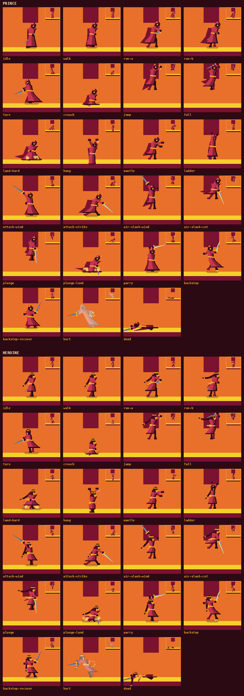
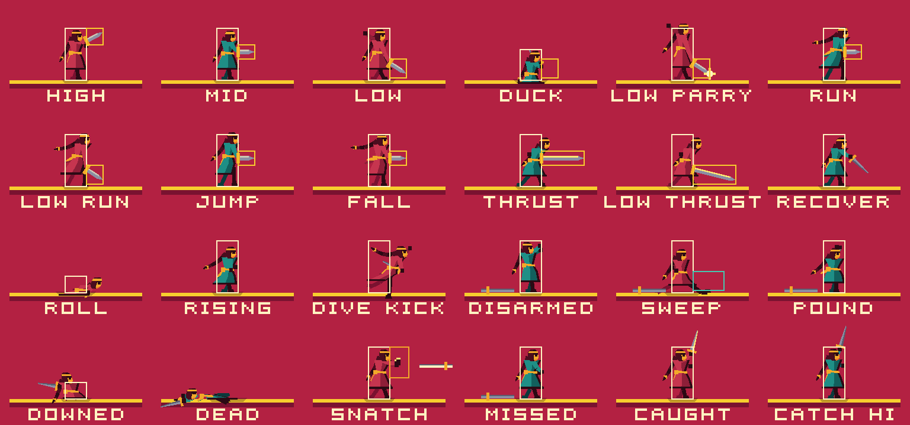
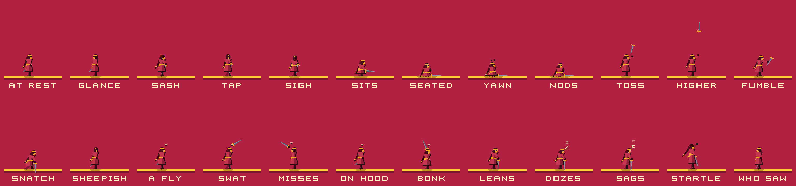
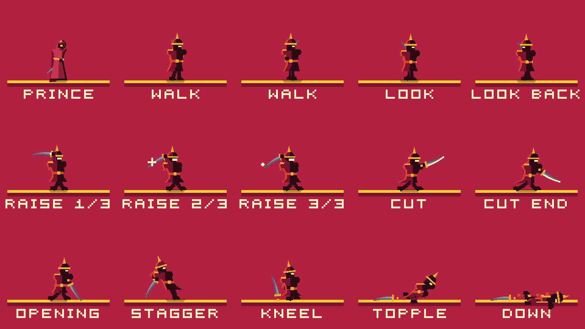

# The character

How the prince and the heroine are drawn, how they are posed, and what the
tuning numbers behind them are for.



## The constraint

The figure is 22 px tall on a 180 px viewport. On a phone that is roughly a
fingernail. Everything in `scripts/player/player_art.gd` follows from that:

- **Silhouette first.** A pose that only reads from its interior does not read.
  Every state below is distinguishable with the colours thrown away.
- **Four tones, nine pixels.** Lit cloth, shade cloth, an ink edge down the
  shadow side, and a darker cloak behind. That is the entire value structure,
  and it is what makes a red figure legible against terrain that is itself red
  and gold.
- **Flat planes, hard edges, no gradients.** The concept art's language, and
  conveniently also the cheapest thing to draw.
- **No image assets.** Everything comes out of `Palette` through
  `draw_colored_polygon`, `draw_rect` and friends. That is deliberate: the
  whole look re-lights from one table.

The light is fixed in the **world**, not on the character: it comes from the
left, the same direction `AsciiLevel.atlas_for()` lights the terrain from. So
the lit plane is the world-left half of the body whichever way the character
faces, and the hard shadow edge runs down his middle.

## The pose vocabulary

`_posture()` turns `(state, state_time)` into a **pose**: a flat dictionary of
named quantities. A pose contains no coordinates. `_rig()` turns a pose into
points, applying squash, lean, sink and the mirror for `facing` exactly once,
and the `_draw_*` helpers read the rig and know nothing about state.

Poses are written in **forward space**: `+x` is the way the character faces,
and `_rig()` mirrors it. Angles are radians, `0` straight forward, positive
downward. `_pose()` lists every field with the value it takes when a state
does not care:

| Field | What it moves |
| --- | --- |
| `squash` | vertical scale; width compensates, so volume roughly holds |
| `sink` | folds the body down **without** shrinking the hood — a crouch, a dead hang |
| `bob` | whole-body vertical offset, for the run's footfall |
| `lean` | forward offset at the shoulders, tapering to nothing at the feet |
| `tilt` | rotation about the feet — only HURT and DEAD use it |
| `twist` | shoulder foreshortening; below 1 reads as turned away |
| `dangle` | how far **below** the origin the feet hang |
| `hem_lift` / `hem_spread` / `hem_fwd` | where the robe's bottom edge is |
| `hood_tilt` / `hood_face` / `hood_push` | where the cowl points; `hood_face` may go negative to look backwards |
| `glint` | alpha of the one eye light |
| `stride` / `stance` / `knee` | the legs |
| `arm_a` / `arm_b` (+ `_len`) | front and back arm |
| `cloak_sweep` / `cloak_rise` / `cloak_flare` | the cloak behind everything |
| `blade` / `blade_len` / `blade_hot` | the sword; `INF` hides it |

### What each state is supposed to read as

| State | The read |
| --- | --- |
| `IDLE` | a standing column; the robe breathes, the hem touches the floor |
| `WALK` | a short stride, hem just clear of the feet |
| `RUN` | deep stride, 3 px of forward lean, cloak streaming, hem swinging **against** the legs |
| `TURN` | narrow — the shoulders foreshorten, the heel digs in, the hood is already looking the new way while the cloak is still travelling the old way |
| `CROUCH` | folded to `CROUCH_HEIGHT` by `sink`, not by scale; hem pools on the floor |
| `JUMP` | stretched, legs tucked, cloth streaming straight down |
| `FALL` | arms up and reaching — the ledge-grab probe fires from here, so the pose has to look like it is asking for a ledge |
| `LAND` | squashed, knees out, hem splayed, dust |
| `HANG` | two ink knuckles above a narrow column. Nothing else in the game has that shape |
| `CLIMB_UP` | a knee driven onto the ledge, then standing up over it, interpolated by the climb's own progress |
| `LADDER` | foreshortened shoulders, hood nearly edge on, hands and feet alternating; JUMP leaves it as a `JUMP` |
| `ATTACK` | wind up back, lunge through, recover; the blade's arc matches `Player.attack_rect()`'s active window |
| `AIR_SLASH` | the opposite of `ATTACK` on both counts the eye uses: knees drawn up off the floor instead of planted wide, and the blade coming *down* from overhead past the feet instead of *across* |
| `PLUNGE` | the only vertical line in the moveset: both hands at the hip, point straight down past the tucked feet, every piece of cloth streaming up |
| `PLUNGE_LAND` | down on one knee over a blade bitten into the stone, drawn short because the buried part is not there to see, then dragged free |
| `PARRY` | the high guard: weight on the back foot, both hands over the hood and the blade across above it, where the sentinel's cut comes down; the edge gleams only while the parry can still turn a cut |
| `BACKSTEP` | the parry's opposite: leaning *away*, the blade upright in front of the face rather than level over the hood, the free arm flung back for balance, feet off the floor for the middle of the slide, then the knees taking the weight; the edge gleams only while a cut from the front would miss |
| `ROLL` | pitched forward over the knees, hood tucked, cloak over the back, inside the 9 px the tuck is to a foe; then up off a crouch with the hood last. Pitched, not folded: the hood keeps its size, so folding sinks the hips through the floor (the duel's roll found that first) |
| `DIVE_KICK` | heel first and leading, the body laid back behind the line, the sword held back out of it: the one attack the blade takes no part in |
| `KICK_LAND` | a wide crouch on both feet, hands to the floor: planted |
| `THROW` | drawn back over the shoulder, flung forward; the blade leaves the drawing on the release frame, as it leaves the hand |
| `SWEEP` | the duel's sweep: half down, one leg scything along the floor exactly in its live window |
| `PICKUP` | a stoop onto the front knee, hand to the floor, up with the blade |
| *unarmed* | any pose with an empty hand: no blade, the sword hand opened a little forward -- reaching, not holding (`MovePoses.unarmed()`) |
| `HURT` | thrown back and tilted, hood knocked away, whole figure burned white for 0.14 s |
| `DEAD` | toppled: the robe keeps its shape, the figure does not. Over *backwards* off a wound's knockback, head and blade behind; from a fatal fall (`Player.is_fallen()`), folded at the knees on the frame it lands and then *face down* in a fifth of a second, arms flung ahead and the blade knocked flat beyond them, with no hop — so a fall never shares a silhouette with a cut |

## The sword in the air

A sword press in a jump or a fall used to sit in the buffer until the feet
came down. It now slashes there and then: `AIR_SLASH`, the ground swing's
timing (`ATTACK_TIME`, the same live window) on a steeper arc whose band runs
from the chest to 4 px below the feet (`AIR_SLASH_HEIGHT`), so a tapped hop
cuts a guard standing in front of it. It wounds through exactly the code a
ground swing does — `Player.attack_rect()` feeds `Game._resolve_foe()`, and
the `attacked` signal that clears the one-swing-one-heart memory fires once
per slash. A slash that lands soft finishes on the feet as `ATTACK` at the
same phase without re-firing `attacked`, so it is still one swing; a landing
heavy enough to cost recovery takes over, as it does for every state.

**It does not touch momentum,** and that is a decision rather than an
omission. The slash is steered by the same `_steer()` as `JUMP` and `FALL`,
keeps gravity and the jump cut, and so a jump with a slash in it traces the
same arc, frame for frame, as the same jump without
(`tests/unit/test_air_slash.gd` compares them). A slash that hung at the apex
or carried the prince forward would stretch every gap past `Tuning.gap_tiles()`
— a second derivation of the grammar hiding in the moveset — and one that
braked would drop a swing thrown half way across a gap into the pit, on a
phone where SWORD sits next to JUMP. The one thing it costs is a ledge: a
slashing prince is holding a sword, so the grab probe is off until it ends.

## The two specials

Two moves on top of the swing, each made of the stick and SWORD, because a
phone has two buttons and the brief was not to add a third. Up and down are
the only directions a thumb can add to SWORD without changing where the prince
is going, and each points at where its move happens: the parry goes up to meet
an overhead cut, the plunge goes down. Both are built against the sentinel's
three beats — the 27-frame raise, the 9-frame cut and the 33-frame opening —
and `tests/unit/test_specials.gd` pins each risk and reward against
`Patrol`'s numbers the way `test_patrol.gd` pins the plain swing.

| | **Plunge** | **Parry** |
| --- | --- | --- |
| Touch | stick **down** + **SWORD**, in a jump or a fall -- or standing on a one-way floor, which it plunges through (`Player._plunge_through()`) | stick **up** + **SWORD**, on the ground |
| Keyboard / pad | down + sword in the air, or on a one-way floor | up + sword |
| What it does | gives up the run (`velocity.x` 0), drops at `MAX_FALL_SPEED` with the point `PLUNGE_REACH` (8 px) under the feet; no steering, no ledge | plants the feet and raises the blade for `PARRY_TIME` (24 frames); it turns a cut only in the first `PARRY_ACTIVE` (12) and only from the front |
| Reward | a heart from where the guard cannot answer: his cut stops at `CUT_HIGH` (18 px), below the top of his own helm, so a body coming down on him is out of it; then it springs back off him (`STOMP_BOUNCE`, as a stomp does) into a jump that can plunge again | no wound to the guard, but his sabre is thrown wide and he reels where he stands for `PARRIED_TIME` (54 frames) — longer than the 33 of a whiffed cut, with the prince already inside reach — and the riposte skips the parry's recovery |
| Risk | a plunge that meets stone bites it and holds the prince for `PLUNGE_RECOVER` (25 frames), jump or no jump; landed in front of a guard that raises on him, 25 frames plus the sword's lead is longer than the raise, so he eats the cut. Over a pit there is no grab to save it | thrown on sight, it is down again 15 frames before the cut lands and the recovery holds him there: the swing is the answer to a raise caught early, the parry to one caught late (after about frame 23, where a swing no longer lands first) |
| Feel | `PLUNGE_FRAMES` (6) hitstop, the ceiling; shake 2.8, a full-weight settle, sparks at the helm, a low `guard_hit` under a `land_hard` thump. Into stone: no hitstop, shake 2.2 on top of the landing, sparks at the point, a low `sword_hit` ring | `PARRY_FRAMES` (5) hitstop, sparks where the blades meet, almost no camera (shake 0.8), a bright `sword_hit` clang at pitch 1.35; the raise itself is a high, quiet `sword` |

Neither is grammar. The plunge only ever drops straight down, which no level
needs and every fall already covers, and the parry does not move the prince;
`LevelReachability` offers neither. The plunge is also the stomp with a sword
in it: the stomp still works without one, and it shares its bounce constant.

There is no in-game control hint in the adventure to update — the touch
buttons are lettered JUMP and SWORD and nothing else is written on screen
during play — so the combinations are documented in the README's controls
table, which is where the game tells a player what the buttons do.

## The backstep

The third move made of the stick and SWORD: **stick back + SWORD, on the
ground**. A slide of `backstep_distance()` — 22.75 px, about 1.4 tiles — away
from the way the prince faces, the blade raised across his body. For the
first `BACKSTEP_ACTIVE` (15 frames) a guard's cut **from the front** does not
land (`Player.evades()`, checked in `Game._resolve_danger()` after the parry).
From behind — the blade he is stepping back into — or after the window, he is
hit as normal. The parry *wins* the exchange; the backstep *survives* it.

| | |
| --- | --- |
| Touch | stick **back** (away from the way he faces) + **SWORD**, on the ground |
| Keyboard / pad | back + sword |
| Slide | `BACKSTEP_SPEED` 210 px/s falling linearly to nothing over `BACKSTEP_SLIDE` (12 frames); `Tuning.backstep_speed()` is both what moves him and what `backstep_distance()` integrates |
| Whole move | `BACKSTEP_TIME` (27 frames): nothing comes out of it — no swing, no jump, no turn, no second backstep — until it is over |
| Window | `BACKSTEP_ACTIVE` (15 frames), from the front only |
| Rearm | `BACKSTEP_REARM` (12 frames) after the end before the stick and SWORD can make another |
| Feel | cloth at −2 dB and the `sword` voice low and soft (pitch 0.7, −10 dB) as a whoosh under it, both through `GameAudio.cue`; five motes of grit thrown forward from the front foot; the camera dips one pixel (`settle` 0.3) and holds its lead |

### How the stick is read, before the turn

Standing or walking, the stick going back turns the prince on the spot, on
that frame. A backstep that came out after that turn would step back facing
away from the blade, so `_reads_backstep()` reads the stick against the facing
he had *before* it:

- **Stick and button on the same frame:** the turn has not happened yet. It is
  a backstep if that turn would have been on the spot (`|velocity.x|` at or
  under `WALK_SPEED`).
- **Stick a few frames first:** within `BACKSTEP_READ` (6 frames, as long as a
  planted `TURN` lasts) of an on-the-spot turn, SWORD takes the turn back and
  backsteps. A thumb never lands the stick and the button together. A second
  turn inside that time is a wiggle and cancels the first, so back-forward-
  SWORD swings forward instead of stepping toward the blade.
- **At a run:** the stick behind plants a `TURN`, as it always has, and a
  SWORD press in it swings the new way when the turn is done. A running
  prince's weight is going forward; the backstep is a move from a stance.
- **Up wins over back:** up-and-back with SWORD is the parry. A diagonal is a
  thumb reaching for up past a stick that has drifted.
- **SWORD first, stick after:** a swing, as for the parry.
- **Inside the rearm:** the press is whatever it was before the backstep
  existed — a swing the way he faces.

### What it costs, against the guard's beats

`tests/unit/test_backstep.gd` pins each of these against `Patrol`'s 27-frame
raise, 9-frame cut and 33-frame opening, reads the stick and plays the window;
`tests/unit/test_backstep_costs.gd` plays the costs, the edges below, the one
swing and the feel beat. Each test was seen to fail with the thing it guards
broken on purpose.

- **The window outlasts a cut, not a raise.** 15 > 9, so with his back to a
  wall a timed backstep outlasts the whole cut; 15 < 27, so thrown on sight
  with nowhere to go it is over before the blade comes down.
- **No riposte, no reel.** `evades()` arms nothing, the guard goes into his
  plain `RECOVER` (33 frames) instead of the parried reel (54), and a SWORD
  press does not cut the backstep short.
- **Ground is lost.** From where a guard raises (`ENGAGE_GAP`), 22.75 px is
  four times the 5.3 px needed to step out of his cut. Take the latest
  backstep that *needed* its window — thrown two frames before the cut, too
  late to slide clear — and its 27 frames, the run back over the lost ground
  and the swing's lead come to 44 frames from the cut, against an opening that
  closes at 42 (the cut's 9 plus `RECOVER`'s 33). The test models the run with
  the real acceleration and the swing pressed on the run, sliding into reach.
  The parry thrown in the same frames gets its riposte in at once.
- **Blocked, it still answers later than the parry.** Against a wall or at a
  lip the backstep loses no ground, and then the guard's opening *is* his — 25
  frames after the cut, where the parry's riposte comes after the clang's 5
  held frames. A prince with his back to a drop has paid in position already.
- **It does not chain.** The hole between the windows of two backsteps as close
  as they can come is 12 + 12 frames, longer than a cut, and a chain retreats
  at 34 px/s, slower than a walk. A held stick and a mashed button make one.

### Edges and the grammar

**It stops at the lip, as a careful step does.** `Player._careful()` lets the
body end each frame only with the whole of it over floor (solid or one-way)
and none of it in spikes or water; otherwise it stops with the heel on the
edge of the last tile. The tests put a nine-tile drop, a one-tile gap and a
spike pit behind him. A backstep that starts already overhanging a lip goes
nowhere, and keeps its window.

**It is not grammar.** It is ground-only (back + SWORD in the air is the air
slash), no jump comes out of it (a jump out of the slide would carry its speed
into the air), and it crosses no gap of any width, so no level can come to
depend on it and `LevelReachability` offers it nowhere. `hop_tiles()`,
`platform_step_tiles()`, `grab_tiles()` and `gap_tiles()` are unchanged.

**It breaks no wall.** The raised blade is not a blow: `attack_rect()` stays
empty for the whole move, so it neither wounds a guard nor opens a cracked
wall, and it fires no `attacked`, so one swing still takes one heart. Its body
does open a false wall it slides into, exactly as walking into one does.

**Not idle.** `IdleArt.is_calm()` is true only in `IDLE`, so a backstep and
its recovery never start a fidget.

## The duel's moves in the adventure

The owner, after a phone session: "In adventure mode, rolls and other attacks
from the duel are missing." They were, and they are not copied over: the duel
is a fencing game between two equals who die to one touch, and the adventure
is a prince against foes that are not fencers. Each move is what the duel's
move becomes when it meets this bestiary. They run in
`scripts/player/prince_moves.gd`, the prince's sword as a thing in the world
is `scripts/player/prince_blade.gd`, their poses are
`scripts/player/move_poses.gd`, and every number is in `Tuning` under "The
duel's moves". The duel's own files are untouched.

| Move | Input | Numbers | It costs |
| --- | --- | --- | --- |
| Roll | down + JUMP, on stone, not at a run | 21-frame tuck at 115 px/s (40 px), 9 px tall to a foe; 12-frame rise | nothing comes out of the rise; 33 frames committed |
| Dive kick | down + JUMP in a jump or a fall | a straight line at (80, 360) px/s; heel 8 px past the body and below the feet | 24 frames planted if it meets stone |
| Throw | THROW, armed, standing or in the air | 12-frame throw, released at frame 4; 300 px/s level for 6 tiles, 14 px up | the sword, until it is picked up or flies home |
| Pick up | down, standing over the blade | 9-frame stoop | standing still over it |
| Sweep | SWORD with no sword | 16 frames, live 3 to 8, reach 15 px, 8 px band at the feet | it wounds nothing |

### Where each sits on the controls, and why

**The roll is down + JUMP wherever stone is under the feet, and not at a
run.** Down + JUMP is already the drop-through, and that is kept to the
frame: on a floor of one-way tiles -- a platform, a hatch -- the press drops,
exactly as it did. "Stone under the feet" is the exact complement of
`Player._on_one_way_floor()`, the test the drop-through and the hatch's
plunge-through use, so the same press can never mean two things. On
stone the press used to do nothing -- the crouch it came from cannot jump --
so the roll takes only a press that meant nothing. At a run, down + JUMP stays
the jump it always was: at a run a JUMP is nearly always a gap, and a thumb's
stick drifts down, so a roll there would stop at the lip and lose the jump.
From a stand, a walk or a crouch it rolls toward the stick, or the facing.

The alternative, down + JUMP *while moving*, was weighed and turned down: it
puts the roll exactly where the drifting stick is, at a run, and leaves the
standing press -- the one that does nothing -- still doing nothing.

**The dive kick is down + JUMP in the air**, the duel's pairing. A JUMP in
the air waited in the buffer and did nothing, so nothing is taken from it,
except in coyote time: a press just after running off a lip is still the late
jump, because that is what a thumb meant.

**THROW is the eighth input bit**, which the duel already carries and every
device already reads (`Q` / `L`, R1). On a phone it is a third button, placed
exactly as the duel's is -- up and to the left of JUMP, through the shared
safe-area helper -- and only the adventure's scene asks for it
(`TouchControls.throw_button`), so the menus have none and the duel never
draws two.

**Pick up is down, standing over the blade**, as in the duel.

Nothing that was there moved: down + SWORD still plunges, and on a one-way
floor -- a hatch -- still plunges through it, up + SWORD still parries, back +
SWORD still steps back, and the frozen clear runs of Chapter
II, the Aqueduct and the Eclipse play exactly as recorded
(`tests/unit/test_moves_input.gd` plays every pairing from both sides).

### The roll: through, where the backstep is back

The backstep survives in place, backwards, facing the blade, and a cut from
behind is the one it steps into. The roll goes **through**: while tucked, a
danger from either side that is `rollable` goes over him
(`FoeDanger.rollable`, true by default, as `evadable` is). What is rollable is
whatever is set against a standing man -- a sentinel's cut, a Bastion's
shield face and his shove. What is not: a body coming down on him (the
Caracal's claws, the King's slam -- the backstep stays their answer), and
anything in flight, which a roll passes only by being lower than it. A
sunbolt at chest height goes over the 9-px tuck as it goes over a crouch, so
the roll is how a prince closes on a Glassbearer under fire; the King's beam
is 16 px tall and reaches the tuck, so the finale is still the parry's.

So a sentinel rolled at on sight of his raise is passed: the prince comes up
behind him before the cut, and the cut goes into the air. Thrown late, into
the live cut, the window carries him through. Either way the guard's back is
there for his recovery. And the Bastion, whose front shut the two-tile
corridor in Chapter II on the owner's playtest: a roll goes under the face
and the shove and comes up behind him, and his back is open through the
whole 30-frame turn (`tests/unit/test_roll_foes.gd`). The 40 px are chosen for
both: through a guard from the gap he raises at, and up again with his back
inside a swing.

The rise is the price, and the stick may turn him in it, so a roll that came
up behind a foe can cut his back at once; without that, stick-back-and-SWORD
together read as a backstep.

**No new traversal.** The roll stops at every lip, as the backstep does
(`Player._careful()`), so it crosses no gap. It keeps the standing body's
collision shape: only the body a *foe* aims at is tucked
(`PrinceMoves.hurt_rect()`, which Game hands the foes); floors, ceilings,
spikes and water see the standing body, so a roll enters no space and passes
no hazard the proof's body does not. A one-tile slot stops it at the mouth.
That was a choice: a roll under a one-tile gap would have had to be taught to
`LevelReachability`, re-proving every level built on the current proof while
chapters are being drafted against it, and a roll under a closing gate would
shorten every race the gates are timed against. And it covers less floor a
second than a run (40 px in 33 frames), so chaining rolls shortens no race.

### The dive kick: the feet, not the blade

Where the plunge is a sword blow straight down that wounds, the kick is the
heel on a steep line forward that **never wounds**: it rocks what it reaches
and springs the prince back off it, up as a stomp springs and back the way
he came. That makes it the move that opens what a blade cannot:

| Foe | A dive kick | An unarmed sweep |
| --- | --- | --- |
| Sentinel | knocked back, reeling 42 frames (`Patrol.KICKED_TIME`): a raise is broken | the same |
| Bastion | the pavise knocked wide, from either side: `OPENED`, 54 frames, no wall and no shove, a blade from the front wounds | clangs off the shield from the front; rocks him from behind |
| Caracal | bowled into its skid, claws spent; knocked out of a pounce into a fall that ends in one | the same |
| Eclipse | blocked: only each phase's lesson wounds him | blocked |

Never faster across than a run and as fast down as anything falls, it lands
nearer than the same jump left alone from any height, so it adds no reach.
A kick that meets stone plants him for 24 frames -- the plunge's price: with
the swing's lead it is longer than a guard's raise, so a kick that misses in
front of a guard cannot be swung out of. It holds no ledge, and it counts
toward a fatal fall as the plunge does. On crumbling stone its landing lights
the slab like any foot, and its 24 frames planted leave three to step off: a
kick that misses onto a slab is a fall.

Every registered foe is held to "the feet never wound"
(`tests/unit/test_foe_contract.gd`): the default `Foe.take_blow()` answers a
kick or a sweep with `knock()` and rings it off a foe that does not override
that, so a foe added later is kicked as a wall, never cut.

### The throw: a mirror blade, and the rule that it always comes back

THROW flings the blade level at chest height for six tiles -- half a
Glassbearer's aim, so a throw at one is a throw from inside his range -- and
the first foe it meets takes it as `Foe.Blow.THROWN` from the side it flew
in from. A sentinel is wounded; a Bastion's shield turns it and it drops at
his feet, inside his shove, and his back is wounded; a prowling Caracal is
lower than a man's chest and the blade goes over it, though a cat in the air
of a pounce is hit; the King blocks it, as he blocks everything but the
lesson. Its point going into a cracked wall opens the secret, as a swing
would: secrets are proved never-a-trap in every combination, so it opens no
route a proof has not walked. It passes sun mirrors and seals, which turn
light, not steel.

Then the prince is unarmed: no swing, no parry, no plunge, no air slash.
SWORD on the ground is the duel's sweep -- on a hatch too, which only a blade
can plunge through -- and the backstep, footwork, is still back + SWORD. Up +
SWORD is spent on nothing: a thumb reaching for the parry must not throw a
leg into a cut. In the air the press is spent on nothing as well, rather
than kept for a sweep on landing nobody aimed.

**It never soft-locks.** A blade left lying for four seconds flies back to the
hand by itself, through anything; one that is plainly lost -- in water, on
spikes, under or outside the level -- after half a second. Back at the last
checkpoint was the other remedy, and was turned down: the proof says a torch
reaches the door, not that the prince can reach the torch from where he is
now, so a drop already taken could strand him from it. Flying home needs no
proof of anything. A respawn always gives the sword back.

### Stance heights: not here

The duel's three heights are its whole game because blade meets blade at a
height: a matrix of high, mid and low. No foe in the adventure fences. Each
has one attack in one band, and the prince's answers are already read on the
stick: up for the parry, down in the air for the plunge, back for the
backstep. The one slot left, down + SWORD on the ground, would buy a low cut
with no target the swing does not already reach -- even the Caracal's 9-px
body is inside the swing's band. So there are no heights here.

### The assist

LONGER WARNINGS stretches foes' tells and the windows that stand between the
prince and a death, and never the prince. Nothing here adds a tell: the
roll's window and the kick's recovery are the prince's, the Bastion's
opening, the sentinel's reel and the cat's bowled skid are openings, and the
recall is not a death's window. So none of it reads `warn()`, by the rule in
`scripts/core/assist.gd`.

## Adding a state

1. Add the case to `_posture()` and write a `_my_state()` function returning
   `_pose({...})` with only the fields that matter. A pose with the sword in
   play goes in `scripts/player/sword_poses.gd` instead, as a static function
   returning just those fields, which `_posture()` passes to `_pose()`: every
   blade drawn there is a promise about a hitbox in `Player`, so those curves
   and those windows sit together. Give it a docstring that
   says what the pose is supposed to **read** as, not what the numbers are.
2. If the state needs a quantity no field expresses, add the field to
   `_pose()`'s defaults and consume it in `_rig()` or a `_draw_*` helper. Do
   not special-case a state inside a drawing helper: the helpers must stay
   state-blind, or the next pose has to fight them.
3. Add a row to `_pose_table()` in `tests/character_poses.gd` and re-render the
   contact sheet (below). If it does not read at 1:1 in the inset, it does not
   read.
4. Render it as the heroine too (`--figure heroine`, below). The pose is hers
   already; what to look at is whether her braid, ribbons and short hem read
   in it, and whether a new field you added means something to her costume.

## Secondary motion

The pose is a pure function of `(state, state_time, velocity, facing)` — which
is what keeps a replay or a network peer drawing the same frames. The *cloth*
is not:

- **`_sway`** chases the body's velocity with an exponential lag, in forward
  space. It reaches the cloak multiplied and the hem multiplied and negated, so
  running makes the cloak trail and the hem drag back, falling makes both
  stream upward, and both keep moving for a few frames after the body stops.
- **`_squash_impulse()`** is a damped ring kicked by the `landed` and `jumped`
  signals. A landing's depth is `Tuning.impact_weight(impact_speed)`, so the
  squash scales with the drop and then settles with a small overshoot instead
  of snapping back.
- **`_flash`** burns every plane of the figure toward `PAPER` for 0.14 s after
  a hit. It lives in the art rather than in the effects node so that the flash
  is exactly the character's own silhouette, not a rectangle laid over it.

That is the only state this node keeps, all of it cosmetic, all of it
self-correcting within a few frames.

## Effects

`scripts/player/player_fx.gd` draws landing dust, run scuffs, a ledge-grab
puff, a sword trail and hit sparks. It is driven entirely off `Player`'s
existing signals — `landed`, `grabbed_ledge`, `hurt`, `died` — plus the two
public fields `PlayerArt.blade_tip` / `blade_hot` for the trail, so the trail
cannot drift away from the sword it is following.

It **attaches itself**: `PlayerArt._ready()` calls `PlayerFx.attach()`, which
adds the node beside the art if it is not already there. Nothing has to be
wired into `scenes/player.tscn`, so every Player everywhere gets the effects
and the scene file stays a two-node file nobody has to merge.

Particles are a fixed-size `PackedFloat32Array` with a stride — no object per
particle, no timer, no tween, nothing allocated or freed while playing. The
node is `top_level`, so dust stays where it was kicked up instead of riding
along with the character.

## When nothing happens

Leave the prince alone and he gets bored, in steps.
`scripts/player/idle_art.gd` (`IdleArt`) is a child of the art, attached by
`PlayerArt._bind()` the way the effects are, and it does three things: keeps
a clock, lays a pose over `_idle()`, and draws a few props over the figure.



| Quiet for | What he does | How long |
| --- | --- | --- |
| 0–4 s | nothing new: the resting breath | — |
| 4 s, 8 s | a **fidget**: a glance over the shoulder, or two tugs at the sash | 1.6 s / 1.5 s |
| 12 s, then every 11 s | a **bit**, one of five, never the same twice running | 3.8–7 s |
| 8 s into each 11 s cycle | a fidget, after the longest bit has finished | as above |

The five bits:

- **Sit** — lays the sword on the floor, sits cross-legged, stretches into a
  yawn with both arms up, nods off for a moment, gets up and takes the sword.
- **Juggle** — flips the sword up and catches it, flips it higher, it glances
  off his fingers, he lunges and snatches it a hand above the floor, then
  turns to the camera: nobody saw that.
- **Swat** — a fly buzzes round his face; he swats, it darts behind his head;
  he swats backwards, it lands on the crest of his hood; he looks up at it,
  slaps his own head, and it flies away.
- **Doze** — plants the sword and leans on the pommel; a "z" rises every
  0.8 s while he sags over it; he jolts awake, looks behind him, then at you.
- **Tap** — turns to the camera, hands on hips, taps his foot six times and
  sighs.

**Every pose is pose fields.** A bit is a table of keyframes over the same
fields as every other state, eased with smoothstep, every field a key leaves
out taken from the resting pose. So the rig draws it in whatever cloth and
proportions the figure has: a recoloured or redrawn figure idles without a
change in `idle_art.gd`. The props — the fly, a sword in the air or on the
floor, the "z" — are drawn by `IdleArt` in world colours (`INK`, `STEEL`,
`PAPER`), because they are not part of the figure.

**Purely a picture.** `IdleArt` reads the `Player` and never writes to it.
It runs in `_process`, which Godot runs after every physics step of a frame,
so the frame a button goes down is the frame `IdleArt.is_calm()` goes false
and the bit is dropped: no delay, no swallowed input, a press while seated
is a press while standing. Calm is narrow on purpose — state `IDLE` and every
input bit up — so every other state, the air slash, plunge and parry
included, is not calm without having to be listed.

**Small sounds**, through `GameAudio.cue` only: cloth for sitting, tugging
and swatting, a high, quiet `sword_hit` for the catch and the fumble, a
`step_walk` per tap, a soft thud for the bonk. There is no yawn: the voice
catalogue has none, and synthesising one is a separate piece of work.

**Not near a guard.** A live guard within `IdleArt.GUARD_NEAR` — 13 tiles
across, 6 up or down — or one raising, cutting or recovering anywhere, holds
the clock at zero, and one walking into range ends a bit on that frame. The
camera rests centred on a standing prince, and a 180-unit frame is at most
400 units wide on a 20:9 phone, so that box is "anywhere a guard could share
the screen with him". If the player can see a guard, so can the prince; and
a prince dozing beside one would teach that guards are harmless. Guards join
`Foe.GROUP`, every foe does, and the idle asks the tree for them and whether
one is `is_engaged()`.

**Not in the duel.** `FighterArt` overrides `_bind()`, so a duellist never
gets an `IdleArt`. That is a decision, not an accident: a duellist standing
still is in a stance, and the stance is the information. The fighter's sword
is drawn exactly where the simulation's blade rect is and the body is kept
inside the hurtbox, so a fighter who sat down or tossed his sword would be
drawn lying about both. And the two peers of an online duel would roll
different bits, since this clock is not in the snapshot.

```bash
xvfb-run -a godot --path . --rendering-driver opengl3 --resolution 3072x720 \
  --script tools/idle_poses.gd -- --out docs/idle-poses.png [--silhouette]
```

`tools/idle_poses.gd` pins one prince per cell with `IdleArt.pin()`, since a
live game reaches a given bit only after a roll and twelve quiet seconds.
`tests/unit/test_idle_art.gd` pins the ladder's timings, every button
cancelling on its own frame, every non-`IDLE` state being un-calm, the guard
radius and the raise, the duel, and that a hundred quiet seconds followed by
a run, a jump, a swing and a crouch trace the same simulation frame for frame
with the idle on as with it off. Each of those was seen to fail by breaking
the thing it guards.

## The tuning, and what changed

`scripts/core/tuning.gd` is the only place feel lives. The hard constraint on
any change is the traversal grammar:

```
Tuning.hop_tiles()            == 2
Tuning.platform_step_tiles()  == 3
Tuning.grab_tiles()           == 4
```

`tests/tuning_grammar_test.gd` pins those and must pass after every change.
Run `tests/tuning_feel_test.gd` and `tests/character_traversal_test.gd` too.

### What moved, and why

| Was | Now | Why |
| --- | --- | --- |
| `GROUND_ACCEL 520` | `900` | 0 → top speed took 10 frames. Deliberate is in the wind-up of a turn, not in a tenth of a second of nothing happening. Now 6 frames. |
| `GROUND_FRICTION 760` | `1100` | Stopping was slower than a human expects, so the character skated. It now plants. It also makes `TURN` (which runs friction × 1.4) actually stop rather than drift. |
| `AIR_ACCEL 340` | `480` | 0.26 s to steer to full speed mid-air was too slow to thread a gap you had already committed to. 0.18 s now — enough to adjust, not enough to fly. |
| `AIR_FRICTION 150` | `260` | Letting go in the air did almost nothing. Now it shortens a jump, which is a real choice. |
| `TURN_TIME 0.09` | `0.1` | Six frames. The turn pose has something to say now, and the stronger friction means those frames read as weight rather than as lag. |
| `SOFT_LAND_SPEED 190` | `265` | **The big one.** A jump from flat ground lands at exactly `JUMP_SPEED` = 252, so at 190 *every single jump* ended in a recovery lockout. Running and jumping felt like wading. Both thresholds now sit above `flat_jump_land_speed()`. |
| `HARD_LAND_SPEED 300` | `330` | Re-spaced with the above: flat jump clean, +1 tile soft, +2 tiles hard. |
| `LAND_RECOVER_TIME 0.18` | `0.12` | The hardest landing now costs 11 frames instead of 17. |
| `MAX_FALL_SPEED 330` | `360` | Headroom so terminal velocity still counts as a hard landing. |
| `APEX_THRESHOLD 36` → `52`, `APEX_GRAVITY_SCALE 0.72` → `0.62` | | The apex float was worth 0.3 px and 0.12 s — invisible. It is now worth 0.9 px and 0.17 s, so the top of the arc is somewhere you can actually aim from. Still inside the grammar: the rise goes 35.6 → 36.2 px, which is between 2 and 3 tiles either way. |
| `JUMP_CUT_MULTIPLIER 0.42` | `0.38` | A crisper short hop. |
| `CLIMB_UP_TIME 0.34` | `0.27`, `HANG_HOLD_TIME 0.08` → `0.06` | The mantle was long enough to feel like a cutscene. |
| `MAX_GRAB_FALL_SPEED 260` | `310` | Above `flat_jump_land_speed()`, so a ledge is still grabbable at the speed a jump actually falls past it. Strictly more forgiving; it can never make geometry unreachable. |
| `ATTACK_TIME 0.28` | `0.24`, `INVULNERABLE_TIME 1.1` → `0.9` | Both were long enough to notice. |
| *(none — the cut applied from frame 1)* | `MIN_JUMP_HOLD 0.1` | **For thumbs.** A one-frame tap rose 6 px, and a jump buffered before landing and released before it fired rose 2 px — a jump that did not happen. Releasing jump now cuts the rise only after six frames in the air, so the shortest jump is a ~21 px hop: over a tile, still well short of a held jump. No apex moves, so the grammar cannot. |
| *(none — a press outside IDLE/WALK/RUN was dropped)* | `ATTACK_BUFFER 0.12` | A sword press in the last frames of a fall, in a turn, in a landing or in the tail of a swing did nothing. It is now kept like a jump press and swings on the first frame it can. |
| `LADDER_SPEED 48` | `88` | **Measured 3.0 tiles/s, now 5.5** (`tests/unit/test_ladder.gd` times it in the real scene). The feel lab's seven-tile ladder took 2.3 s, longer than walking the whole lab; it now takes 1.3 s, a run's pace. |
| *(a ladder jump that re-grabbed the next frame)* | `LADDER_JUMP_SCALE 0.82`, `LADDER_REGRAB_TIME 0.3` | JUMP on a ladder always left it — for one frame. The stick is still pushed up when the thumb taps JUMP, so the next frame's free movement put the prince back on the rungs. A ladder jump now goes sideways at run speed when a direction is held and straight up off the rungs when none is, and keeps the hands off every ladder for 18 frames. The 0.82 was already the jump's height; it moved here from `player.gd`. |
| *(no fall killed)* | `FATAL_FALL_TILES 10` | **The owner's rule** (`docs/campaign.md`): a landing ten tiles or more below the apex of its fall kills. A height, not a landing speed, because speed saturates: `terminal_fall_height()` is five tiles, so every drop from five down lands at `MAX_FALL_SPEED`. Measured from the apex, so a jump's rise counts — a walk off nine tiles is survived, a jump off eight is not. Ladders, ledge grabs and the floor reset it; a plunge does not (`docs/feel.md`, *A fall of ten tiles*). Not reach: it moves no arc, and the proof prunes by the same `is_fatal_fall()` the player dies by. |
| *(a ladder caught in mid-air slid)* | — | Gravity and the air-state pass ran on top of a mid-air grab and turned it back into `FALL`, so a ladder could only be taken from the floor. `LevelReachability` has always routed through the mid-air catch; the player can now do it. |

**None of the ladder numbers is grammar.** `LevelReachability` steps between
ladder cells whatever the climb speed and offers no ladder jump, so the
ladder tuning can make a proved level quicker to climb or easier to leave and
can never make it unprovable. `tuning.gd` says so next to the numbers.

**Nothing that defines reach moved.** `GRAVITY`, `JUMP_SPEED`, `RUN_SPEED`,
`WALK_SPEED`, `BODY_WIDTH`, `BODY_HEIGHT` and `GRAB_PROBE_Y` are untouched, so
every existing level's distances are exactly as they were.

Four derived numbers were added — `flat_jump_land_speed()`,
`land_speed_after_drop()`, `impact_weight()` and `gap_tiles()`. They are
consequences, not knobs: the landing thresholds are set relative to the first,
the art and the dust both scale off `impact_weight()` so they cannot disagree
about how hard a landing was, and `gap_tiles()` is the horizontal half of the
grammar — the widest flat gap a running jump crosses, currently 3 — which is
what the feel lab's long-gap station is built to.

The fatal fall added three more, beside the one constant it chose:
`fatal_fall_height()` (160 px), `terminal_fall_height()` (80 px — five tiles,
integrated at 60 Hz, which is the argument for the rule being a height) and
`safe_jump_drop_tiles()` (7 — the deepest drop a full jump survives, against
the campaign's five-tile rule for intended drops). `is_fatal_fall()` is the
one comparison: `Player` dies by it and `LevelReachability` prunes by it.

## The feel lab

`scenes/feel_lab.tscn` + `levels/feel_lab.txt` is the A/B bench: every
canonical obstacle side by side, in the order the grammar introduces them —
open run-up, 2-tile hop, 3-tile platform step, 4-tile grab wall, 3-tile gap,
a four-tile drop, a ladder onto a terrace with a seven-tile drop off it, and a
one-way platform to hop through and fall back down through. It is registered
in `mode_registry.gd`, so it is one entry in the menu.

Change a number in `tuning.gd`, play the lab, and you can see in one screen
which distances still work.

## Looking at it

The only honest test of this art is the pixels. Two tools:

```bash
# Every pose, one frame each, as a labelled contact sheet with 1:1 insets.
xvfb-run -a godot --path . --rendering-driver opengl3 \
  --script tests/character_poses.gd -- --out /tmp/poses/after
python3 tests/character_contact_sheet.py docs/character-states.png \
  "after=/tmp/poses/after" "before=/tmp/poses/before"

# The character in the real game, in motion, against real terrain.
xvfb-run -a godot --path . --rendering-driver opengl3 \
  --script tools/screenshot.gd -- --scene res://scenes/feel_lab.tscn \
  --out /tmp/lab --shots 0.6,1.6,2.4,3.2 --hold move_right
```

`tests/character_poses.gd` exists because `tools/screenshot.gd` walks a live
scene and cannot reach `HANG`, `CLIMB_UP`, `ATTACK` or `DEAD` on demand. The
harness freezes a player into each pose in turn — re-pinning it every idle
frame, because the state machine keeps running underneath — and captures a
frame with the feet on a fixed mark, so a fixed crop lands on the character
every time.

## The duel fighter wears the same figure

The duel's `Fighter` is a different character with a different state machine,
but it is drawn by the same rig. `scripts/duel/fighter_art.gd` extends
`PlayerArt` and overrides the eight methods through which `PlayerArt` reads the
body it dresses — `_bind()`, `_has_body()`, `_body_facing()`, `_body_motion()`,
`_speed_share()`, `_skip_frame()`, `_blade_in_front()`, `_show_grip()` — plus
`_grounded()` and `_posture()`. For the prince those methods read the `Player`
exactly as before; a pixel comparison of level 1 before and after the change
showed no difference anywhere on him.



What the fighter adds is one rule: **the sword is drawn where the simulation's
blade rect is.** Same height as the stance band, same reach, the front hand
moved onto its hilt in `_rig()`. The duel is decided by where that rectangle
is, so the picture of the sword *is* the rectangle, and HIGH, MID and LOW read
at a glance. When the blade is held but not up — a roll, a dive, the recovery
of a thrust that missed — it is carried on the pose's angle instead, visibly
lowered, because a fighter who missed has to be seen to be open.

The same honesty applies to the body. Each pose was checked against the
fighter's hurtbox with the overlay on, and three were changed to fit it: the
roll pitches forward rather than folding down (the hood keeps its size, so a
deep fold pushed the hips through the floor); the sweep stays half upright,
because a sweeping fighter keeps its full-height hurtbox; and a downed fighter
sits back inside its small box instead of lying full length past it.

Seat two wears `Palette.WATER_DEEP`, `WATER_SHADE` and `WATER_NIGHT` in place of
the prince's crimson steps, whatever figure or look either player chose (see the
heroine, below).

```bash
xvfb-run -a godot --path . --rendering-driver opengl3 --resolution 1280x720 \
  --script tests/fighter_poses.gd -- --out docs/fighter-poses.png [--hitboxes]
```

## The heroine: a second figure on the same skeleton

There are two figures, the prince and the heroine, and one skeleton. What a
player chooses in the wardrobe (`docs/ui.md`) is a **look** — a figure and a
few palette colours, `scripts/player/character_look.gd` — and the look puts a
**costume** on `PlayerArt`. Gameplay never sees either: the body, its hitbox,
its tuning and its reach are the prince's whichever figure is drawn.



### Why a costume layer and not a second PlayerArt

`PlayerArt` does three jobs. It turns a state into a pose (`_posture()`), the
pose into a rig of points (`_rig()`), and draws planes on the rig. Only the
third differs between the two figures, and everything that makes a pose
*read* — the lean, the stride, the arm angles, the sword's arc, the squash of
a landing — lives in the first two. A forked `HeroineArt` would have drifted
from the first new pose; a `FighterArt` per figure would have doubled again.
So a costume (`scripts/player/costume.gd`) replaces whole **layers** of the
drawing and nothing else:

| Layer | When | The prince | The heroine |
| --- | --- | --- | --- |
| back | behind the legs | the cloak | the braid and two sash ribbons |
| body | over the legs and back arm | robe and sash | belted knee-length tunic |
| head | over everything | the hood | hair, a lit face, a headband |

Legs, arms, hands, the sword, the ledge grip and the contact shadow are shared.
The base `Costume` *is* the prince and draws nothing: each `draw_*` returns
false and `PlayerArt` draws his layer with the helpers it always had, so the
default figure is pixel for pixel what it was. `HeroineCostume` returns true
and draws her own. The hook in `player_art.gd` is three `if not
costume.draw_*()` lines in `_draw()` and one `costume.tick()` in `_process()`.

The consequence that matters: **a pose added to `player_art.gd` or
`sword_poses.gd` is the heroine's too, with no change to her file.** The air
slash, the plunge, its landing, the parry and the backstep arrived after her
costume was written and she wears all five, and so the idle ladder (below). `tests/unit/test_figure_poses.gd` draws every
`Player.State` and every `Fighter.State` as both figures, reading the states
from the enums, so a new state is covered the moment it exists. It fails on a
plane Godot cannot triangulate (a polygon that folds over in some pose) and on
a plane that leaves the box a 22 px figure can occupy.

One rule follows for whoever adds a pose field: a field that a *costume layer*
consumes (the cloak and hood fields: `cloak_*`, `hood_*`, `hem_*`) has to mean
something to every costume. Read it in `HeroineCostume` too, or say in the
field's comment that she ignores it and why.

### Who she is at 22 px

At tile scale a figure is a silhouette and a value pattern, so each of the
prince's three strongest cues is answered by its opposite:

- **Head.** His is a pale cowl with a dark hole for a face and a forward peak.
  Hers is dark hair with a lit face, the value structure of the head inverted,
  round where he is pointed, with one accent band across the hair. The face is
  always the lit skin tone: strictly the sun should put it in shade when she
  faces right, and the first render did, and the shade steps of the skin ramp
  are the terrain's own oranges, so her face vanished into the wall.
- **Hem.** His robe reaches the floor and hides his legs; her tunic stops at
  the knee and flares, so legs and boots show. A figure with a waist and a
  stride where his is a cone.
- **What trails.** His cloak is one broad dark plane. Hers is lines — a braid
  down the back and two narrow ribbons from the belt. Only the near ribbon is
  the accent colour: two bright ribbons crossing on a fall read as an X,
  louder than the figure.

### Her secondary motion

The cloak lags the body on an exponential chase and never overshoots. The
braid is a **pendulum**: an under-damped spring on one angle, held in *world*
space. It swings past where it is going and back, flicks forward on a landing
and back on a jump (it takes the same kick as the squash spring), and on a turn
it crosses her back to the new side instead of mirroring there. The ribbons
flutter at their own rate, harder the faster she moves. Like the cloth lag,
all of it is cosmetic, lives in `_process`, and settles within a second.

### In the duel

`FighterArt.dress(fighter, seat, look)` puts the look on and then the seat's
colour over it, and `_bind()` re-imposes the seat again, so the robe, the
sleeves and the back plane are always crimson for seat one and sea-green for
seat two — the outfit row is the adventure's. Her silhouette fits the fighter's
hurtbox the way his does; the braid and ribbons reach past it as his cloak
does, and are cloth.



```bash
# Both figures through the pose table, and the sheet above.
xvfb-run -a godot --path . --rendering-driver opengl3 \
  --script tests/character_poses.gd -- --out /tmp/poses/prince
xvfb-run -a godot --path . --rendering-driver opengl3 \
  --script tests/character_poses.gd -- --out /tmp/poses/heroine --figure heroine
python3 tests/character_contact_sheet.py docs/heroine-poses.png \
  "prince=/tmp/poses/prince" "heroine=/tmp/poses/heroine"

xvfb-run -a godot --path . --rendering-driver opengl3 --resolution 1280x720 \
  --script tests/fighter_poses.gd -- --out docs/heroine-fighter-poses.png \
  --figure heroine [--hitboxes]
```

The renderers dress the figure's *default* look and never read the saved
wardrobe, so a contact sheet does not depend on what someone last chose.

The idle ladder is hers too. Its fidgets and bits are keyframes over the shared
pose fields and IdleArt attaches to any PlayerArt bound to a Player, so the
heroine glances, sits, tosses the sword and dozes with no line in her costume
about it. Where a bit turns the head away (`hood_face` negative) her face goes
to the far side and the back of her head, dark hair, is what shows.



```bash
xvfb-run -a godot --path . --rendering-driver opengl3 --resolution 3072x720 \
  --script tools/idle_poses.gd -- --out docs/heroine-idle-poses.png --figure heroine
```

## The sentinel

The guards on the terraces are drawn by `scripts/entities/patrol_art.gd`, a
rig of the same kind as the prince's — a pose dictionary from
`(state, state_time)`, a rig, state-blind drawing helpers — and built to be his
opposite at every point the eye uses at this size: near-black where he is mid
red, a dome helm with a gold spike where he has a pointed cowl, pauldrons
where he is narrowest, legs and boots under a knee-length coat where his robe
reaches the floor, and a curved sabre on the shoulder where his blade hangs
low. The sun-facing edge of the coat, helm, pauldrons and helm-cloth carries a
one-pixel rim, so a dark figure does not vanish into the ink of an arch.



What the guard *does* changed with it, deliberately and narrowly. It used to
hurt on contact, which made it a moving spike: nothing to read and nothing to
fence with. Now it is harmless to touch and dangerous in one state only:

| State | Frames | What it is for |
| --- | --- | --- |
| `WINDUP` | 27 | the telegraph — sabre cocked overhead, eye slit burning white, a star of light up the blade, a cloth cue |
| `STRIKE` | 9 | the only frames `Patrol.strike_rect()` is non-empty |
| `RECOVER` | 33 | point on the floor, bent over: the opening |

The raise starts when the prince is `ENGAGE_GAP` in front of the guard, which
is already inside the prince's own sword reach, and his sword is live six
frames into a swing. So a player who acts on the raise wins the exchange, and
a hit during it staggers the guard out of its cut; a player who backs off one
tile is out of `REACH`. `tests/unit/test_patrol.gd` pins those relationships
against `Tuning`, so a retune of the prince cannot quietly make guards unfair.
The stomp is unchanged. A guard that dies kneels, topples and flickers out
over 1.3 s while its sabre spins away; it is neither dangerous nor hittable
from the killing blow on.

```bash
xvfb-run -a godot --path . --rendering-driver opengl3 --resolution 1280x720 \
  --script tools/enemy_poses.gd -- --out docs/enemy-poses.png [--silhouette]
```

`--silhouette` paints every figure black: the two-tone check from
`docs/art-direction.md`, and the quickest way to see that the guard and the
prince are different shapes.

## Tests

```bash
godot --headless --path . --script tests/tuning_grammar_test.gd     # the grammar
godot --headless --path . --script tests/tuning_feel_test.gd        # the feel relationships
godot --headless --path . --script tests/character_traversal_test.gd # the lab, played
```

The traversal test drives the real `Player` through the real feel lab with a
deliberately stupid bot — hold right, jump at a wall, jump at a gap, climb what
cannot be jumped, mantle a ledge — and asserts every station is cleared. It
runs in real time (the engine steps physics at wall-clock 60 Hz), so give it
about a minute. If a station needs more cleverness than that bot has, the
station is too fiddly to be canonical.

The duel's moves have five GUT suites of their own, each seen to go red when
the rule it holds was broken on purpose: `tests/unit/test_moves_input.gd`
(where each press lands, and that the drop-through, the late jump, the plunge,
the parry and the backstep did not move), `tests/unit/test_roll.gd` (its
numbers, the lip, the slot, the window), `tests/unit/test_roll_foes.gd` (the
sentinel and the corridor Bastion, played), `tests/unit/test_dive_kick.gd`
(its reach, its price, each foe's answer to the feet) and
`tests/unit/test_sword_throw.gd` (the throw, the pickup, the recall, the
respawn, and the bestiary). `tests/unit/test_touch_controls.gd` holds the
THROW button to the duel's place.
