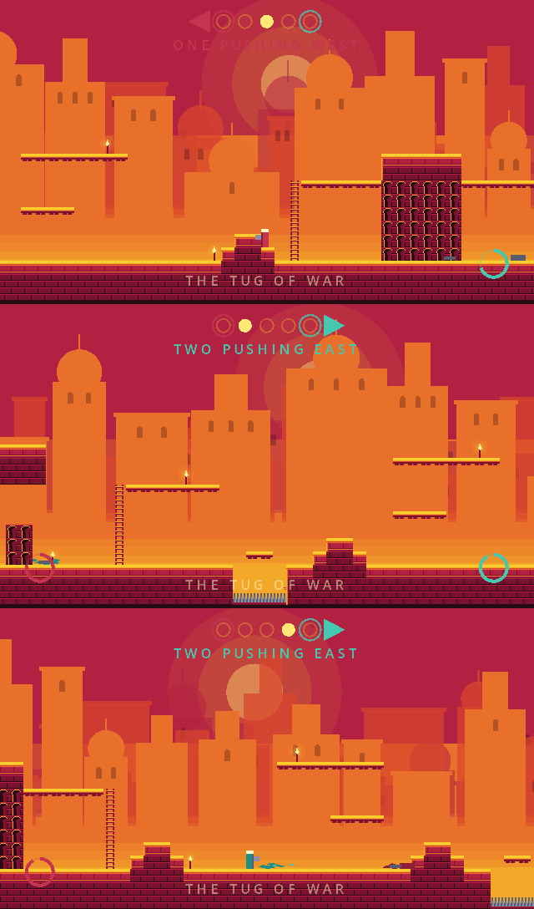

# The duel match: a tug-of-war

The match layer turns two fighters into a Nidhogg match: a strip of zones, an
initiative that decides which way the world scrolls, respawns, and two gates.
The specification is [`duel-spec.md`](duel-spec.md) §3. How a single exchange
of blades resolves is [`duel-combat.md`](duel-combat.md).

*Rendered with `tools/screenshot.gd` from `scenes/duel_match.tscn --demo`, on
the real fighter, in the prince's figure (`scripts/duel/fighter_art.gd`). The demo's
kills are scripted so a screenshot at a given second is always the same one.
Rings are respawn timers, the track at the top is zone and initiative.*

## The pieces

| File | Owns |
|---|---|
| `scripts/duel/match.gd` (`DuelMatch`) | initiative, scroll, respawn timers, win condition, snapshot, checksum |
| `scripts/duel/match_sim.gd` (`DuelSim`) | the surface the network session drives; the match implements it |
| `scripts/duel/match_seat.gd` (`DuelSeat`) | the **only** place that touches a fighter |
| `scripts/duel/zones.gd` (`ZoneStrip`) | the zones as data, and every collision question |
| `scripts/duel/zones_view.gd` | streams the zones' drawn layers near the camera, dressed and lit |
| `scripts/duel/gore.gd` (`GoreField`) | decals, presentation only |
| `scripts/duel/match_camera.gd`, `match_hud.gd`, `match_gate.gd` | presentation |
| `levels/duel_zones.txt`, `levels/zone_0*.txt` | the strip: a manifest and five zones |

## One frame

`DuelMatch.step(bits_a, bits_b)` is one frame, and the frame is a function of
nothing but the match's state and those two input bytes. That is the promise
the round duel made and the network session relies on: a client replays the
host's frames and compares checksums. `docs/netplay.md` explains what it buys.

Inside the frame, in this order: both inputs applied, both fighters simulated,
then `DuelSeat.referee()` — blade against blade through `DuelCombat.resolve()`,
then each body against the ground's hazards (spikes, water, falling out of the
world). Blades go first, so a fighter cut down over the spikes is credited to
the blade. The fighter resolves its own frame and nothing else; refereeing two
of them is the match's job.

The real fighter moves with `move_and_collide()`, so it needs ground in the
physics space. The match builds that itself, once per match: a hidden tilemap
of every solid and one-way cell of the whole strip (`_build_ground()`). The
view's tilemap is streamed and only draws — its collision is off — because a
streamed floor is one two peers could hold differently.

## Simulation and presentation

The line is drawn on purpose, and tests hold it.

**Simulation** — in `write_state()` and the checksum: the frame, phase,
initiative, zone index, winner, kill counts, phase time, both respawn timers,
the scroll, and both fighters' state. Initiative computed separately on each
peer is initiative that eventually disagrees, and the disagreement is a match
where one screen scrolls and the other does not.

**Presentation** — never in the snapshot: gore, the camera, the HUD. A
presentation field inside the snapshot is as bad as a simulation field outside
it; it would make a blood spot something two peers could diverge over.
`tests/match_gore_test.gd` proves gore never touches state.

**Geometry is never streamed.** `ZoneStrip` answers every collision question for
every zone from the level text, always, and the physics a fighter moves against
is the match's own ground layer, built whole. Only the *drawing* is streamed —
each zone's tile layers, dressed and lit — three zones around the view plus
wherever a fighter stands or is about to respawn. A simulation whose
answers depended on what had finished loading would be one two peers could
disagree about.

## The snapshot is the bandwidth

`snapshot_bytes()` is `HEADER_BYTES` (44) plus two fighter blocks. The four
time-and-distance values in the header are doubles, not floats: they are
compared against thresholds, and rounding a threshold comparison to 32 bits
moves a transition by a whole frame.

The checksum quantises every float to 1/256 before hashing, so noise in the
last bit cannot fire it. The real fighter supplies its own share
(`Fighter.checksum_into()`), because its 100-byte state mixes doubles and
int32s and only it knows which bytes are which. A fighter that does not hash
itself — the placeholder — is read back as a run of float64s, so its state must
be a whole number of them; `build()` refuses one that is neither.

## Initiative and the window

The spec's `LeaderState`, kept to its names. A match opens `NEUTRAL`; nothing
scrolls until someone has died. **Every death hands the initiative to the other
fighter**, whatever did the killing: a fall onto spikes is credited to the
opponent. A death reported twice scores once.

The playable window is one zone wide and **slides continuously**. The leader
drags it, and it only ever moves in the leader's goal direction. That one-way
ratchet *is* "the screen opens only in the leader's direction": running the
wrong way walks you into the trailing wall instead of scrolling the world back.
Because the window slides rather than snapping zone to zone, crossing a seam is
not an event anywhere in the code, and there is nothing at a seam to stutter.

## Respawn

From the spec, with its numbers:

- `RESPAWN_DELAY` — 2.0 s.
- `RESPAWN_LEAD` — 1.5 screen widths ahead of the leader, in the leader's
  direction of travel, facing the leader.
- Only on **open ground**: `FLAT_RUN` cells of unbroken floor either side and
  `HEADROOM` clear rows above, so the leader can always jump over or roll past
  the respawned fighter. That keeps the pacifist line open: a leader is never
  forced to fight.
- At the final zone the respawn goes in front of the gate, with a standoff
  (`GATE_STANDOFF`). The gate's lintel in `zone_01.txt` sits high for exactly
  this reason: the leader has to be able to go over the top.

## The zones

One screen each, one set piece each, and the stake rises toward either end
(`levels/duel_zones.txt` lists them):

| Zone | | Set piece | Stake |
| --- | --- | --- | --- |
| 3 | the Mirror Court | a raised tower over an arcade, a ladder either side | none: the start |
| 2, 4 | the Cistern Court | a spike pit three tiles wide, a stepping stone over it | a hazard with help |
| 1, 5 | the Gates | the arch, the crowd, and a moat of open water one jump out | a hazard with none, at dusk |

**The moat is two tiles, not three.** The duel fighter has no ledge grab, so
any gap is a hazard, and its running jump carries about 42 px. Over a
three-tile (48 px) moat exactly one press frame gets across; over two tiles a
run gets across if jump is pressed anywhere in a window of about eight frames
(16 px), and walking in still kills. `tests/match_fighter_test.gd` runs at the
moat from both gates and holds the window to at least four frames, and fails
with a three-tile moat. The pyramid of steps that stood there before came out
to make room, which raised the gate zones' open ground from 14 to 18 of 30
columns; the strip is 86 of 150, a little over half.

A respawn's zone is streamed in when its timer **starts**, not when the fighter
appears, so the only stream not triggered by travel has two seconds' warning.

## Gore

A bounded list per zone (`GoreField.MAX_PER_ZONE`, 192), not a render target.
Five zones are about fifty kilobytes and no VRAM, against tens of megabytes for
a render target on a phone. The list survives a zone being streamed out and
back because it is not in the tilemap. Shapes are seeded from the frame and the
seat, so both screens show the same splatter — without it being simulation.
The match does not emit `fighter_died` while replaying a corrected frame, so a
reconciling client does not paint the same death twice.

## Tests

- `tests/match_initiative_test.gd` — leader state, the ratchet, the window.
- `tests/match_respawn_test.gd` — every leader position on the strip at 4 px
  intervals: timer, lead distance, facing, open ground, final zone, the
  pacifist line.
- `tests/zone_strip_test.gd` — loading, seams, spawn columns, and that no cell
  is written on a frame a fight crosses a seam.
- `tests/unit/test_zone_dressing.gd` — the zones are dressed and lit as one
  world, and none of it reaches the simulation.
- `tests/match_fighter_test.gd` — the match on the real fighter, including the
  gate moat: walking in kills, a running jump crosses.
- `tests/match_gore_test.gd` — gore never reaches state or checksum, and the
  list is bounded.

## Status

**The match runs on the real fighter.** `scenes/duel_match.tscn` builds it,
and `tests/match_fighter_test.gd` plays matches on it: the seam hands over the
world and the checksum, the fighters stand on the ground, a thrust kills
through the match and moves the initiative, a hazard kills, two runs on the
same inputs agree frame by frame, and a rewind to a snapshot replays 300 frames
byte for byte. Each of those checks was seen to fail with its fix removed.

The match's own suites still run on the placeholder in `match_stub_fighter.gd`,
on purpose: they test the rope, and do not need a physics space.

Both menu entries run the match, and **the round duel is retired**: its
simulation, scenes, camera, HUD and art are gone, and so is the duel-only code
it needed in `scripts/player/player.gd` (guard, stagger, first-blood and its own
slide loop — the prince is the adventure's again). What its tests proved about
netplay now runs on the match: `tests/net_desync_test.gd` (a recorded host,
prediction, reconciliation, a detector that fires on a tampered snapshot and
stays quiet through loss and lag) and `tests/duel_determinism_test.gd` (two
sims agree, a snapshot round trip is exact, and a burst equals a paced run).
`tests/net_live.sh` plays the match between two processes. The tests of the
round duel's own rules and arena went with it.

Moving the paced-run check onto the real fighter found one thing the round
duel did not have: a burst and a paced run part by about 1e-4 px. It is inside
the checksum's quantum, and the test now holds it there and prints it; see
the last item in [`netplay.md`](netplay.md#not-handled-yet).

The five items that stood between the match and replacing the round duel:

1. ~~Zone width.~~ **Decided: a fighter stands 8–9% of the screen's height**,
   and the strip follows from that. The camera scales by height
   (`MatchCamera.FIGHTER_SHARE`, 0.085) at a whole number of screen pixels per
   texel — 8.1% at 1080 px tall, 9.2–9.4% at 1170–1440 — and snaps to the pixel
   grid, so texels are all one size on any aspect. At that scale phones show
   506–600 px of world, so a zone is 480 px (30 tiles,
   `ZoneStrip.SCREEN_WIDTH`) and always fits across: both fighters are on
   screen at every moment, as the mode needs. On narrower screens — a 16:9
   720p device, a 4:3 tablet — the camera follows the pair. The five zones were
   cut from 40 columns to 30 by removing only columns identical to their
   neighbour, chosen to keep the most open ground, so every gate, ladder,
   ledge and mark survived and the share of respawnable floor held at about
   half. The respawn lead is 1.5 × 480 = 720 px. `--framing=<px>` still frames
   a fixed width, for comparisons.
2. ~~The fighter is drawn as its hitboxes.~~ **The fighter wears the
   prince's figure** (`fighter_art.gd` extends `PlayerArt`), with the sword
   drawn exactly on the simulation's blade rect. See
   [`character.md`](character.md#the-duel-fighter-wears-the-same-figure) and
   `docs/fighter-poses.png`.
3. ~~The zones are bare.~~ **The zones are dressed and lit by the level
   path** ([`world.md`](world.md#the-duels-zones)). `ZoneView` dresses the
   whole strip once with `WorldDresser`, solves a full-resolution shadow mask
   per zone with `SunShadow`, and draws each streamed zone with `Level`'s own
   layers and shader material. Presentation only: every layer has collision
   off, the strip's identity does not change, and
   `tests/unit/test_zone_dressing.gd` holds both, plus a per-zone shadow
   that matches a solve over everything to its west pixel for pixel. In a
   duel the foreground plane is drawn at 55% so it never hides a fighter.
4. ~~The HUD is on the fallback font.~~ **The HUD is set in Alcazar**, on
   `UiFont`, `UiLayout` and `UiMarks` like every other screen
   ([`ui.md`](ui.md#duel-hud)): chrome at the top of the safe area, words for
   events and the result only in the reserved band, and a second, shorter
   phrasing for a 320-unit screen. `tests/ui_screens.gd` renders it as
   `match`, `match_flash` and `match_over`.
5. ~~The menu and the network session.~~ The menu's **Duel** is the match on
   one keyboard, and **Duel Online** is the match between two devices
   (`scenes/duel_match_online.tscn`, `scripts/duel/match_online.gd`): the lobby,
   transport and session of the round duel around the match's own scene, with
   touch controls and a THROW button. Phones on one Wi-Fi pair with a
   one-number code (`scripts/net/lan_code.gd`). `tests/match_net_test.gd` plays
   it between two sessions under latency, jitter and loss, and
   `tests/net_live.sh` between two processes, direct and relayed.

Task 14, the zone design, is done to the extent above: a set piece per zone and
a rising stake. Left for a designer's eye rather than a test: whether the
middle court should be flatter still, and whether the gate zones want a second
feature between the moat and the arch.
