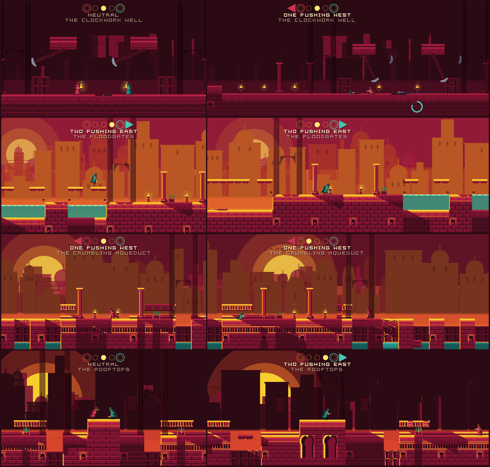

# The duel match: a tug-of-war

The match layer turns two fighters into a Nidhogg match: a strip of zones, an
initiative that decides which way the world scrolls, respawns, and two gates.
The specification is [`duel-spec.md`](duel-spec.md) §3. How a single exchange
of blades resolves is [`duel-combat.md`](duel-combat.md).

*Rendered with `tools/screenshot.gd` from `scenes/duel_match.tscn --demo`, on
the real fighter, in the prince's figure (`scripts/duel/fighter_art.gd`). The demo's
kills are scripted so a screenshot at a given second is always the same one.
Rings are respawn timers, the track at the top is zone and initiative.*

## The pieces

| File | Owns |
|---|---|
| `scripts/duel/match.gd` (`DuelMatch`) | initiative, scroll, respawn timers, win condition, snapshot, checksum |
| `scripts/duel/match_sim.gd` (`DuelSim`) | the surface the network session drives; the match implements it |
| `scripts/duel/match_seat.gd` (`DuelSeat`) | the **only** place that touches a fighter |
| `scripts/duel/match_ledger.gd` (`MatchLedger`) | what the scene has been told, against what the history holds; presentation only |
| `scripts/duel/zones.gd` (`ZoneStrip`) | the zones as data, and every collision question |
| `scripts/duel/zones_view.gd` | streams the zones' drawn layers near the camera, dressed and lit |
| `scripts/duel/gore.gd` (`GoreField`) | decals and the death spurt, presentation only |
| `scripts/duel/match_camera.gd`, `match_framing.gd` | where the view is, and how close it stands; presentation |
| `scripts/duel/match_hud.gd`, `match_gate.gd` | presentation |
| `scripts/ui/duel_select.gd`, `duel_choice.gd` | the menu's second step: one keyboard, VS CPU or online, and the strip, remembered |
| `scripts/duel/duel_brain.gd` (`DuelBrain`) | the computer opponent: one input byte a frame from a `DuelView` |
| `scripts/duel/duel_view.gd`, `duel_eyes.gd`, `duel_cpu.gd` | what it may see, how late, and the order that keeps it honest |
| `scripts/duel/duel_feet.gd` (`DuelFeet`) | where its jumps land: the moat, the pit, the benches, the beat, the tide and the stone |
| `scripts/duel/match_cpu.gd`, `scenes/duel_match_cpu.tscn` | Duel vs CPU: the match with seat two's byte from the computer |
| `scripts/duel/duel_strips.gd` (`DuelStrips`) | the strips by name: the catalogue, RANDOM, the page's captions |
| `scripts/duel/strip_hazards.gd` (`StripHazards`) | blades, floods and crumbling stone: their rules, as functions of the frame and the stones |
| `scripts/duel/match_ground.gd` (`MatchGround`) | the strip with its unfallen stone, as a fighter's world |
| `scripts/duel/hazard_view.gd` (`HazardView`) | the hazards drawn and heard; presentation |
| `levels/duel_zones.txt`, `levels/zone_0*.txt` | the Tug of War: a manifest and five zones |
| `levels/strip_*.txt` and their zones | the other four strips (*The strips*, below) |

## One frame

`DuelMatch.step(bits_a, bits_b)` is one frame, and the frame is a function of
nothing but the match's state and those two input bytes. That is the promise
the round duel made and the network session relies on: a client replays the
host's frames and compares checksums. `docs/netplay.md` explains what it buys.

Inside the frame, in this order: both inputs applied, both fighters simulated,
then `DuelSeat.referee()` — blade against blade through `DuelCombat.resolve()`,
then each body against the ground's hazards (spikes, water, falling out of the
world). Blades go first, so a fighter cut down over the spikes is credited to
the blade. The fighter resolves its own frame and nothing else; refereeing two
of them is the match's job.

The real fighter moves with `move_and_collide()`, so it needs ground in the
physics space. The match builds that itself, once per match: a hidden tilemap
of every solid and one-way cell of the whole strip (`_build_ground()`). The
view's tilemap is streamed and only draws — its collision is off — because a
streamed floor is one two peers could hold differently.

## Simulation and presentation

The line is drawn on purpose, and tests hold it.

**Simulation** — in `write_state()` and the checksum: the frame, phase,
initiative, zone index, winner, kill counts, phase time, both respawn timers,
the scroll, and both fighters' state. Initiative computed separately on each
peer is initiative that eventually disagrees, and the disagreement is a match
where one screen scrolls and the other does not.

**Presentation** — never in the snapshot: gore, the camera, the HUD. A
presentation field inside the snapshot is as bad as a simulation field outside
it; it would make a blood spot something two peers could diverge over.
`tests/match_gore_test.gd` proves gore never touches state.

**Geometry is never streamed.** `ZoneStrip` answers every collision question for
every zone from the level text, always, and the physics a fighter moves against
is the match's own ground layer, built whole. Only the *drawing* is streamed —
each zone's tile layers, dressed and lit — three zones around the view plus
wherever a fighter stands or is about to respawn. A simulation whose
answers depended on what had finished loading would be one two peers could
disagree about.

## The snapshot is the bandwidth

`snapshot_bytes()` is `HEADER_BYTES` (44) plus two fighter blocks. The four
time-and-distance values in the header are doubles, not floats: they are
compared against thresholds, and rounding a threshold comparison to 32 bits
moves a transition by a whole frame.

The checksum quantises every float to 1/256 before hashing, so noise in the
last bit cannot fire it. The real fighter supplies its own share
(`Fighter.checksum_into()`), because its 100-byte state mixes doubles and
int32s and only it knows which bytes are which. A fighter that does not hash
itself — the placeholder — is read back as a run of float64s, so its state must
be a whole number of them; `build()` refuses one that is neither.

## Initiative and the window

The spec's `LeaderState`, kept to its names. A match opens `NEUTRAL`; nothing
scrolls until someone has died. **Every death hands the initiative to the other
fighter**, whatever did the killing: a fall onto spikes is credited to the
opponent. A death reported twice scores once.

The playable window is one zone wide and **slides continuously**. The leader
drags it, and it only ever moves in the leader's goal direction. That one-way
ratchet *is* "the screen opens only in the leader's direction": running the
wrong way walks you into the trailing wall instead of scrolling the world back.
Because the window slides rather than snapping zone to zone, crossing a seam is
not an event anywhere in the code, and there is nothing at a seam to stutter.

## Respawn

From the spec, with its numbers:

- `RESPAWN_DELAY` — 2.0 s.
- `RESPAWN_LEAD` — 1.5 screen widths ahead of the leader, in the leader's
  direction of travel, facing the leader.
- Only on **open ground**: `FLAT_RUN` cells of unbroken floor either side and
  `HEADROOM` clear rows above, so the leader can always jump over or roll past
  the respawned fighter. That keeps the pacifist line open: a leader is never
  forced to fight.
- At the final zone the respawn goes in front of the gate, with a standoff
  (`GATE_STANDOFF`). The gate's lintel in `zone_01.txt` sits high for exactly
  this reason: the leader has to be able to go over the top.

## The zones

One screen each, one set piece each, and the stake rises toward either end
(`levels/duel_zones.txt` lists them):

| Zone | | Set piece | Stake |
| --- | --- | --- | --- |
| 3 | the Mirror Court | flat floor wall to wall, a low gallery in the middle | none: the start |
| 2, 4 | the Cistern Court | a spike pit three tiles wide, a stepping stone over it | a hazard with help |
| 1, 5 | the Gates | the arch, the crowd, and a moat of open water one jump out | a hazard with none, at dusk |

**The moat is two tiles, not three.** The duel fighter has no ledge grab, so
any gap is a hazard, and its running jump carries about 42 px. Over a
three-tile (48 px) moat exactly one press frame gets across; over two tiles a
run gets across if jump is pressed anywhere in a window of about eight frames
(16 px), and walking in still kills. `tests/match_fighter_test.gd` runs at the
moat from both gates and holds the window to at least four frames, and fails
with a three-tile moat. The pyramid of steps that stood there before came out
to make room, which raised the gate zones' open ground from 14 to 18 of 30
columns; the strip is 86 of 150, a little over half.

A respawn's zone is streamed in when its timer **starts**, not when the fighter
appears, so the only stream not triggered by travel has two seconds' warning.

## The strips

The Tug of War is one strip of five. The others are each a place, an hour and
one rule that changes how a Nidhogg duel is fought on it, not only how it
looks. The duel page chooses among them, with RANDOM; online, the host's choice
is the match's (*The handshake*, in [`netplay.md`](netplay.md)).

*Rendered with `tools/screenshot.gd` from `scenes/duel_match.tscn --demo-cpu
--strip=<id>`: two MEDIUM computers fighting it out, at 1280 × 720 (320 units)
and 1760 × 720 (440 units).*

| Strip | Hour | The rule | What it does to a duel |
| --- | --- | --- | --- |
| **The Tug of War** (`tug`) | afternoon, dusk at the gates | a spike pit with a stone, a moat | the original |
| **The Clockwork Well** (`well`) | night, by torchlight | scythes swing through the lane at head height on the beat; spike slots rise on the off-beat | a scythe kills a standing fighter and passes over a ducking or rolling one; the room plays heights too, and a fighter who reads the beat makes the other stand where it is about to cut |
| **The Floodgates** (`floodgates`) | golden hour | the sunken courts flood two tiles deep and drain, on a twenty-second tide | the floor moves the fight: a court is the short way and the place to fight while dry, and a trap when the sluices gush; the middle and gates flood together, the long cisterns on the other half of the cycle |
| **The Crumbling Aqueduct** (`aqueduct`) | sunset | a slab of cracked stone lights the first frame a foot finds it, shudders, drops into the channel with its neighbour, and stays down | standing still to fence on cracked stone is standing on a fuse; every fight wears its holes into the deck for the rest of the match |
| **The Rooftops** (`roofs`) | dusk | alleys between the roofs, two tiles across with nothing at the bottom; chimneys; a plank over the widest gap | an edge under every exchange: a clash's knock-back is a step toward an alley |

### One rule for every hazard: the frame, or the snapshot

A blade and a flood are **pure functions of the match frame**
(`StripHazards.is_live()`, `surface_of()`): a scythe on phase 0 cuts on frames
100k to 100k + 15. The frame is already in the snapshot and the checksum, so
these add nothing to either, cost nothing on the wire, and a rewind or a replay
cannot get them wrong -- there is nothing to replay. It is the adventure's own
choice for its Well, made for the same reason: never the music's clock, which
drifts. The tempo is the Well's, 72 beats a minute, which at 60 Hz is exactly 50
frames a beat.

Crumbling stone is the one hazard with state, because what it remembers is
who stood on it. It is one byte a slab -- whole, burning (frames since lit), or
fallen -- in `DuelMatch.stones`, written after the fighters in the snapshot and
hashed into the checksum. Its collision is one static body per slab on a
physics layer of the match's own, switched by `collision_layer` whenever the
bytes change: the physics server reads the layer on the next query, so a slab
that fell on frame N is gone for frame N + 1's move, and a snapshot from before
puts it back. The layer is the match's own so that the two matches of a
networked test, which share one physics space, never stand on each other's
stone. A loose sword lands on unfallen stone too: the fighter's world on such a
strip is `MatchGround`, the strip plus the bytes.

`move_and_slide()` is still nowhere. The bytes go through the ledger as a
presentable event (`stone`), so a slab's fall rings its dust and sound once,
and what the floor looks like is read from the state, never from the beat --
the rope's rule from "Corrected outcomes".

### Told before it kills

Every hazard is told at least **27 frames** ahead -- the adventure's one
telegraph, `Patrol.WINDUP_TIME` -- or is static and obvious:

| Hazard | Tell | Lethal |
| --- | --- | --- |
| scythe | drawn back three ratchet notches over 27 frames, the edge glinting, three ticks | 16 frames, through the lane |
| spike slot | tips rattling at the grille for 27 frames | 30 frames up |
| flood | the sluices gush for 90 frames; the tide mark is always on the walls | water deeper than 6 px over the feet, 28 frames after it starts to climb |
| crumbling stone | an ink crack across the cap, always; lit, it shudders and sheds grit for 36 frames | the fall |
| alley, moat, pit | static | always |

No hazard reads the LONGER WARNINGS assist, unlike the campaign's: two phones
with different settings would step different matches. `HazardView` draws them
in steel for blades and spikes and teal for water, in `MatchDusk.LIT` so no hour
dims a tell, and keys its sounds on the frame, each frame heard at most once
however often a client steps it.

### Fair under the respawn rules

`ZoneStrip.is_open_ground()` refuses any column within `FLAT_RUN +
HAZARD_CLEARANCE` (four) columns of a cell a blade or a basin can ever take,
from the top of the headroom to two rows under the floor; crumbling stone is not
solid rock, so the flat run refuses it anyway. Whatever the clock says when a
fighter comes back, nothing on the beat reaches them, and
`tests/unit/test_duel_strips.gd` checks every spot a respawn can be put on every
strip against a whole flood cycle. Each strip keeps the Tug of War's other
rules: five 30-column zones, mirror symmetry cell for cell and beat for beat,
the gates mirrored with their high lintels, both start marks on open ground,
eight columns of open ground in every zone (the strips have 8 to 14; the Tug of
War 16 to 18), and a respawn found for every position. No run of cracked stone
is wider than two slabs and no alley wider than two tiles, so the strip can be
worn to jumps but never cut. The window, the initiative and the camera are
untouched: a strip is only geometry and hazards.

### The computer opponent on the strips

`DuelFeet` predicts on the frame it is predicting (`look()` gives it the view's
frame and stones): a jump whose arc crosses a slot while it is up, or lands
in a lane about to be cut or a basin about to flood, is unsafe like one into the
moat. Walking, a cell ahead is a gap while a blade or the water will be in it as
the body passes, so the feet stop at its lip and wait for the beat, or take the
stones. A basin is not entered if it floods within 150 frames. The slabs are on
the feet's grid as the view saw them, and a burning one is not a place to put a
foot. Before any fencing, the brain asks whether where it stands is about to
kill it (`DuelBrain._mind_the_ground`): it ducks under a scythe if a duck is
enough, and otherwise goes to the nearer safe footing (`DuelFeet.refuge()`).
A wall too tall to hop from a standstill -- a chimney -- is backed off from for a
run-up. The blunder knob does not reach any of it.

Computer against computer, each level against itself, six-minute limit,
three seeds a level unless said:

| Strip | EASY | MEDIUM | HARD |
| --- | --- | --- | --- |
| Clockwork Well (8 seeds) | 8 of 8 finish, mean 1,809 frames; 0 of 16 deaths to hazards | 8 of 8, mean 6,893, longest 12,402; 3 of 93 | 8 of 8, mean 2,357; 1 of 26 |
| Floodgates | 3 of 3, mean 935; 0 of 4 | 3 of 3, mean 2,878; 0 of 15 | 3 of 3, mean 1,459; 0 of 8 |
| Aqueduct | 3 of 3, mean 939; 0 of 3 | 3 of 3, mean 1,194; 0 of 5 | 3 of 3, mean 1,787; 0 of 10 |
| Rooftops | 3 of 3, mean 1,392; 0 of 4 | 3 of 3, mean 1,569; 0 of 7 | 3 of 3, mean 1,866; 0 of 8 |

`tests/unit/test_duel_strip_cpu.gd` holds every pairing on every strip to an end
inside six minutes, HARD to one hazard death in twenty and every level to one in
eight. The Well's evenly matched MEDIUM pairs are the long ones: the rope goes
back and forth for up to three and a half minutes, because a runner home waits
for the beat and the chaser catches up while it does.

## The camera

`MatchCamera` puts the view where the simulation's window is; how close it
stands is `MatchFraming`, a pure model it feeds the fighters and the clock.
Neither touches the match: the camera reads `scroll`, the fighters and the
respawn timers, and nothing it holds is in the snapshot, so DUEL VS CPU and the
online duel use it unchanged and two peers may frame one frame differently.

**The frame breathes.** The owner played on a phone and liked the adventure's
framing better. So the scale is a *level* — a whole number of screen pixels
per texel — between two ends:

| | Level | At 1080 px tall | Fighter on screen |
| --- | --- | --- | --- |
| far | `round(height × 0.085 / 22)`, the old fixed framing | 4 px/texel, 480 × 270 world px at 320 units | 8.1% |
| close | `floor(stretch)`, the adventure's scale, never closer | 6 px/texel, 320 × 180 at 320 units, 440 × 180 at 440 | 12.2% |

Other screens: 1170 px tall is 5 to 6 (the adventure there is a fractional 6.5,
and the duel stays at 6); 1440 is 6 to 8; a 720 px desktop is 3 to 4.

**The curve.** A step function of the distance between the two, with a gap
between its up and down edges: the frame goes out a level when the pair no
longer fits it with `SIDE` (40 px: a thrust's reach and a step of warning) in
front of each, and comes in a level when they fit the closer one with `SIDE` +
`HYSTERESIS` (88 px) each. In world pixels between the two:

| Screen (1080 px tall) | 6 px/texel (adventure) | 5 px/texel | 4 px/texel (far) |
| --- | --- | --- | --- |
| 320 units, 16:9 | in at ≤ 144, out at > 240 | in at ≤ 208, out at > 304 | beyond |
| 400 units, 20:9 phone | in at ≤ 224, out at > 320 | in at ≤ 304, out at > 400 | beyond |
| 440 units, 22:9 | in at ≤ 264, out at > 360 | in at ≤ 352, out at > 448 | beyond |

The window is 480 px, so on a wide phone a fight is mostly at the adventure's
scale and reaches the far level only with the two at opposite ends of it.
Vertically the frame also wants their jump's height (24 px) above the higher
head, which only the gallery and the ladders ever ask for.

**No pumping**, three ways: a level is entered only with `HYSTERESIS` (48 px,
more than a lunge) more room than it is left at; only after the pair has fitted
it for `DWELL` (0.6 s) without a break, which is longer than a jump; and never
within `COOLDOWN` (1.2 s) of stepping out. Twenty seconds of lunging across the
line move it at most once (`tests/unit/test_match_framing.gd`).

**Never fights a kill or a read.** On a death the frame holds for `KILL_HOLD`
(0.8 s), at the scale the kill happened and with the body's spot kept in it,
before it stands back. A step in is a 0.6 s ease, centred between the two.

**The texel grid.** At rest the scale is a whole level and the position is
snapped to the screen's pixel grid, so every texel is one size. Between levels
the scale eases (smoothstep; 0.6 s calm, 0.3 s when someone is running for the
edge), and only those frames are fractional: in motion, for a fraction of a
second, a texel n or n+1 pixels wide reads as the zoom moving. A fractional
scale at rest is the shimmer `docs/feel.md` rules out; one that moves and lands
is a camera move. Judged on frames rendered mid-ease at 320 and 440 units.

**Both fighters, always.** The closest level at which every living fighter in
the window fits with `EDGE` (6 px) to spare is a ceiling nothing overrides —
not the hysteresis, the hold or an ease, which is capped by the exact fit
frame by frame — and the camera's glide is clamped so it cannot lag a fighter
out. A 16:9 desktop is narrower than a zone at the far level, so there the
floor drops a whole level below it rather than lose one. Close framing is
allowed only while both are alive and inside the window. A fighter respawned
ahead is 720 px from the leader by the spec — outside the window, and outside
any framing that keeps a fighter readable — so while anyone is down the frame
stands at the far level and leans toward where they will come back, and the
respawned fighter is on screen no later than the frame they enter the window.
`tests/unit/test_match_camera.gd` plays matches at three screen sizes and
checks every frame.

## Gore

Two bounded lists per zone, not a render target: pools and streaks
(`GoreField.MAX_MARKS`, 48) and droplet stains (`MAX_DROPS`, 384). Five zones
at the bound are well under a hundred kilobytes and no VRAM, against tens of
megabytes for a render target on a phone. The lists survive a zone being
streamed out and back because they are not in the tilemap. Bounded apart, a
busy zone sheds its oldest droplets and keeps its pools.

**A kill reads as a kill.** The first version threw six splats and laid one
pool, and on a phone it read as a smudge. A kill is now:

- **a spurt** — three pulses of droplets out of the wound, 12, 8 and 5, eight
  frames apart and each weaker, thrown the way the blow travelled and up, two
  a pulse spattering back. Each flies a real arc against the tiles and lands
  on a floor or platform, or sticks to a wall and runs down it; one that
  reaches water is gone. A hazard has no blow and throws up and to both sides;
- **a streak** along the floor from under the body in the blow's direction,
  as far as the floor runs flat;
- **a pool** that spreads for a second and a half, wet — the glint on its
  sunward side — for four seconds, then dries from the rim inward over six,
  and stays dark for the rest of the match. The streak dries with it.

All in the blood ramp (`Palette.BLOOD`, `BLOOD_DRIED`, `BLOOD_WET`; see
docs/art-direction.md, "The fifth accent: blood"), hard-edged, droplets and
their stains as whole-pixel rects on the texel grid; no gradient, no glow.
Every mark is two tones: a first-pulse drop has the glint on its sunward
pixel, a wall hit is a fresh blob over a dried run, a floor's spray is both.
The blow's direction is read in the step from where the killer stood and
carried only in the event (`death_recorded`'s fourth argument); no step reads
it back.

**Blood is blood, for both seats.** Seat two used to bleed teal. Teal is
water's, and a teal pool beside a gate zone's water read as a puddle, not a
death; who died is already said by the body and by the HUD's flash in the
seat's colour; and an accent that means "someone died here" should not also
mean "which seat". The HUD's seat colours are now its own (`MatchHud.SEAT`)
rather than borrowed from the blood.

**Lit like the stone.** The zones' stone is drawn by an unshaded shader and
never takes the dusk's multiply; the field joins `MatchDusk.LIT`, so a kill in
the last room is as red as one at noon instead of going out against walls the
dusk never touched.

**On the match's clock.** The spurt is not a particle system. Every droplet's
arc and landing are worked out once, at `spill()`, and drawn at "frames since
the death" against the match frame the scene passes to `tick()`. A death a
correction moves carries on at the host's age instead of spurting again; a
kill found late is shown mid-flight; `wipe()` takes a retracted kill's
droplets out of the air as well as off the floor. The field redraws every
frame only while a death is younger than its spurt and its pool's drying.

The blood is fed by `death_recorded` and `death_retracted`, not by the beat
(`fighter_died`): a reconciling client paints each death once, takes back the
blood of a predicted kill the host never had, and moves a kill the correction
moved to the host's frame and place. `docs/netplay.md`, "Corrected outcomes",
has the rule and the argument for it. Shapes are seeded from the frame, the
seat, the place and the blow, so both screens show the same splatter without
it being simulation.

**Drawn over the stone.** The field sits after the zones at their z, under the
fighters and the foreground plane. It used to be at z -1, beneath the zones'
own layers, where every stain in front of a backdrop was drawn and hidden;
`tests/unit/test_duel_blood.gd` now holds the order.

## The computer opponent

**VS CPU** (`scenes/duel_match_cpu.tscn`) is the one-keyboard match with
seat two's input byte taken from the computer instead of the keyboard
(`_step()` in `scripts/duel/match_cpu.gd`; the rest of that file is names and
seeds). It is the only way to duel on one phone. The player is seat one,
crimson, on the shared actions — the stick, JUMP, SWORD and THROW on a phone,
the single-player keys or a gamepad on a desktop — and the computer wears the
wardrobe's second look, in sea-green.

### What it may know

The opponent is a `DuelBrain`, and all it is ever handed is a `DuelView`, one
per frame. It answers with one byte of `PlayerInput`, the same eight bits a
keyboard, a replay or the network produce, and the match steps it exactly as
it steps a person. It holds no match, fighter, seat or input object, so it
cannot touch a rule and cannot read the player's buttons. That is checked on
the scripts themselves, not promised (`tests/unit/test_duel_cpu_seat.gd`).

| In the view | As of |
| --- | --- |
| its own fighter | the last frame stepped |
| the other fighter, the swords out of hand, the initiative, the other's respawn timer | `reaction` frames before the frame being decided |
| the level and the fighter's numbers | always: they never change, and both are on the screen |

**The order of a frame** is `DuelCpu`'s: the computer's bits are chosen from
frames already stepped, then the frame is stepped with the player's bits —
read off the input map there, for the first time — then the frame is looked
at. `DuelEyes` keeps a copy of what each frame showed, so "acts on what it saw
N frames ago" is literally a picture N frames old; subtracting N frames of
motion from the live match would be a guess at the past made with the present
in hand. The seat test changes the player's input on one frame and holds the
computer to the same bytes for its whole reaction time, and to different ones
after it. Hand the brain the newest picture instead and the test fails: the
computer answers one frame later.

**Why its own fighter is not late.** A player knows what their own thumbs are
doing without waiting to see it, and a jump over the moat timed off a picture
of yourself a third of a second old is a suicide, not a reaction. Everything
the other player did reaches it late; nothing they are doing reaches it at all.

### How it plays

Range is most of Nidhogg. A thrust reaches a body at 27 px between the feet
(`body_width + blade_reach`) and a resting blade at 34. Between the two — the
edge — a thrust can be parried or read but cannot kill, so the computer fences
from there:

- **Guard.** It holds the other fighter's height, which parries, as often as
  its level guards, reconsidered every 8 to 24 frames rather than every frame.
- **Read.** From the edge it flicks into the other's height one frame in four.
  Four is inside the five-frame disarm window
  ([`duel-combat.md`](duel-combat.md#the-disarm-window)), so a thrust from the
  edge always meets a flick on its way in. Inside the edge it stops flicking:
  a mismatched stance there is a dead one.
- **Attack.** It picks an open line — a height the other is not holding, and
  of those the one they hold least, from a running count of their stances —
  shows it for `tell` frames, steps in and thrusts. If they moved into it
  during the tell, a `feint` takes the other open line on the thrust frame;
  without one the thrust goes where it was shown, and is parried. A thrust
  that missed, a snatch at nothing, a disarmed or downed fighter is punished
  at once, with no tell. The longer two fighters stand at the edge the likelier
  an attack, so two careful fighters do not stand there forever.
- **Throw.** At a back running away, low by preference, because a low throw
  cannot be caught and has to be jumped; at range now and then. A throw coming
  at it is ducked if high, rolled under if middle and jumped if low, and the
  dodge is held until the blade is out the other side of the body. Empty-handed
  it snatches a high or middle throw instead, then fetches the nearest sword it
  can reach — never one in the water — and sweeps and stamps if there is none.
- **With the initiative** it runs for its gate and does not fight. A respawn
  in its way is vaulted: jumped if its blade is low, and otherwise rolled under
  seven times in ten and jumped the rest, so the vault is not a certainty to
  wait for. A jump comes down inside the other's reach, so once past, with them
  following, it rolls, which is faster than they can run. Near the end of the
  strip it stops short of the spot in front of the gate where the other is
  about to reappear: the rule (`DuelMatch.respawn_plan`) and the ring counting
  it down are both on the screen.
- **Without it**, it waits on the open ground a respawn puts it on, blade up,
  and meets the runner where it stands rather than running at them (two
  fighters closing at once close faster than either can see); thrusts low at a
  roller; chases, and throws at, one who got past; and goes and gets one who
  stops coming rather than waiting for a runner who will not run.

**The ground.** Every step goes through `DuelFeet`, which integrates the
fighter's own motion — the acceleration, gravity, jump cut and terminal speed
from `DuelTuning`, in the order `Fighter.simulate()` applies them — against the
tiles the referee kills on, and says where a jump lands. It tries a full jump
and two hops and takes the best on the first frame one lands well onto its
footing; at the lip it takes any safe one; with none it stops. A jump, roll,
thrust or throw the brain asks for is refused if it would come down in a
hazard. The prediction is the grid's and the fighter's motion is the physics
engine's, and the two part at corners: a one-way platform's corner does not
reliably catch a body falling past it, so a landing counts only with three
pixels of the body over footing (`DuelFeet.FOOTHOLD`). The easy opponent once
drowned off a landing with six hundredths of a pixel of the moat's far lip
under it, so `tests/unit/test_duel_cpu_feet.gd` sweeps every lip in twentieths
of a pixel against an oracle that shares no code with the rule.

### The levels

`DuelBrain.PROFILES`, one dictionary per level. Every knob is one a player can
feel; none of them is how much it is allowed to know.

| | EASY | MEDIUM | HARD |
| --- | --- | --- | --- |
| reaction: frames late it sees the other | 20 | 13 | 8 |
| anticipate: how far it leads a moving fighter | 0.4 | 0.5 | 1.0 |
| tell: frames it shows a thrust's height first | 22 | 10 | 4 |
| feint: chance to switch line on the thrust | 0 | 0.15 | 0.4 |
| guard: chance to hold the other's height | 0.3 | 0.65 | 0.9 |
| flick: chance to fish for a disarm at the edge | 0 | 0.25 | 0.5 |
| blunder: chance a thrust, vault or dodge goes wrong | 0.35 | 0.12 | 0.04 |
| aggression: attacks a second at the edge | 0.45 | 1.0 | 1.8 |
| throw: chance a second at a back running away | 0.2 | 0.5 | 0.9 |
| slop: frames late it jumps a hazard, never past the lip | 2 | 1 | 0 |

EASY is built to be beaten by someone who has just picked the game up: it sees
a third of a second late, shows every thrust's height for a third of a second
before it comes, guards one time in three and gets one thing in three wrong.
HARD sees in eight frames, which is quicker than a person, and is kept a fight
rather than a wall by its blunders and by the fact that it, too, cannot see a
thrust coming inside the disarm window: it guesses, as a person does.

### Seeds

All its chance comes from one `RandomNumberGenerator`, seeded in `reset()` and
drawn only inside `decide()`. The same seed and the same player inputs are the
same match, every checksum equal; a different seed is a different match
(`tests/unit/test_duel_cpu_bouts.gd`). The scene prints the level and the seed
when a match starts, takes `--seed=N` and `--cpu=easy|medium|hard` in the user
arguments, and takes the next seed for a rematch. The player's inputs are not
recorded, so a printed seed alone does not yet replay a match someone played;
see the open items.

### Measured

Headless, on the real fighter, at most three minutes a match:

| Against | Result |
| --- | --- |
| the closing bot of `tests/match_net_test.gd`, made to run for its gate when it leads; 20 seeds a level | EASY won 7, MEDIUM 17, HARD 20 |
| the same in the suite, 10 seeds a level | EASY 5, MEDIUM 8, HARD 10 |
| itself, 10 seeds a pairing | every match finished: EASY–EASY in 1,004 frames on average, MEDIUM–MEDIUM in 2,057 (longest 4,988), HARD–HARD in 3,145 (longest 8,917); HARD beat EASY 10 times in 10 and MEDIUM 8 |
| a scripted human (the determinism suites' input stream), 12 seeds a level | the computer won every match; the hands killed EASY 6 times, MEDIUM 8, HARD 2 |
| the ground, across all of the above | no deaths |

The suite holds HARD to eight wins in ten against the bot, EASY to losing some
and winning some, MEDIUM between them, every computer-against-computer match to
an end, and hazard deaths to one in twenty; each of those was seen to fail with
the behaviour behind it broken.

### Open

- **The numbers are measured against scripts, not people.** Whether EASY is
  beatable by a newcomer on a phone, and whether HARD is a fight rather than a
  wall, wants playing on a phone, as the disarm window did. The knobs are in
  one table for that.
- **A real match cannot be replayed from its seed alone** until the player's
  inputs are recorded with it.
- **Moves it does not use:** the dive kick, the thrust in the air, and turning
  a throw aside with a thrust.

## Tests

- `tests/match_initiative_test.gd` — leader state, the ratchet, the window.
- `tests/match_respawn_test.gd` — every leader position on the strip at 4 px
  intervals: timer, lead distance, facing, open ground, final zone, the
  pacifist line.
- `tests/zone_strip_test.gd` — loading, seams, spawn columns, and that no cell
  is written on a frame a fight crosses a seam.
- `tests/unit/test_zone_dressing.gd` — the zones are dressed and lit as one
  world, and none of it reaches the simulation.
- `tests/match_fighter_test.gd` — the match on the real fighter, including the
  gate moat: walking in kills, a running jump crosses.
- `tests/unit/test_duel_cpu_seat.gd` — the computer holds nothing it could
  peek through, presses only bytes a person could, and answers the player's
  input no sooner than its reaction time.
- `tests/unit/test_duel_cpu_bouts.gd` — replay from a seed, the win rates by
  level, computer against computer always finishing, and a leader who will not
  run being fetched.
- `tests/unit/test_duel_cpu_feet.gd` — every hazard crossed by the real fighter
  from a run and from a standstill, and the landing rule against an oracle.
- `tests/unit/test_duel_cpu_mode.gd` — the scene at the level the duel page
  saved, stepping both seats.
- `tests/unit/test_duel_select.gd` — the one DUEL row, the page's three ways,
  the level on its row, what is remembered and its field-by-field fallback,
  taps, and the thumb buttons.
- `tests/unit/test_match_framing.gd` — the zoom levels per screen, coming in
  and going out, the ease, no pumping, the kill hold, and a minute of running
  about without a fighter framed out.
- `tests/unit/test_match_camera.gd` — the camera on matches: every fighter in
  the window always on screen, the stand-back for a respawn ahead, and a match
  framed every frame stepping to the same bytes as one never framed.
- `tests/match_gore_test.gd` — gore never reaches state or checksum, and the
  lists are bounded.
- `tests/unit/test_duel_blood.gd` — a kill's spurt, streak and pool, the spray
  thrown the blow's way, the match's clock, a moved and a wiped death, the
  bound, and the blood drawn over the stone.
- `tests/unit/test_duel_strips.gd` — every strip: its name and hour, its shape,
  the mirror of tiles, hazards and beats, open ground in every zone, no respawn
  a blade or the water can reach, every hazard told 27 frames ahead, no slab run
  wider than a jump, and the hazards in the handshake hash.
- `tests/unit/test_duel_strip_net.gd` — every strip between two NetSessions on
  clean, laggy and lossy links with no desync; each gimmick rewound and replayed
  byte for byte; a fallen slab gone from the physics and back on a rewind.
- `tests/unit/test_duel_strip_cpu.gd` — two computers finish on every strip at
  every level, the hazard share, ducking a scythe and leaving a burning slab.
- `tests/unit/test_duel_strip_choice.gd` — the STRIP row, RANDOM, what is saved
  and its fallback, and the scene playing the strip saved.
- `tests/unit/test_net_strip_handshake.gd` — the strip on WELCOME, protocol 3,
  the guest switched to the host's strip, and a guest without it refused.

## Status

**The match runs on the real fighter.** `scenes/duel_match.tscn` builds it,
and `tests/match_fighter_test.gd` plays matches on it: the seam hands over the
world and the checksum, the fighters stand on the ground, a thrust kills
through the match and moves the initiative, a hazard kills, two runs on the
same inputs agree frame by frame, and a rewind to a snapshot replays 300 frames
byte for byte. Each of those checks was seen to fail with its fix removed.

The match's own suites still run on the placeholder in `match_stub_fighter.gd`,
on purpose: they test the rope, and do not need a physics space.

All three ways on the duel page run the match — one keyboard, VS CPU and online —
and **the round duel is retired**: its
simulation, scenes, camera, HUD and art are gone, and so is the duel-only code
it needed in `scripts/player/player.gd` (guard, stagger, first-blood and its own
slide loop — the prince is the adventure's again). What its tests proved about
netplay now runs on the match: `tests/net_desync_test.gd` (a recorded host,
prediction, reconciliation, a detector that fires on a tampered snapshot and
stays quiet through loss and lag) and `tests/duel_determinism_test.gd` (two
sims agree, a snapshot round trip is exact, and a burst equals a paced run).
`tests/net_live.sh` plays the match between two processes. The tests of the
round duel's own rules and arena went with it.

Moving the paced-run check onto the real fighter found one thing the round
duel did not have: a burst and a paced run part by about 1e-4 px. It is inside
the checksum's quantum, and the test now holds it there and prints it; see
the last item in [`netplay.md`](netplay.md#not-handled-yet).

The five items that stood between the match and replacing the round duel:

1. ~~Zone width.~~ **Decided: a fighter stands 8–9% of the screen's height**,
   and the strip follows from that. The camera scales by height
   (`MatchCamera.FIGHTER_SHARE`, 0.085) at a whole number of screen pixels per
   texel — 8.1% at 1080 px tall, 9.2–9.4% at 1170–1440 — and snaps to the pixel
   grid, so texels are all one size on any aspect. At that scale phones show
   506–600 px of world, so a zone is 480 px (30 tiles,
   `ZoneStrip.SCREEN_WIDTH`) and always fits across: both fighters are on
   screen at every moment, as the mode needs. On narrower screens — a 16:9
   720p device, a 4:3 tablet — the camera follows the pair. The five zones were
   cut from 40 columns to 30 by removing only columns identical to their
   neighbour, chosen to keep the most open ground, so every gate, ladder,
   ledge and mark survived and the share of respawnable floor held at about
   half. The respawn lead is 1.5 × 480 = 720 px. `--framing=<px>` still frames
   a fixed width, for comparisons. **Since then the frame breathes**: this
   framing is now the far end of a zoom that comes in to the adventure's
   scale as the fighters close (see *The camera* above), because on a phone
   the owner preferred the adventure's. A zone still fits across a phone at
   the far end, which is what the strip was cut for.
2. ~~The fighter is drawn as its hitboxes.~~ **The fighter wears the
   prince's figure** (`fighter_art.gd` extends `PlayerArt`), with the sword
   drawn exactly on the simulation's blade rect. See
   [`character.md`](character.md#the-duel-fighter-wears-the-same-figure) and
   `docs/fighter-poses.png`.
3. ~~The zones are bare.~~ **The zones are dressed and lit by the level
   path** ([`world.md`](world.md#the-duels-zones)). `ZoneView` dresses the
   whole strip once with `WorldDresser`, solves a full-resolution shadow mask
   per zone with `SunShadow`, and draws each streamed zone with `Level`'s own
   layers and shader material. Presentation only: every layer has collision
   off, the strip's identity does not change, and
   `tests/unit/test_zone_dressing.gd` holds both, plus a per-zone shadow
   that matches a solve over everything to its west pixel for pixel. In a
   duel the foreground plane is drawn at 55% so it never hides a fighter.
4. ~~The HUD is on the fallback font.~~ **The HUD is set in Alcazar**, on
   `UiFont`, `UiLayout` and `UiMarks` like every other screen
   ([`ui.md`](ui.md#duel-hud)): chrome at the top of the safe area, words for
   events and the result only in the reserved band, and a second, shorter
   phrasing for a 320-unit screen. `tests/ui_screens.gd` renders it as
   `match`, `match_flash` and `match_over`.
5. ~~The menu and the network session.~~ The duel page's **One keyboard** is
   the match on one keyboard, and **Online** is the match between two devices
   (`scenes/duel_match_online.tscn`, `scripts/duel/match_online.gd`): the lobby,
   transport and session of the round duel around the match's own scene, with
   touch controls and a THROW button. Phones on one Wi-Fi pair with a
   one-number code (`scripts/net/lan_code.gd`). `tests/match_net_test.gd` plays
   it between two sessions under latency, jitter and loss, and
   `tests/net_live.sh` between two processes, direct and relayed.

Task 14, the zone design, is done to the extent above: a set piece per zone and
a rising stake. Left for a designer's eye rather than a test: whether the
middle court should be flatter still, and whether the gate zones want a second
feature between the moat and the arch.
