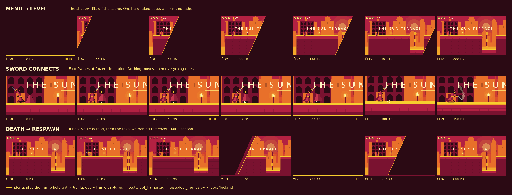

# Feel

Everything around the character. The character itself is `docs/character.md`;
this is the camera that frames it, the frames that freeze when something
connects, the transitions between scenes, and the half-second between dying
and trying again.



The strip above is rendered from the running game, not drawn. A gold rule
under a frame means it is **identical to the frame before it** — which is what
a held frame looks like, and the only honest way to put timing on paper. Three
of them in the middle row is the hitstop; the long one in the bottom row is
the covered frame a respawn happens behind.

Rebuild it with:

```bash
xvfb-run -a godot --path . --rendering-driver opengl3 --fixed-fps 60 \
  --script tests/feel_frames.gd -- --out /tmp/feel
python3 tests/feel_frames.py /tmp/feel docs/feel-frames.png
```

---

## The one rule

> If a player notices the camera, it is too much.

`docs/art-direction.md` has a section called Restraint and it applies here
with full force. The failure mode of this work is juice for its own sake: a
camera that lurches, a hitstop on everything, a wipe you sit through twice a
minute. Every number below is small on purpose, and the section at the bottom
lists what was built and then removed.

---

## The camera

`scripts/render/game_camera.gd`.

The resting behaviour is unchanged: a dead zone (Godot's drag margins) so a
hop or a turn-around does not shove the screen about, and a vertical anchor on
the last grounded height so jumping does not pan the view. What is new is that
four beats bend it.

| Beat | What the frame does | Budget |
| --- | --- | --- |
| **idle** | stops leading entirely; comes to rest on the character | no lead |
| **running** | drifts ahead in the direction of travel | `look_ahead`, 34 px |
| **a long fall** | follows down, and leads the fall so the ground arrives before the player does | `FALL_LEAD_MAX`, 30 px |
| **a ledge grab** | stops leading, lifts onto the ledge being taken | `GRAB_LIFT`, 10 px |
| **a hard landing** | settles with the weight of it, then recovers | `SETTLE_MAX`, 4 px |

All the vertical reframing added together is 44 px of a 180 px frame, and
`tests/feel_camera_test.gd` fails if that grows past 48.

### How each one is decided

The rules are **static, pure functions** on `GameCamera` — `lead_scale()`,
`fall_lead()`, `anchor_for()` — and `_physics_process` does nothing but
compose them and smooth the result. That is not a testing affectation: it is
the only way to argue about "what does the camera do when the character is
falling and hanging at the same time" without standing in front of a ledge.

- **Lead** scales with speed, not with facing: `|velocity.x| / RUN_SPEED`. A
  standstill leads by nothing, so the frame settles on the character instead
  of sitting permanently off to one side. Extending the lead uses
  `look_ahead_smoothing` (6.0) and retracting it uses `LOOK_BEHIND_SMOOTHING`
  (2.6) — stopping dead should let the frame drift back, not yank it.
- **Fall lead** opens up only past `Tuning.SOFT_LAND_SPEED * 0.5`, which is
  faster than the arc of a plain hop. Derived from the tuning rather than
  picked, so retuning the landings moves the camera's idea of "a real fall"
  with them.
- **The anchor** is the floor underfoot when grounded, the ledge when hanging,
  and while falling it follows down with 8 px of slack. It never climbs back
  up on its own — that is what jumping is, and it is the behaviour the camera
  always had.
- **Settle** is an impulse scaled by `Tuning.impact_weight()`, the same number
  the dust and the character art scale off, so the three cannot disagree about
  how hard a landing was. It decays; it does not overshoot.
- **Shake** is unchanged in spirit and still driven off impacts from
  `game.gd`. It is now rounded to whole pixels along with the settle, because
  the world is drawn with nearest filtering and half a pixel of shake is a
  shimmer rather than a movement.

### No zoom

Widening on a fall and tightening on a grab are the obvious reach for
`Camera2D.zoom`. Both were tried and both are wrong here: at 320x180 with
nearest filtering, a non-integer zoom resamples the tilemap and puts a soft,
uneven edge on every shadow in the frame — the one thing the art direction
does not allow. Integer zoom steps are far too coarse to be subtle.

So both beats are framed with offsets instead, which turns out to be what the
player actually needed: seeing further down a drop is a question of where the
frame sits, not how wide it is. `tests/feel_camera_test.gd` reads the source
and fails if anyone writes `zoom`.

---

## Hitstop

`Flow.hitstop()` in `scripts/core/flow.gd`, spent by `scripts/core/game.gd`.

A handful of frames where the simulation does not advance. It is the cheapest
weight in the game and the easiest to overspend, so it has a budget:

| Event | Frames | Why |
| --- | --- | --- |
| sword connects | `HIT_FRAMES` = 4 | enough to register, short enough to swing again |
| stomp | `STOMP_FRAMES` = 5 | heavier: the whole body is behind it |
| player takes a hit | `HURT_FRAMES` = 3 | the player needs control back, not a lesson |
| death | 0 | death has its own beat, below |

Two rules keep it from compounding:

- **`MAX_HITSTOP` is 6 frames** and stops are taken with `max()`, never
  summed. Three things connecting in one frame cannot stack into a stutter.
- **`IMPACT_COOLDOWN` is 0.16 s** in `game.gd`. The attack rect stays live for
  about eight frames and the interaction pass runs on every one of them, so
  without a cooldown a single swing spends the budget two or three times over
  and the frame appears to freeze for a fifth of a second. The filmstrip
  caught exactly that before the cooldown existed.

While a hitstop holds, `Game` stops stepping the player and the entities,
`GameCamera` holds its position and does not re-roll the shake, and `PlayerFx`
holds its particles and the sword trail. All four have to agree or the freeze
reads as a dropped frame instead of as weight.

### Hitstop and the duel — read this before changing anything

Hitstop here is a **real freeze of the simulation**, not a presentational
trick. That is only sound because of where it is driven from.

A duel steps in `_physics_process` and both peers must reach the same state
from the same inputs on the same frame (`docs/netplay.md`). A frozen frame
would have to be a decision both of them made identically — and a sword
landing is detected locally, on a client that is predicting ahead of the
host's authoritative state. One peer freezing is one peer diverging.

What keeps that from happening:

- `Flow` is **not an autoload**. It is a self-installing node, and the only
  thing that installs it is `Game._ready()`. The duel scenes do not run
  `Game`, so in a duel there is no `Flow` and `is_hitstopped()` is constantly
  false.
- `Flow.hitstop()` has exactly **one caller**, `scripts/core/game.gd`.
- `tests/feel_flow_test.gd` scans the source and fails if anything under
  `scripts/duel/` or `scripts/net/` so much as mentions `Flow` or `hitstop`,
  and fails if a second caller of `Flow.hitstop()` appears anywhere.

*Reading* the flag is harmless and `PlayerFx` does it — a duellist's dust
holds still in a held frame, in the single-player modes where frames are ever
held, and the branch is simply never taken in a duel.

If a duel ever wants impact, it must be **presentational only**: shake, a
flash, a camera settle. Nothing that changes how many times `Duel.step()`
runs, and nothing that changes what it is given. `docs/duel-spec.md` draws the
same line from the other side — "gore, dust and camera do not [go in the
snapshot]" — and notes that one field hiding outside the snapshot is what
caused the only desync the project has had.

---

## Transitions

`scripts/core/flow.gd`. Every scene change in the game goes through it, so
none of them is a hard cut.

### The look

A hard-edged shadow sweeping across the frame, left to right, at the same low
rake as the sun: a two-pixel lit rim at the leading edge, a step of crimson
behind it, then ink. Three flat values, no gradient anywhere. It is a cast
shadow passing over the scene — a crossfade would mean a frame with no hard
edges in it, which the look cannot have.

The caller's work happens at **full cover**, so a respawn, a rebuild or a
scene swap is never seen.

### The API

```gdscript
Flow.enter(self)                              # reveal: call from a scene's _ready()
Flow.wipe(self, _restart)                     # cover, do the work, uncover
Flow.change_scene(self, MENU_SCENE)           # the only wrapper around change_scene_to_file
Flow.wipe(self, _restart, Flow.Pace.FAST)     # the same, at retry speed
Flow.busy()                                   # true while a transition owns the screen
```

| Stage | Normal | Fast (`Pace.FAST`, 0.55×) |
| --- | --- | --- |
| cover | 160 ms | 88 ms |
| hold | 70 ms | 39 ms |
| uncover | 200 ms | 110 ms |
| **total** | **430 ms** | **237 ms** |

The hold exists because `change_scene_to_file` is deferred: without it the
shadow would start to lift off a scene that is still being built.

The whole state machine runs in `_physics_process`, not `_process`. A wipe
looks like pure presentation — `DuelCamera` reaches the opposite conclusion
for that reason — but this one fires the caller's work at full cover, and that
work is a respawn or a scene change. A retry landing on frame 23 at 60 fps and
frame 11 at 30 fps is gameplay depending on the display, which `CLAUDE.md`
rules out. The reason `DuelCamera` avoids the physics clock — a reconciling
client may step it twice in one frame — cannot reach `Flow`, because a duel
never runs `Game` and so never installs one.

`Flow.enter()` is a no-op while a transition is already running, which makes
it safe to call unconditionally from `_ready()`. That is what gives an
incoming wipe even when the *outgoing* half came from somewhere that still
calls `change_scene_to_file` directly — the menu, today.

> **For whoever owns `scripts/ui/menu.gd`:** one line gets the outgoing half
> too. Replace `get_tree().change_scene_to_file(scene)` with
> `Flow.change_scene(self, scene)`. The same applies to
> `scripts/core/boot.gd`, though boot → menu is the one cut nobody sees.

### Where it is used

| From | To | Pace |
| --- | --- | --- |
| any scene | itself, on load | reveal only |
| pause → menu | `menu.tscn` | normal |
| complete → replay | same level, rebuilt behind the cover | normal |
| complete → menu | `menu.tscn` | normal |
| death → respawn | same level, rebuilt behind the cover | **fast** |

---

## Death, retry and completion

`scripts/core/game.gd`, all of it marked `--- feel/flow (additive) ---`.

Dying used to hold for 1.1 s and then hard-cut to a respawned level. It now
costs about half a second, and the half second is *readable*:

| From death | What happens |
| --- | --- |
| 0 ms | the hit lands: dust burst, camera shake, the body goes down |
| 0–300 ms | `DEATH_HOLD`. The beat. You can see what killed you |
| from 100 ms | `DEATH_SKIP_DELAY` has passed — **jump skips the rest** |
| 300–388 ms | the shadow sweeps in, fast pace |
| **388 ms** | full cover. The level is rebuilt and the character respawned **here** |
| 388–427 ms | the hold: one covered frame, and nobody saw the teleport |
| 427–537 ms | the shadow lifts off a character who has been playable since 388 ms |

The two numbers that matter are 300 ms of beat and the fact that the
restart happens *behind* the cover rather than after it. The player is in
control again while the shadow is still clearing, which is the thing that
makes a retry feel instant rather than merely short.

Completing a level is unchanged in substance — the overlay, the relic count,
the time — except that jump-to-replay and sword-to-menu now wipe instead of
cutting, and both are gated on `Flow.busy()` so a mashed button cannot queue a
second transition behind the first.

---

## Haptics

`Flow.haptic(strength)`, called from `scripts/player/player_fx.gd`.

A buzz scaled 0..1, 12–45 ms, off `Input.vibrate_handheld()`. It fires on
landings above `Tuning.impact_weight()` 0.35 (a landing lighter than that is a
touchdown, not an impact), on sword and stomp connections, on taking a hit and
on dying — all scaled by the same weight the dust and the camera use.

The setting lives in `user://feel.cfg` under `[feel] haptics`, and
`Flow.set_haptics_enabled()` writes it. **It defaults to on where there is
something to vibrate — `OS.has_feature("mobile")` — and off everywhere else**,
so a desktop or web build never pays for it and a phone gets it without
needing a settings screen that does not exist yet. Switching it off is one
call whenever one does.

---

## What was deliberately left out

Each of these was considered, and some were built and then taken out again.

- **Camera zoom** on falls and ledge grabs. Argued above: it softens every
  edge in the frame.
- **Hitstop on relic pickup, on landing, and on the exit door.** Hitstop is
  for things that resist you. A relic that stops time is a relic that feels
  like a mistake.
- **Any hitstop at all in the duel.** Not a scoping decision — a correctness
  one. See above.
- **A rotational kick on impact.** `ignore_rotation` stays on. A tilted frame
  on a pixel grid is a resampled frame.
- **Spring overshoot on the landing settle.** The frame dips and returns. An
  overshoot is a bounce, and the character already has a landing animation
  that does that job inside the silhouette.
- **A death animation or a "you died" card.** The dust burst and 300 ms is
  the whole ceremony. Anything more is something the player reads once and
  then waits through four hundred times.
- **A slow-motion ramp out of a death.** `Engine.time_scale` would be the
  obvious tool and it also scales the physics step — the exact thing that must
  not vary.
- **Transition variety.** One wipe, one direction, two speeds. A game with
  four transitions has no transition.
- **Screen flash on impact.** `PlayerArt` already burns the character's own
  planes white; a full-screen flash would be the second time the same frame
  says the same thing.

---

## Tests

```bash
godot --headless --script tests/feel_flow_test.gd     # transitions, budget, the duel guard
godot --headless --script tests/feel_camera_test.gd   # the framing rules and the held frame
```

Both are standalone `SceneTree` scripts named `*_test.gd`, which is the suffix
`.github/scripts/run_tests.sh` discovers. `tests/feel_frames.gd` is *not*
named that way on purpose: it is the rendering harness, not a test.
