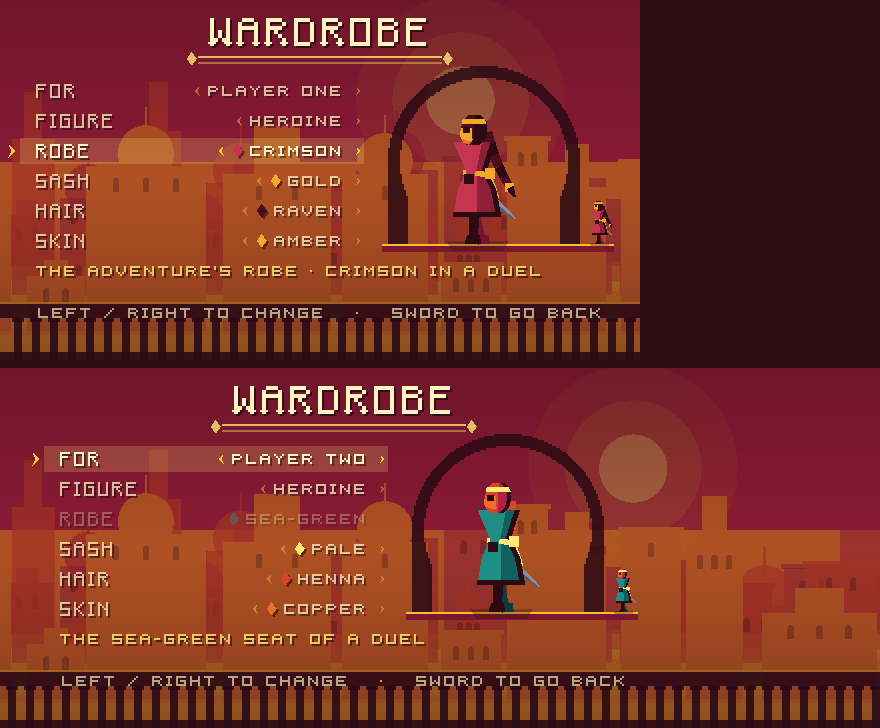

# Interface and typography

The game's text is set in **Alcazar**, a bitmap typeface drawn by
`tools/generate_font.py`. Nothing in the interface uses
`ThemeDB.fallback_font`, and nothing should: the fallback is Open Sans, and a
sun-bleached Moorish city wearing the system UI font is the loudest possible
signal that a game was assembled rather than designed.

The specimen sheet is `docs/typography.png` — the face at the size it is
actually set at, magnified, and before/after of every screen.

---

## The face

Alcazar is a Latin **unicase** built on square-Kufic manners. It is invented,
not traced: no real script is imitated, only the posture is borrowed.

| | |
| --- | --- |
| Square counters | O, C, G, D are rectangles. At five pixels a curve is a lie, and the reference inscriptions are rectilinear anyway. |
| Terminal bars | C, E, S, Z, L, U close on a full-width horizontal. The long baseline bar is the loudest thing about the reference lettering. |
| Raised bars | A, B, E, F, G, H, P, R carry the crossbar one row above centre, so every letter stands on a long leg. |
| Flat apexes | A, M, W, V have no points; diagonals are steps. Both a Kufic cue and the only way a diagonal survives at five pixels. |
| Barred I, footed 1 | The alif-like stem closed top and bottom. |
| Dotted zero | `0` carries a centre pixel; `O` does not. They are otherwise the same rectangle. |

### Three cuts, not one scaled face

The viewport is 180 units tall. The difference between a five-pixel cap and a
seven-pixel cap is the difference between a readable hint and a smear, and
neither one is a title scaled down. So there are three drawings:

| Cut | Cap | Atlas | Used for |
| --- | --- | --- | --- |
| `UiFont.Cut.MICRO` | 5 px | `assets/font_alcazar_micro.*` | hints, readouts, button labels, captions |
| `UiFont.Cut.TEXT` | 7 px | `assets/font_alcazar_text.*` | menu rows, counters, settings labels |
| `UiFont.Cut.DISPLAY` | 14 px | `assets/font_alcazar_display.*` | the title, level cards, overlay titles |

MICRO is its own drawing on a 5×5 body — at that size every letter has to be
square, which is conveniently the most Kufic the face ever looks. DISPLAY is
the TEXT cut at double scale with one addition: every vertical stem that
reaches the baseline is stood on a one-pixel **spur**, while anything wider
than a stem (the terminal bars of C, E, L, S, Z, the bowl of D) stays flat.
That is what makes it a display cut rather than the small face enlarged.

There is no fourth size and there is no scaling. Asking for a point size that
is not a cut is how a bitmap face turns to mud.

### What is in it, and what is not

Present: `A–Z`, `0–9`, space, and `. , : ; - / ( ) ' " ! ? % +` plus the two
typographic marks the UI leans on, the middle dot `·` (U+00B7) and the em dash
`—` (U+2014). Lowercase is mapped onto the capitals in the `.fnt`, so a string
that forgot its `.to_upper()` still renders.

**Left out, deliberately:** true lowercase, accented letters, `@ # $ & * = _
| ~ ^ < > [ ] { } \`` and every currency symbol, and kerning pairs. Nothing in
the game prints them. `tests/ui_layout_test.gd` asserts that every character in
the documented set exists in all three cuts — a missing glyph renders as
nothing at all, which is invisible in a diff and obvious only to a player.

---

## The font pipeline

```
tools/generate_font.py          glyph tables -> atlas PNG + BMFont .fnt
    |
    v
assets/font_alcazar_{micro,text,display}.{png,fnt}
    |
    v   godot --headless --path . --import
FontFile resources
    |
    v
scripts/ui/ui_font.gd           the only thing that names those files
```

To rebuild:

```sh
python3 tools/generate_font.py
godot --headless --path . --import
```

Both the `.png` and the `.fnt` are committed, along with their `.import`
files. The `.fnt` is BMFont's text flavour, which Godot imports to a `FontFile`
with no further configuration.

> One trap, since it cost an hour: the `common` line must say
> `alphaChnl=0 redChnl=4 greenChnl=4 blueChnl=4` — the glyph lives in the alpha
> channel and the colour channels are "one". Declare the glyph as living in the
> colour channels and Godot builds each glyph out of a texture that is white
> everywhere, so every letter renders as a solid filled block.

### Adding a glyph

1. Open `tools/generate_font.py`. Add the character to the `TEXT` table as a
   list of seven `#`/`.` rows (eight if it descends below the baseline, like
   `,` and `Q`), and to the `MICRO` table as five rows (six with a descender).
   Widths are free; the advance is the drawn width plus one.
   The DISPLAY cut is derived from `TEXT`, so it needs nothing.
2. `python3 tools/generate_font.py` — it re-packs the atlas and rewrites the
   metrics. The atlas grows to the next power of two by itself.
3. `godot --headless --path . --import`.
4. Add the character to the `used` string in
   `tests/ui_layout_test.gd::_test_font_covers_the_game_strings`, so it stays
   present.
5. Look at it: `python3 tools/specimen_sheet.py docs/typography.png …` (see
   below) and read the sheet at 1:1.

Keep it rectilinear. A diagonal is a step, not a line, and the only diagonals
in the face are in `K N R V W X Y Z / %`.

---

## Layout rules

Three modules, in `scripts/ui/`:

- `ui_font.gd` — the faces, measurement, and the only text-drawing call.
- `ui_layout.gd` — every rectangle the interface is allowed to use.
- `ui_marks.gd` — the drawn parts: rules, lozenges, tallies, gauges, arches.

### Safe areas

`DisplayServer.get_display_safe_area()` reports **physical pixels**; the canvas
is in units. `UiLayout.safe(view)` does the conversion and returns the usable
rectangle. Chrome goes inside `UiLayout.content(view)`, which is that
rectangle pulled in by a 7-unit gutter.

Two things it does that a naive conversion does not:

- It clamps negative insets to zero. On desktop the "safe area" is the whole
  desktop, not the window, so the right inset comes out as a large negative
  number. Believing it pushed the touch buttons clean off the right edge.
- It refuses any single inset larger than `MAX_INSET` (22%) of the screen.

Never write a literal offset from a screen edge. `10.0` from the corner is
underneath the notch on half the phones sold since 2017.

### Variable width

The viewport is fixed-height with an **aspect-derived width**. In practice the
engine floors the canvas at the 320-unit base width — a 4:3 screen is
letterboxed rather than narrowed — and widens it from there, so the real range
is **320 to about 440 units** (21:9). Height is always 180.

Consequences:

- Centre on `UiLayout.safe(view)`, never on `160`.
- Put lists and forms in `UiLayout.column(view, want)`: a column of the width
  you want, centred, clamped to the screen. A 440-unit-wide line of menu text
  is not a menu.
- A sentence that fits at 440 may not fit at 320. `UiFont.fit()` takes a list
  of phrasings, longest first, and returns the first that fits. Use it for
  every hint line.
- `tests/ui_layout_test.gd` exercises the layout at 240, 320 and 440 units and
  asserts that the two extremes do not produce the same numbers.

### The reserved band

`UiLayout.banner(view)` is a 48-unit band across the middle of the safe area.
**It is the only place an overlay may put words.** Level title cards,
ESCAPED, round results, match results, the desync warning and the duel's hit
flashes all live there and nowhere else.

This is a promise to the level art: nothing will be written outside that band,
so the floor can be a row of spikes. `PAUSE TO QUIT` used to be printed across
them. Persistent duel hints now sit at the top centre, under the network line,
for the same reason.

The title card and the complete overlay share the band, so only one is ever
drawn. The pause menu is not an overlay: it is a page (*The pause menu*,
below). Four rows do not fit in 48 units, and while it is open nothing of the
level is being read.

### The light

Everything obeys the same lighting law as the world (`docs/art-direction.md`):
the sun rakes in low from the left. So:

- Text takes a cast shadow one unit right and down, in ink —
  `UiFont.draw_text(..., shadow: 0.8)`. That is what lets a caption sit over a
  bright sky without a box behind it.
- A raised mark throws the same shadow (`UiMarks.CAST`).
- A carved recess is lit along its **lower and right** inner walls
  (`UiMarks.recess`), because those are the faces the sun reaches.

### Pixel grid

`UiFont.draw_text` rounds its origin to whole canvas units. A bitmap glyph on a
half unit samples between pixels and goes soft. If you draw type by any other
route, round it yourself.

---

## The screens

| Screen | File |
| --- | --- |
| Title screen | `scripts/ui/menu.gd`, `scenes/menu.tscn` |
| Settings | `scripts/ui/settings_panel.gd` |
| Wardrobe | `scripts/ui/wardrobe_screen.gd`, `scripts/ui/figure_preview.gd`, `scenes/wardrobe.tscn` |
| Chapter select | `scripts/ui/chapter_select.gd`, `scenes/chapter_select.tscn` |
| Duel page | `scripts/ui/duel_select.gd`, `scripts/ui/duel_choice.gd`, `scenes/duel_select.tscn` |
| Level HUD, title and chapter cards, complete overlay | `scripts/ui/hud.gd` |
| The pause menu, in a level and in a duel | `scripts/ui/pause_menu.gd`; a level's rows and when it opens, `scripts/core/game_pause.gd` |
| The dawn's words | `scripts/campaign/ending_card.gd`, over `scripts/campaign/dawn_frame.gd` |
| Touch controls | `scripts/ui/touch_controls.gd`, `scripts/ui/touch_surface.gd` |
| Duel HUD | `scripts/duel/match_hud.gd` |

### Title screen

Built back to front: the parallax city, a graded wash, a scalloped lintel
across the top, the title, the list, and a **foreground balustrade** you are
standing behind. The balustrade is the only piece of foreground occlusion on
any screen and it is what makes the menu a place rather than a background.

Only the selected mode shows its subtitle, in a fixed slot below the list, so
moving the selection does not reflow anything. Eight rows each with a caption
is a wall of small type.

**Every row opens a page.** The title screen once had a row for each way to
duel — DUEL, DUEL VS CPU with EASY, MEDIUM and HARD stepped with left and
right in the caption slot, and DUEL ONLINE — three of eight rows for one mode,
and the only row on the screen that did two things. Now there is one DUEL, and
the way and the level are chosen on its own page, as the Adventure's chapter
is (*Duel page*, below). Left and right do nothing on this screen.

**The row pitch** is twelve units at most. With more rows than twelve leaves
room for between the title and a caption clear of the rail, the pitch closes
up (`MenuScene._row_pitch`): eight rows sat at eleven while the duel
had three. Six or seven sit at twelve, so adding a row never moves a screen
that had room for it.

The hint line is cut into the rail (`UiLayout.rail(view)`, shared with the
settings page). When the on-screen stick is up, a sword button covers the right
end of that rail, so the hint moves to the left end and says less — the buttons
are lettered and are the instruction at that point.

**The update plaque.** A development build (and only one: see
[`docs/ci.md`](ci.md#the-dev-channel-one-tap-updates-on-the-phone)) asks the
dev channel's `version.json` whether it has been superseded. If it has, a
plaque hangs from the centre of the lintel reading `UPDATE AVAILABLE · BUILD n`
in MICRO, in the light colour, between two lozenges. It sits there because the
top centre is the only place on this screen that is neither the list nor a
touch button, and the only place wide enough for the whole phrase at 320 units;
`MenuScene.PLAQUE_CLEARANCE` keeps it clear of the pause and mute buttons, and
`UiFont.fit()` shortens it to `UPDATE · BUILD n` or `BUILD n` if a screen is
too narrow. It is hung from the architecture rather than floated as a toast,
so it reads as part of the place.

It is the one thing on the title screen that is **touched** rather than chosen
with the stick: it is not a way into the game and does not belong in the list
the stick walks. Its touch target reaches `PLAQUE_TOUCH` (24) units below the
top of the safe area — about 9 mm on a phone held sideways — and overlaps the
top of the title, which is not touchable, rather than shrinking. Only the touch
event counts, not the mouse click Godot emulates from it, so one tap opens the
browser once. `tests/unit/test_menu_update.gd` holds both properties.

### The HUD answers

A count that silently changes in the corner is a count nobody saw change. So
the corner answers for `Hud.PULSE_TIME` (0.45 s): a relic gained pops the
lozenge two units larger and steps it back in whole units, the count lit; a
health mark lost stays lit and burns white for a few blinks before it goes
dark. A heart regained answers the same way, mirrored: the mark burns white
for the same blinks at the same rate and then stays lit, so the blink says
which mark changed and what is left afterwards says which way. Only a gain
pops and only a change burns — a restart or a respawn at a torch refills
health and resets counts, and `Game` reports it to `Hud.update_model()` as a
refill, which sets off nothing (`tests/unit/test_pickup_feedback.gd`,
`tests/unit/test_relic_heals.gd`).

A relic is worth a heart. At full health it is only a relic: it still counts
toward the tally on the complete screen, nothing is banked and nothing becomes
a score — the game keeps none, and a heal you could store would make every
relic a reason to stand still in front of a guard. The heart comes back
through `Player.heal()`, which emits `healed`; `Game` refreshes the corner on
that and on `hurt`. Before, the corner heard only about deaths, so a hit that
did not kill left three marks lit and the loss flash never fired in play.

The relic itself answers in the world: it bursts into a star and six sparks for
`Relic.BURST_TIME` instead of vanishing, and is no longer collectable from the
moment it is taken, so standing in the burst cannot count it twice. Still no
hitstop on a pickup — `docs/feel.md` explains why.

### Chapter cards

A chapter of *The Last Light* opens on its card (`Hud.show_card()`, fed by
`Campaign.card()`), set in the reserved band over the picture, never in a
box:

```
            THE MIRROR TOWER          DISPLAY, paper, cast
        ◆════════  IV  ════════◆      the rule, broken for the numeral (TEXT)
           CATCH THE LAST LIGHT       TEXT, paper, cast
```

The numeral is set into a break in the rule, the way a book sets a
chapter's number into its ornament; drawn as a fourth line above the name it
read as a stray mark at 1:1, and two free-floating lozenges beside it read
as two more. The epigraph is paper, not gold: in `LIGHT` it vanished into the
Sun Terrace's balustrade, which is exactly the band it is set over.

**It is set in three strokes**, because a card that appears whole is a label
and one that arrives is a title: the rule opens from the middle as the wipe
lifts (`CARD_RULE_AT`, `CARD_RULE_OPEN`), the numeral and the name come up on
it, and the epigraph follows a beat later (`CARD_EPIGRAPH_AT`) as a line of
its own — read last, so it is the line that stays with you. It holds to
`CARD_HOLD` (4.4 s) and fades.

**The first press of any verb takes it away** (`SKIP_FADE`, a quarter of a
second, from wherever its fade had got to). The band is the middle of the
screen and so where the prince is; a card held over him through his first
jump would be covering the game to show its name. The press itself is never
taken — the jump happens, and the card is gone before the jump is at its
height (`tests/unit/test_title_cards.gd` times both). A press counts at once
and a hold does not — the jump that chose the chapter may still be down when
the card opens, and that one was not aimed at it — until the card has been
read (`CARD_READ`, 2.2 s): then a verb still held is play, so a player who ran
in through the wipe is not run under the card for its whole hold. A plain
level title (Endless, a
level played on its own) is the same card with only its name, timed as it
always was, and skippable the same way.

**The finale has its own card.** The Eclipse has no numeral of its own and
no epigraph — it is chapter V's last room, and what it is about is not said —
so its rule carries the one silhouette in the game that is a ring of light, a
black disc ringed with fire, where the numeral would be.

### Duel HUD

The rope hangs from the top of the content rectangle: five zone pips, the
initiative arrow in the leader's colour, and under them one MICRO line that
says what the arrow says (`ONE PUSHING WEST`, or `NEUTRAL`). That line is set
in paper, not in the seat's colour — crimson type on a crimson sky is
illegible, and the arrow already carries the colour. Under it, for an online
match, the network line, then the persistent hint; a hint wider than the safe
area breaks at its `  ·  ` separators rather than running off a 4:3 screen.

**Who is who, against the computer.** In VS CPU each end of the rope
carries a tag on the side of that seat's gate: `YOU` beside the west gate, and
`CPU` with its level under it beside the east, each with a lozenge in the
seat's colour on a rim of light (a crimson mark on a crimson sky is otherwise
no mark). The tags hug the rope, outside the arrow's tip, rather than the
screen's corners, because the top right corner is the pause and mute buttons'
on a phone; the second line is how the longest level, MEDIUM, still fits
inside them at 320 units. With tags up the line under the rope says only who
leads — `YOU LEAD`, `CPU LEADS` — since the arrow now points at the leader's
own tag, and a longer line runs into the tags' second lines. The band and the
result speak to the player: `YOU ARE DOWN`, `YOU HAVE THE INITIATIVE`,
`YOU WIN`; the computer is `CPU`. The one-keyboard duel sets no tags and reads
as before.

Everything an event throws up — a death, the initiative changing hands, the
gate — goes in the band, at the display cut if it fits and the text cut if it
does not. `MatchHud.flash(text, terse)` takes a second, shorter phrasing for
the narrow screen. The result is the band plate with title, rule, how the
match was won and the hint. A desync takes the band over. The only things
drawn at the bottom are the two respawn rings, which are marks, not words.

### Settings

A sub-screen of the menu, not a mode: it is not something you play, and
`ModeRegistry` is the list of things you play. **`scripts/core/mode_registry.gd`
is unchanged.** The row and the page are called SETTINGS; they were SOUND
until the page gained a switch that is not about sound.

Master / music / SFX volume and mute, written through
`AudioDirector.set_volume()` and `AudioDirector.toggle_mute()`, both of which
persist to `user://audio.cfg` for themselves. The panel subscribes to
`AudioDirector.settings.changed`, so a change made elsewhere — the `M` key, the
touch mute button — is on screen immediately.

The panel takes its director through an injected `audio` property rather than
reaching for the global, so `tests/ui_layout_test.gd` can drive it with a stub
and not touch the real mixer or write to `user://`.

Under the list, small and dim, is the running build: its version name, build
number and commit (`0.1.0-DEV+4F2C9E1 · BUILD 57`; a build nobody stamped says
`LOCAL`). It is on this page and not the title screen because only someone
reporting a bug needs it, and they will look for it where the settings are.

Volume is a ten-cell gauge, and a step snaps to the grid. Driven by the same
four actions as the menu: up/down to choose, left/right to set, jump to
confirm, sword to go back.

**LONGER WARNINGS** is the one assist (`scripts/core/assist.gd`): every foe's
tell, and every timed window that guards a death, lasts half as long again.
It is here rather than on a page of its own because this is where a player
looks for anything they can set. Off by default, saved at once to
`user://assist.cfg`, and loaded at boot only — so a test or a tool that never
boots the game plays unassisted, whatever a developer last chose. Six rows
made the pitch 15 rather than 16, or the build line landed on the rail's hint.

### Chapter select

The title screen's ADVENTURE opens *The Last Light*'s chapter select
(`scripts/ui/chapter_select.gd`), headed with the campaign's name.

CONTINUE is the first row and the cursor starts on it: the one thing a
returning player wants is to carry on, and it costs one press. It goes to the
first entry that is open, built and not yet cleared, and names it on the
right. Under it, every entry in order — numeral, title, and on the right what
the player has done there: the best time once cleared (`1:14.6`), NEW when
open and unplayed, LOCKED until the one before is cleared, TO COME while it is
still being built. The finale has no numeral; it is set in under chapter V
with a lozenge. A row that cannot be played is dimmed but still visited by
the cursor — what is ahead is part of the reason to go on — and jump on it is
the back sound and nothing else.

Two caption lines under the list speak for the selected row: the hour it is
set at and its epigraph, then its bests in full — BEST, RELICS, SECRETS — or
why it cannot be played (CLEAR THE SUN TERRACE TO OPEN IT, STILL BEING BUILT).
Each line falls back to a shorter phrasing at narrow widths; the best time,
which the row already shows, is the first thing to go.

Driven like every other page: up/down, jump to play, sword or pause back to
the title screen. Rows can be tapped: a tap selects, a tap on the selected row
plays it. With the thumb buttons up, the list keeps out of JUMP's corner and
the caption out of SWORD's reach — SWORD sits 110 units in from the right and
50 up, further in than the JUMP corner the wardrobe's list was measured
against — so no tap on a row is also a tap on a button. Seven rows at 14
units leave room for the two captions above the rail at 180 units tall.

After the last entry comes the dawn: one still lit from the east
(`DawnFrame`, `docs/world.md`, "The dawn"), held, with DAWN over THE SUN
REMEMBERS set on it in the reserved band like a chapter card
(`scripts/campaign/ending_card.gd`). The picture is seen alone first; the
title comes up at `EndingCard.WORDS_AT` (1.2 s) and the epigraph a second
later, and their cast shadow falls down and to the **left**, the one place
in the interface it does, because the light does. There is no scrim: the
picture is the point. It holds for `EndingCard.HOLD` (3.4 s) before jump,
sword or a tap returns to the chapter select: a card a held jump skips is a
card nobody saw, and this one is the last.

### Duel page

The title screen's DUEL opens a second step (`scripts/ui/duel_select.gd`):
**ONE KEYBOARD**, **VS CPU**, **ONLINE**. It is the chapter select's shape —
the same wash and rail, the title in the display cut over a rule, the
selected row lit, one caption under the list, the hint cut in the rail — so
the two second steps read as one place. Three rows leave room, so each is 16
units tall, two more than a chapter's, and the list sits lower, in the middle
of the stone.

On the right each row says what it is: TWO PLAYERS, TWO PHONES, and on VS CPU
the computer's level. With that row selected the level sits between carets
that say which way it can go — EASY points only right, HARD only left — and
left and right step it, stopping at the ends; the hint on the rail says
`LEFT / RIGHT: HOW HARD`. A tap selects a row, a tap on the selected row plays
it, and a tap on either side of the level steps it that way. With the thumbs
up the list keeps out of JUMP's corner and the caption out of SWORD's reach;
`tests/unit/test_duel_select.gd` holds every row's hit rectangle clear of
both buttons.

**Where.** A fourth row, **STRIP**, says where the duel is fought: TUG OF WAR,
CLOCKWORK WELL, FLOODGATES, AQUEDUCT, ROOFTOPS, then RANDOM, stepped with left
and right between carets exactly as the level is, stopping at either end
(`DuelStrips.step()`), with the hint `LEFT / RIGHT: WHERE`. Its slot is wider
than the level's (104 units against 66) so CLOCKWORK WELL fits in the MICRO cut
between the carets. The caption under the list, on that row, says what the
strip does to a duel in one line, longest phrasing first —
`SCYTHES ON THE BEAT, SLOTS ON THE OFF-BEAT · NIGHT` down to `BLADES ON THE
BEAT` (`DuelStrips.CAPTIONS`). It is a setting rather than a way to duel, so
jump on it plays the way last played. One row rather than a page of its own,
for the level's reason: the way and the place are the choice made most often,
and both are one look at this page. Online the host's strip is the match's;
the guest's row is only what its screen shows until it is seated
([`netplay.md`](netplay.md), "The strip").

**It remembers.** Starting a duel writes the way, the level and the strip to
`user://duel.cfg` (`DuelChoice`), as words, and the page opens on them next
time: someone who plays the computer every evening presses DUEL and then
jump. Browsing saves nothing. A missing file, one that does not parse, a key
that is not there, a value of the wrong type or a word that names nothing
falls back for exactly that field — ONE KEYBOARD, EASY, TUG OF WAR — and a
broken way never costs the level or the strip. A file from before the strips
has no `strip` and opens on the Tug of War, which is the duel it was saved
from; `random` is kept as RANDOM and drawn when a match is built. Tests and `tests/ui_screens.gd` take the file through
an injected `store_path` (and the VS CPU scene through `choice_path`).

Back is sword or pause, to the title screen; quitting a match from any of the
three ways comes back here, as quitting a chapter goes to the chapter select.

### Wardrobe

`scripts/ui/wardrobe_screen.gd`, `scenes/wardrobe.tscn`: choose the figure each
player plays — the prince or the heroine — and what it wears. Like SOUND it is
not a mode, so it is a row of the title screen (`WARDROBE`) and not an entry in
`ModeRegistry`; unlike SOUND it is its own scene, because it carries two live
figures and the title screen should not.



Six rows on the left, the figure on the right:

| Row | Choices | Notes |
| --- | --- | --- |
| FOR | PLAYER ONE, PLAYER TWO | one is the adventure, Endless, the feel lab and the crimson duel seat; two is the sea-green seat |
| FIGURE | PRINCE, HEROINE | same body, same hitbox; only the look changes |
| ROBE | CRIMSON, EMBER, SAFFRON, WINE | the adventure's; locked to SEA-GREEN for player two |
| SASH | GOLD, PALE, FIRE, INK | sash and hood crest, or headband, belt and ribbon |
| HAIR | RAVEN, CHESTNUT, HENNA, GOLD | the heroine's; HOODED for the prince |
| SKIN | SAND, AMBER, COPPER, UMBER | the heroine's face; HOODED for the prince |

Every option is a ramp of `Palette` steps, never a free colour: the figure
has to keep its four tones against gold and crimson terrain, and a skin or
hair tone from outside the palette would be the one thing in the frame not lit
by the same sun (`CharacterLook`'s docstring argues it in full).

**Rows that change nothing are shown dimmed and skipped**, not hidden, so the
list does not reflow when the figure changes and the dimmed value says why the
row is not there to change.

**The preview** is the real figure — `FigurePreview` is a `PlayerArt` driven
through the same body seam as `FighterArt`, posed by a clock instead of a
`Player`, so it has no physics, no footstep audio and no dust — standing in a
horseshoe arch with the parallax sky behind it. It cycles idle, run, jump,
fall, land, swing and hang, at three times its size (a whole multiple, so the
edges stay hard) and again at its true size on the sill outside the arch,
because that is the size that has to read.

**Touch.** Driven by the same four actions as every page — up/down to choose,
left/right to change, jump to step forward, sword or pause to go back — so the
stick works. Rows can also be tapped: the left half of a value steps it back,
the right half forward. The list is on the **left** because the JUMP and SWORD
buttons own the bottom right; `tests/unit/test_wardrobe_screen.gd` asserts no
row's hit rectangle reaches a thumb button's. A tap holds the stick off for a
moment, since the same thumb has just started a stick. With the thumbs up, the
caption under the list keeps to the list's width, clear of JUMP.

**Saving.** Every change is written at once to `user://wardrobe.cfg`
(`scripts/player/wardrobe.gd`), as ids rather than positions. A missing file,
a file that does not parse, an unknown id or a value of the wrong type falls
back to the default for exactly what is missing — the prince, as the game drew
him before there was a wardrobe. `tests/unit/test_wardrobe_save.gd` holds the
round trip and each of those fallbacks. The page takes its file through an
injected `store_path`, so tests and `tests/ui_screens.gd` never touch the real
one.

**The duel's seats stay apart.** In a duel the robe's three planes are always
the seat's team colour, put on after the look (`FighterArt.dress`) and again
when the art binds to its fighter; and no choosable colour belongs to either
team, so seat one can never carry teal and seat two never crimson.
`tests/unit/test_duel_seats_distinct.gd` walks all 512 looks for both seats.
Online, each phone shows its own seat in player one's look and the other seat
in the look the other phone sent, held to the same seat colour
(`docs/netplay.md`, *The looks*).

The title screen's row pitch went from 13 to 12 units to make room for the
seventh row: at 13 the caption under the list landed on the rail.

### Touch

`scripts/ui/touch_controls.gd` lays its buttons out against `UiLayout.safe()`.
It carries a **mute** button next to pause, drawn as a horn with a bar struck
through it when the game is silent — not lettered, because `SOUND` and `MUTED`
are the same width at five pixels and nobody reads a label on a button they
are hitting with a thumb. It is the only touch-reachable way to silence the
game short of the settings screen.

The duel's THROW button (`scripts/duel/duel_touch.gd`, online and against
the computer) lays itself out against the same `UiLayout.safe()`, up and to the left
of JUMP. It used to convert the safe area by hand, which put it off the right
edge whenever the reported area was wider than the window — the bug the stick
and the other buttons had before UiLayout.

### What the buttons say

The two thumb buttons always said JUMP and SWORD, over the pause screen, the
complete screen and every page, where they meant *choose* and *leave*. A
thumb reads the button it is about to press, not the hint line under a list,
so the owner and a second player on phones asked for the words to follow the
function. They do, through one call every screen makes:

```gdscript
TouchControls.label(screen, "CONTINUE|NEXT", "QUIT")  # or controls.set_labels(...)
controls.play_labels()                                # JUMP and SWORD
```

A label is phrasings, longest first, split on `|`; the button shows the first
that fits inside its ring (`TouchControls.fit_label()`), as `UiFont.fit()`
shortens a hint. The rings do not grow with the screen, so a word that fits
at 320 units fits at 440: JUMP's ring holds six MICRO letters and SWORD's
five — SWORD itself, with a unit to spare. CONTINUE (53 units) and REMATCH
(48) are wider than JUMP's ring, which is why those buttons say NEXT and AGAIN
where their hint lines say the long word. An empty label letters the button
with nothing: on that screen it does nothing. THROW, which has no menu
meaning, is hidden whenever the labels are not play's — TouchControls' own,
and the duel's (`DuelTouchGuard.suppressed`).

| Screen | JUMP | SWORD |
| --- | --- | --- |
| Play, a level or a duel | JUMP | SWORD |
| A title card over play | JUMP | SWORD |
| The pause menu (every mode) | SELECT | BACK (into the game) |
| The death beat | RETRY (skips it to the torch) | — |
| The complete screen | NEXT / DONE / DAWN / REPLAY | QUIT |
| The duel's result | AGAIN | QUIT |
| The online duel's result | — | LEAVE |
| Title screen | OPEN | OPEN |
| Settings | LOUDER / SWITCH / BACK, by row | BACK |
| Chapter select | PLAY (— on a locked row) | BACK |
| Duel page | PLAY | BACK |
| Wardrobe | NEXT | BACK |
| Duel lobby | SELECT | BACK; LOCAL while waiting |
| The dawn | RETURN, once it can be left | BACK |
| A ruin that would not generate | BACK | BACK |

**A title card keeps the play words.** The first press of any verb takes a
card away, but the press is play too — the jump happens (*Chapter cards*,
above). A button lettered SKIP that also jumps would be a lie about the one
thing the player is about to do. The dawn's card, whose press does nothing
but leave, says so.

**The lobby is driven by the stick now.** Its rows are real Buttons, moved and
pressed by the GUI's `ui_*` actions, which the touch stick and JUMP never
send; on a phone the only way in was to tap a row. `DuelLobby.drive()` reads
the game's actions and steps the focus and presses the focused row, but only
for a press the GUI did not get too, since Space is both `jump` and
`ui_accept`.

`tests/unit/test_touch_labels.gd` letters every screen through its own frame
and fails a word that does not fit; its guard fails any scene with thumb
buttons that it does not visit.

### The pause menu

`scripts/ui/pause_menu.gd`, one list for every mode that plays, opened by
PAUSE — the touch pause button, Escape or P, a pad's Start — and closed by it.
Up and down choose, JUMP chooses, SWORD goes back into the game; rows can be
tapped (a tap selects, a tap on the selected row chooses, as on the chapter
select), and with the thumbs up the list keeps clear of JUMP's corner and the
caption of SWORD's reach. Under the list, one line says where you are: the
clock, the relics and the secrets.

It is a page over a scrim, not an overlay in the band, and the world shows
dimly through it, stopped. A resume chosen with JUMP or SWORD waits for the
button to come up, so the press is not also the prince's first jump or swing
(`GamePause.resume()`); the duel holds its step the same way.

| Mode | Rows | Why |
| --- | --- | --- |
| A level on its own, the feel lab | RESUME · RESTART FROM TORCH · RESTART LEVEL · QUIT TO TITLE | |
| A chapter of the campaign, the boss | RESUME · RESTART FROM TORCH · RESTART CHAPTER · QUIT TO CHAPTERS | the campaign is a place: leaving goes to its chapter select |
| Endless | RESUME · RESTART FROM TORCH · RESTART RUIN · QUIT TO TITLE | the same ruin, never a new one: a roll is reported by its seed |
| One keyboard, VS CPU | RESUME · RESTART MATCH · LEAVE MATCH | no torch and nothing to keep; the match stops |
| Online | KEEP FIGHTING · LEAVE MATCH | the match cannot stop |

RESUME is first and under the cursor, so a stray pause costs one press.
RESTART FROM TORCH is what a death does, without the death — the clock runs,
latches hold, the fallen stay down — for a player who has walked into a state
they would rather not play out; before any torch is taken it is dimmed and
skipped, not hidden. RESTART is the level from nothing. QUIT is last and
furthest from the thumb: the old pause screen quit on SWORD, the button the
player had been swinging a moment before.

**Online the match goes on.** The other phone is stepping it, so the menu's
heading says THE MATCH GOES ON, the scrim is lighter, and while it is up this
phone sends no input: the fighter stands where he was, as if the phone were
put down. LEAVE MATCH is `NetSession.shutdown()`, which sends BYE before the
socket closes, so the other phone hears *the other player left* and goes back
to its lobby instead of timing out. A finished online match has no rematch to
offer — both phones would have to agree — so its SWORD and PAUSE leave.

### Ways back

Every screen shows a way back, and `tests/unit/test_quit_routes.gd` leaves
each one the way a player would, through the scene's own frame; its guard
fails any scene that is in neither its routes nor its exemptions. The audit
behind it found three dead ends and two traps:

- **A ruin that would not generate** left a screen with no game on it — no
  pause menu, no buttons. It now says SWORD OR PAUSE TO GO BACK, with buttons
  lettered BACK.
- **The online result screen** offered JUMP FOR A REMATCH, which nothing
  answered.
- **The dawn** had no buttons on a phone and said how to leave only once it
  could be left; it now has both.
- **Pause, then SWORD** quit a level at once, and **online PAUSE** left the
  match with no question asked. Both are now the menu's last row.

The title screen is the one screen with no way back: it is the root. Its
buttons say OPEN.

**Android's Back.** Godot quits on Back unless told not to, so the phone
build closed from every screen — mid-level, mid-match, from the wardrobe —
with nothing saved since the last chapter clear.
`application/config/quit_on_go_back` is off (`tools/configure_project.gd`),
and Back arrives as `NOTIFICATION_WM_GO_BACK_REQUEST`, which each screen
answers as the button it already has for going back:

| Where | Back does |
| --- | --- |
| Play: a level, a chapter, Endless, the feel lab, a duel on one device | PAUSE: opens the pause menu, and closes it again |
| The complete screen, a finished duel | its SWORD / PAUSE: leaves |
| An online match | opens and closes the menu that does not stop the match |
| A page: chapter select, duel page, wardrobe, settings | SWORD: one page back |
| The lobby | a text page to the list, the list to the duel page |
| The dawn, a ruin that would not generate | its buttons: back |
| The title screen | closes the app |

Only one node per screen answers — the screen, not a panel on it — because
the engine sends the notification to every node from the root down, and a
page and its panel both stepping back would be two presses.
`tests/unit/test_back_button.gd` sends it that way, through each scene's own
frame, and its guard fails any scene in neither its routes nor its
exemptions.

**When the app goes away.** A call, a switch to another app or the
notification shade pulled down sends `NOTIFICATION_APPLICATION_PAUSED` or
`NOTIFICATION_APPLICATION_FOCUS_OUT`, and wherever the game can stop it
opens the pause menu: a level, a chapter, Endless, a duel on one device. The
player comes back to a menu, not to a prince who died while the phone was at
an ear. An online match does nothing: the other phone is stepping it, and the
host's simulation never waits on this one. Neither Back nor going away acts
inside the notification: both are held for the next physics step and read
there with the buttons, since they are input, and a request that lands behind
a wipe or in the death beat waits for play rather than being dropped.

---

## Looking at it

Text is judged at actual size. A 1280×720 screenshot is a **four times
magnification** of the 320×180 canvas; judging type on it is judging a
different typeface.

```sh
# One frame per interface state, including the ones you cannot reach by
# playing: pause, settings, a finished match, the wardrobe as the heroine
# and as player two (wardrobe_heroine, wardrobe_two, wardrobe_touch), and
# the duel page on a first launch and opened on VS CPU at HARD with the
# thumbs up (duel_select, duel_select_cpu), and that match (match_cpu).
xvfb-run -a godot --path . --rendering-driver opengl3 \
  --script tests/ui_screens.gd -- --out /tmp/ui/after --window 1280x720

# The wardrobe live, as it opens on the saved look (`--resolution 1760x720`
# for 440 units wide).
xvfb-run -a godot --path . --rendering-driver opengl3 --resolution 1280x720 \
  --script tools/screenshot.gd -- --scene res://scenes/wardrobe.tscn \
  --out /tmp/wardrobe --shots 0.8,2.4

# The same at a wide-phone aspect: a 440x180 canvas. A window wider than
# xvfb's default 1280-pixel screen reports that screen as its safe area and
# everything centred slides left, so give it a wider screen.
xvfb-run -a -s "-screen 0 1920x1080x24" godot --path . --rendering-driver \
  opengl3 --script tests/ui_screens.gd -- --out /tmp/ui/wide --window 1760x720

# Back down to 1:1, or a magnified crop in canvas units.
python3 tools/crop_1to1.py /tmp/ui/after/menu.png /tmp/menu.png
python3 tools/crop_1to1.py /tmp/ui/after/menu.png /tmp/title.png \
  --rect 60,20,200,70 --zoom 5

# The specimen sheet.
python3 tools/specimen_sheet.py docs/typography.png \
  before=/tmp/ui/before after=/tmp/ui/after wide=/tmp/ui/wide
```

`tests/ui_screens.gd` is deliberately **not** named `*_test.gd`:
`.github/scripts/run_tests.sh` collects that suffix and would try to run the
harness as an assertion suite. The suite is `tests/ui_layout_test.gd`.
